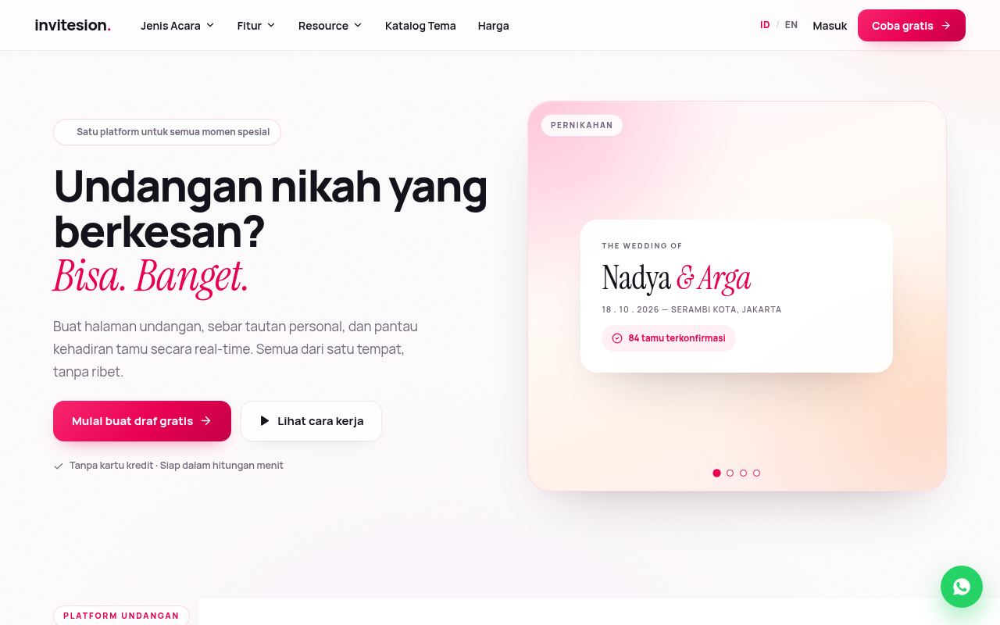
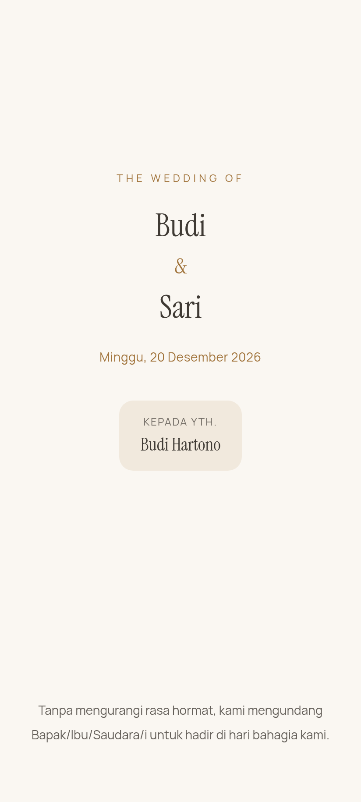
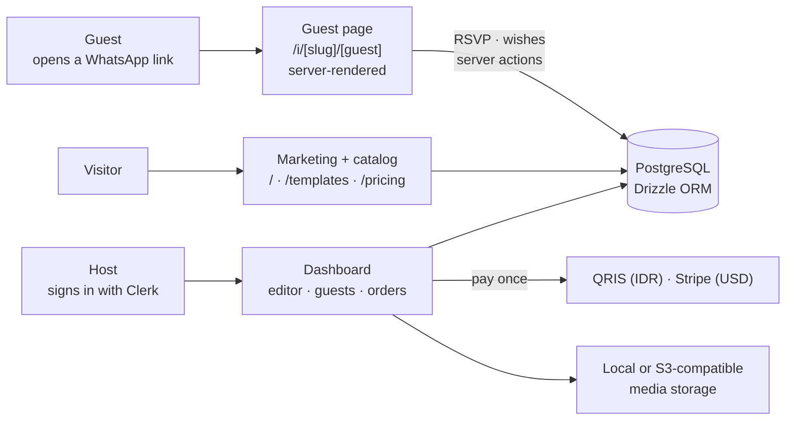

<h1 align="center">invitesion.</h1>

<p align="center">
  <strong>Undangan digital untuk pernikahan dan setiap momen penting.</strong><br>
  Buat sendiri, bayar sekali, sebar tautan personal ke setiap tamu.
</p>

<p align="center">
  <a href="invitation-research/09-masterplan/00-README.md">Masterplan</a> ·
  <a href="invitation-research/README.md">Research</a> ·
  <a href="docs/INDEX.md">Product docs</a> ·
  <a href="AGENTS.md">Agent rules</a> ·
  <a href="archive/README.md">Archive</a>
</p>

<p align="center">
  
  &nbsp;
  
</p>
<p align="center"><sub>Current build (<code>7a00a6d</code>), local production build captured 2026-11-04 with the fictional seed fixture; <code>middleware.ts</code> omitted locally because it needs real Clerk keys.</sub></p>

---

**Invitesion** adalah platform undangan digital Indonesia untuk pernikahan, aqiqah dan khitanan, syukuran, ulang tahun, reuni, acara komunitas hingga acara kantor. Pilih tema, isi detail acara, kirim tautan personal ke setiap tamu lewat WhatsApp, lalu pantau RSVP dan ucapan dari satu dasbor. Satu kali bayar per undangan, aktif 12 bulan, bisa diedit kapan saja.

*In English:* Invitesion is an Indonesian digital-invitation platform for weddings and other life, community and business events. Hosts choose a template, fill in their event, share a personal link with every guest over WhatsApp, and follow RSVPs and wishes in one dashboard. One payment per invitation, active for 12 months, editable at any time.

## What ships today

| For | Capabilities (current code: `ce6efd1`, the session-23r tree, plus session 24's E-051 / E-052 in the exported folder; per-item history in the implementation log) |
|---|---|
| **Guests** | Personal link per guest (`/i/<invitation>/<guest>`) greeting them by name · the classic layout or one of four design families (Gapura, Kartu, Riang, Lontar) on contrast-checked palettes · RSVP with party size kept within the host's allowance, a "maybe" answer, the host's own questions and an answer per event · events the host marks invite-only shown only to invited guests · wishes wall · countdown and add-to-calendar (Google Calendar + `.ics`) · event times in the event's own zone (WIB / WITA / WIT) · link-preview image with names and date for WhatsApp (Latin-script names) · love story, schedule, maps, gift accounts, livestream link, person photos, a corporate programme (agenda, speakers, dress code, contact) and the organiser's logo when the host fills them · children's photos only on personal links and only when the host switches them on, served through an access-checked route · no login, pages not indexed by search engines, unknown guest links return 404 |
| **Hosts** | Catalog of 64 templates in 27 event categories with filters · form editor with a private preview and a layout picker · RSVP question editor, answers per guest and per event, RSVP counts on the dashboard · invite-only events per guest · guest list with personal-link generator, WhatsApp share links, CSV export (spreadsheet-formula safe), RSVP override and manual check-in · edits after publishing · free drafting, pay to publish |
| **Business** | One-time prices from `lib/pricing.ts`: **Rp 149.000** standard, **Rp 299.000** premium (USD 19 / 39 abroad), 12 months active · QRIS (IDR) with admin order confirmation and a Stripe adapter for USD · Indonesian and English marketing site with programmatic event, feature and resource pages · private admin panel |

Ten of the twelve must-have fixes (P0) shipped in session 09; the change log per item is [`invitation-research/_handoff/IMPLEMENTATION-LOG.md`](invitation-research/_handoff/IMPLEMENTATION-LOG.md).

Session 11 added:
- **Accurate open counts:** simultaneous first opens of one guest link record one view (B-017a, migration `0011`, `scripts/verify-view-dedupe.ts`).
- **One data load per guest open** instead of two (B-014 step 1), and no locale cookie on guest pages.
- **A content contract** (`lib/invitation/content-contract.ts`) that records what the guest page renders. The editor now marks inputs that are saved but not shown to guests yet (for example music, Instagram Story, couple photos and parents), and says plainly that guestbook moderation is not active. A stored config with one invalid section now loses only that section instead of rendering an empty invitation. Background: [`template-editability-s11.md`](invitation-research/01-codebase-audit/template-editability-s11.md).

Sessions 12–23r added, among others (each with its evidence in the implementation log):
- **Design families** (B-030): four layouts that render the same invitation content as the classic page, chosen per invitation; contrast-safe palette tokens (B-016) checked by a rendered sweep.
- **RSVP depth** (B-027, D-034–D-037): "maybe", custom questions with conditions, an answer per event, invite-only events. Server-side flags in `lib/flags.ts` ship these **on** and switch each one off per deployment.
- **People and organisers** (B-029, D-038, D-040): ceremony profiles, person photos, the corporate programme and the organiser's mark; children's photos stored under a protected prefix that only the signed-in owner or a valid personal link can reach, with a byte-verified migration for existing photos.
- **Lighter guest pages** (B-015, E-043): no Clerk provider on guest pages and shared date formatting, 28.5 → 22.2 ms server CPU and 131.5 → 56.3 KB per page on one host.
- **Harness gates on the product** (B-012): byte budgets per family on two contents, the cover fold, rendered contrast and a phone design check (rhythm, stress names, reduced motion, icons in forced colours and print).

### Experimental (in the repository, not on by default or not wired into the product)
- **Opaque guest links** behind `FLAG_OPAQUE_GUEST_LINKS`, **off** by default: the owner keeps slug links; existing links keep working either way.
- **Template harness** (`pnpm harness`) with three original sample templates in `templates/_harness-samples/` (basic, premium Islamic, signature 3D). Their reports pass every gate, but the product renderer cannot load these templates yet.
- **Stripe checkout** for non-IDR currencies exists as an adapter; it has not been verified against a live Stripe account.

### Planned (from the verified masterplan; not shipped)
Implementation proceeds alongside the open research (owner decision ADR-O08); order and reasons in [`LATEST.md`](invitation-research/_handoff/LATEST.md) §4. Next: cover gate with background music (B-009; music is stored, not shown) · day grouping for multi-day agendas. Deferred out of this rebuild phase by the owner, and not passed: signed-in acceptance with real Clerk keys, and the children's-photo migration in each real environment, which is a deployment step ([`deferred-acceptance.md`](invitation-research/_handoff/deferred-acceptance.md)). Later: QR check-in, gift block with the host's own QRIS, bulk guest import, the rest of template system v2. Evaluated and not pursued: a cached invitation shell (B-014 step 2, D-039). Every backlog item carries its evidence, paths, acceptance criteria and rollback in [`09-masterplan/06-backlog.md`](invitation-research/09-masterplan/06-backlog.md).

## How it fits together



One Next.js App Router application: React Server Components for pages, Server Actions for guest writes, one renderer for every template. The measured decision to keep this stack (no Rust service) is ADR-A1 in [`12-decision-log.md`](invitation-research/09-masterplan/12-decision-log.md).

## Stack and prerequisites

- **Framework:** Next.js 15.6 canary (App Router) · React 19 · TypeScript · Tailwind CSS 4 with shadcn / Radix primitives
- **Data:** PostgreSQL with Drizzle ORM (postgres.js); migrations `0000`–`0011` in `lib/db/migrations/`
- **Auth:** Clerk for sign-in; roles stay in the local `users` table
- **Payments and storage:** own QRIS payload builder and a Stripe adapter behind one rail interface; local or S3-compatible storage with an in-house SigV4 signer
- **Tests:** `node:test` through `tsx`

Verified locally on 2026-11-04 with Node.js 24, pnpm 10.34 and PostgreSQL 16.15. Signed-in routes need real Clerk keys from a Clerk instance dedicated to this project; payment keys are optional for local work.

## Run locally

```bash
cp .env.example .env            # POSTGRES_URL and the Clerk keys are required; read the comments in the file
pnpm install                    # without a terminal (CI, sandboxes): CI=true pnpm install --frozen-lockfile
pnpm db:migrate                 # applies lib/db/migrations
pnpm db:seed:templates          # syncs the 64-template catalog
pnpm dev                        # http://localhost:3000
```

Use `.env`, not `.env.local`, and do not run `pnpm db:setup` (a leftover of the starter template). For measurements and research work there is a disposable stack with Postgres 16, a production build and fictional demo invitations: `bash invitation-research/_tools/ops/local-stack.sh up`.

## Verify

```bash
pnpm typecheck                  # TypeScript, no emit
pnpm test                       # 105 unit tests
pnpm build                      # production build (needs POSTGRES_URL)
pnpm verify                     # all three
pnpm harness check templates/_harness-samples/basic-wedding-melati   # template gates
npx tsx scripts/verify-payment.ts       # against a scratch database
npx tsx scripts/verify-view-dedupe.ts   # against a scratch database (concurrent opens → one view)
```

Research checks (evidence references, feature matrix, benchmark pack, privacy) are listed in [`invitation-research/README.md`](invitation-research/README.md#commands-from-the-repo-root).

## Repository map

| Path | What |
|---|---|
| `app/`, `components/`, `lib/`, `proxy.ts` | Product code (Next.js 16 App Router; `proxy.ts` was `middleware.ts` before F-01) |
| `lib/db/` | Schema and migrations |
| `tests/`, `scripts/` | Unit tests, catalog seed, database smoke checks |
| `tools/template-harness/`, `templates/_harness-samples/` | Template contract checker and its original samples |
| `content/verified-religious-texts/` | Owner-approved religious-text corpus (empty by design: no quotation renders until entries are approved) |
| `docs/` | Product decisions, systems, specs and worklogs ([`docs/INDEX.md`](docs/INDEX.md)) |
| `invitation-research/` | Competitor research, benchmarks and the masterplan |
| `AGENTS.md`, `AGENT_WORKFLOW.md`, `CLAUDE.md` | Rules for contributors and coding agents (start with `AGENTS.md`) |
| `.agents/skills/`, `SKILLS-LOCK.md` | Vetted agent skills and their pinned versions |
| `archive/` | Retired files with their provenance |

## Masterplan

The upgrade plan lives in [`invitation-research/09-masterplan/`](invitation-research/09-masterplan/00-README.md): executive summary in English and Bahasa Indonesia, evidence coverage, market, current state, backlog, flows, template system, architecture, privacy and payments, roadmap and decisions. Its status is **verified, not complete**: the open research items (one competitor blocked by its robots.txt, demos that are not safely available, untested viewports and devices, backlog rows still missing acceptance criteria) are tracked one by one in [`acceptance-matrix.md`](invitation-research/_handoff/acceptance-matrix.md).

## License and asset provenance

- **Code:** MIT. [`LICENSE`](LICENSE) is the MIT text inherited from the `nextjs/saas-starter` template this codebase started from; its copyright line still reads "Copyright (c) 2025 Vercel".
- **Fonts:** Manrope and Instrument Serif through `next/font/google` (SIL Open Font License 1.1).
- **Template photos:** all 64 catalog templates use original art generated for this repository across 19 mood pools and served from `public/theme-art/` (licence own-work, provenance generated; one record per asset with its prompt, original's SHA-256, crop and derivative sizes in `lib/invitation/theme-art-register.ts`; G-016, E-088). The records carry the agent's self-review only; the owner's art review is pending. Three pools that no catalog template uses (watercolor, lavender, graduation) keep their remote Unsplash photos (Unsplash License) as the compatibility and rollback boundary for a template outside the catalog (`REMOTE_THEME_ART_POOLS` in `lib/invitation/theme-art.ts`). `pnpm harness catalog` (G-062) checks every catalog template's manifest and its art files byte for byte.
- **Harness samples:** images, audio and the 3D model are own work or generated for this repository; their fonts are OFL-1.1, declared per asset in each `template.manifest.json`.
- **README screenshots:** captured from this codebase with fictional data; no customer data.
- **Competitors:** the research records facts and measurements only; no competitor code, assets, fonts, audio or copy is used in the product.
