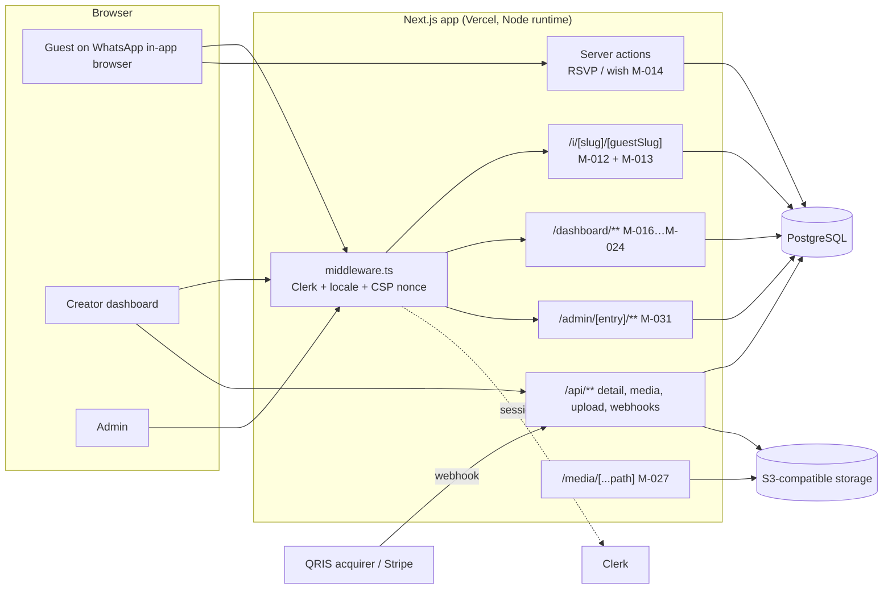
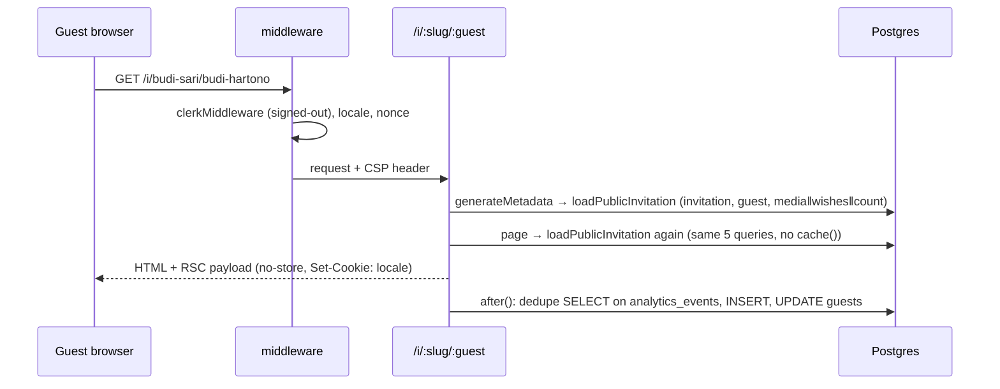
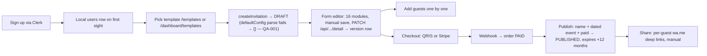

<!-- SUMMARY (first 7 lines — greppable) -->
# architecture.md — Invitesion as it exists at 22ed99e
> WHAT: Stack, runtime, deployment shape, request paths (guest read, guest write, creator), and hot-path cost, with diagrams.
> STATUS: DONE (Phase 1)
> OWNER: Oracle (research)
> DEPS: module-map.md, data-model.md, quality-audit.md, ../00-setup/setup-log.md
> GREP: architecture, stack, runtime, deployment, request path, hot path, mermaid
> UPDATED: 2026-10-29

## 1. Stack [OBSERVED package.json, configs]
| Layer | Today | Notes |
|---|---|---|
| Framework | Next.js 15.6.0-canary.59, App Router, Turbopack dev; `experimental.ppr` + `clientSegmentCache` | Canary in production is a risk (no LTS patches) |
| UI | React 19.1.4, Tailwind 4.1.7, Radix/shadcn primitives, lucide icons, CSS Modules on marketing pages | No animation library, no `next/image` |
| Data | PostgreSQL via postgres.js (pool `max` 10, `POSTGRES_POOL_MAX`) + Drizzle ORM 0.43 | 18 tables, 9 migrations |
| Auth | Clerk 7 (`@clerk/nextjs`), local `users` row mapped by `clerk_user_id`; roles in DB | ClerkProvider wraps the root layout, so guest pages also load clerk-js |
| Payments | QRIS (own EMVCo payload + provider adapter) and Stripe (REST + own signature check) | No SDKs; idempotent settlement |
| Storage | Local disk (dev) / S3-compatible (prod) with own SigV4 | Originals only, no image pipeline |
| Validation | Zod 3 (`detailConfigSchema`, strict) | — |
| Tests | node:test via tsx, 49 cases | No CI in the repo (`.github/` absent) |
| Hosting (inferred) | Vercel: `vercel-build` runs migrations + template seed on production builds; middleware reads `x-vercel-ip-country` | [INFERRED high] |

## 2. Runtime shape
- **Rendering:** every customer and guest page is server-rendered on demand. Guest pages declare `dynamic = 'force-dynamic'`; with PPR the static shell is prerendered and the body streams (`x-nextjs-postponed: 1`) [OBSERVED H-INV-001].
- **Mutations:** Server Actions with Post/Redirect/Get for guest RSVP and wishes; Route Handlers for JSON APIs (detail PATCH, media, upload, payment webhooks, user).
- **Middleware (Node runtime) on every non-static request:** Clerk session resolution, protected-route redirects, locale resolution, per-request CSP nonce (report-only), and `Set-Cookie: locale=…` on every response.
- **Background work:** none besides `after()` view tracking. No queue, no scheduler, no worker (Redis/BullMQ planned, not present).

## 3. Component view

## 4. Guest read path (the hot path)

**Cost per guest open [OBSERVED code M-012]:** 5 queries for metadata + 5 for the page (3 sequential rounds each) + 3 for tracking = **13 queries**, none cacheable at the CDN because the response is `private, no-store` and sets a cookie. The `analytics_events` dedupe query has no supporting index (data-model.md §5), so its cost grows with total platform traffic, not per invitation.

Local measurement (C-INV-001, production build, Lighthouse mobile Slow-4G + 4× CPU): Performance 94, LCP 2.6 s, TBT 186 ms, CLS 0, 19 requests / 323 KB transferred **excluding clerk-js** (+70.7 KB brotli in production; DNS-blocked in the sandbox) [OBSERVED C-INV-001, H-INV-004]. Server TTFB on localhost 5–10 ms with a warm pool [OBSERVED H-INV-001]; the realistic risk is pool exhaustion (10 connections × instances) during a WhatsApp blast, not single-request latency. Load numbers: Phase 8 spike.

## 5. Guest write path
`submitRsvp` / `submitGuestMessage` → re-resolve invitation + guest (2 queries) → UPDATE/INSERT + analytics INSERT → `revalidatePath` → 303 redirect → full page re-render (another 13 queries). No rate limit, no idempotency key, no CSRF token beyond Server Action origin checks.

## 6. Creator path

## 7. Deployment notes
- Production build runs `db:migrate` and `db:seed:templates` inside `vercel-build` (schema changes ship with every deploy; a failing migration fails the deploy) [OBSERVED package.json].
- `pnpm build` requires `POSTGRES_URL` because a route evaluates the DB client during page-data collection [OBSERVED setup-log].
- Security headers in `next.config.ts` (nosniff, SAMEORIGIN, referrer policy, permissions policy, HSTS); CSP is per-request in middleware and report-only (`CSP_ENFORCE` flag).
- No observability stack (no tracing, no error tracker, no uptime checks) in the repo [OBSERVED].
