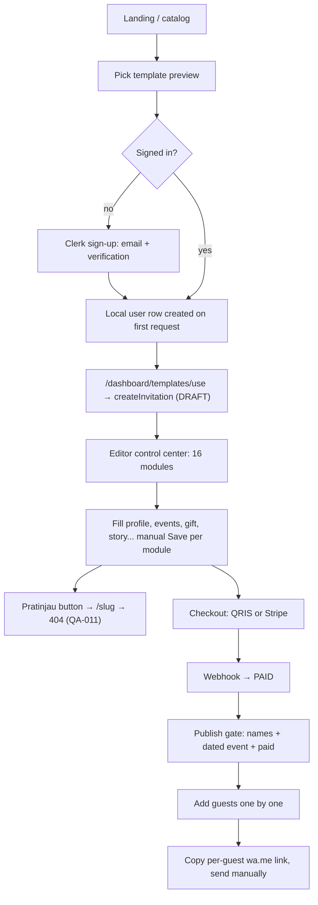
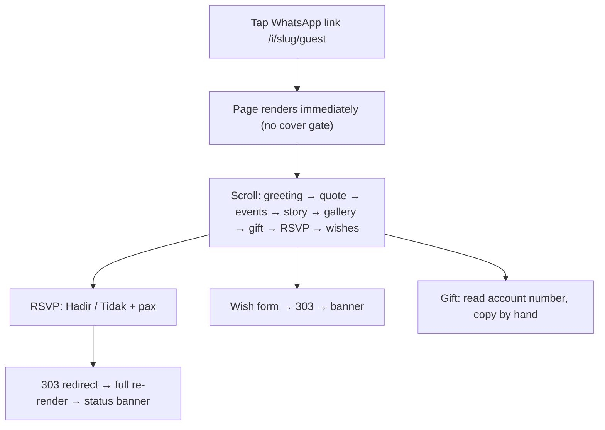

<!-- SUMMARY (first 7 lines — greppable) -->
# flows.md — current flows: creator, guest, host on the day, admin/reseller
> WHAT: Step lists + mermaid for each journey as implemented at 22ed99e, with friction, step counts and broken steps. Baseline for 03-teardowns/_flows/ comparisons.
> STATUS: DONE (Phase 1) — creator/admin steps read from code (no Clerk keys → not clicked through); guest flow measured on our instance
> OWNER: Oracle (research)
> DEPS: architecture.md, quality-audit.md, module-map.md
> GREP: flow, journey, creator, guest, host, check-in, admin, reseller, steps
> UPDATED: 2026-10-29

## 1. Creator: onboarding → publish → share

| # | Step | Friction / defect |
|---|---|---|
| 1–3 | Catalog → preview → sign up | Preview shows a richer design than the product renders (style-observations §1) |
| 4 | Create from template | **Template lost** (QA-001): draft starts empty, default palette |
| 5–6 | Editor | Form-only, no live preview, manual save, theme tab unreachable, preview link 404 |
| 7 | Pay | QRIS acquirer not chosen (B5) → today manual confirmation by admin |
| 8 | Publish | Shallow gate (good); 12-month window starts |
| 9 | Guests | No bulk import; slug from name (QA-003) |
| 10 | Share | wa.me per guest, manual; no blast, no message personalisation beyond template text |
**Minimum clicks to a shareable link (estimate):** ≈ 25–35 interactions + payment wait [ESTIMATE from code paths]; time-to-publish unknown without live Clerk [UNKNOWN].

## 2. Guest: open → RSVP → wish → gift

| # | Step | Measured / observed |
|---|---|---|
| 1 | Open | LCP 2.45–2.60 s Slow-4G (+ clerk-js in prod) [C-INV-001/002] |
| 2 | Read details | Times wrong by +7 h on UTC servers (QA-002); maps = external link only; no add-to-calendar |
| 3 | RSVP | 1 tap (+ pax); no "ragu-ragu"; full-page reload; decline erases allowance (QA-005) |
| 4 | Wish | 1 form; posts instantly visible (no moderation) |
| 5 | Gift | No copy button, no QRIS |
| 6 | Music/countdown/share | Absent |
Guest step count to RSVP: **2 interactions** (scroll + tap) — already competitive; the gap is richness and correctness, not friction.

## 3. Host on the day
Manual check-in per guest row in `/dashboard/invitations/[id]/guests` (buttons: Hadir, Tidak hadir, Check-in/Batalkan, Tandai dikirim, WhatsApp). No QR scanning, no kiosk/guestbook mode, no souvenir tracking, no live arrival counter, no multi-usher access (single owner account). `checkInSettings` (QR required, manual allowed) exists in config only.

## 4. Admin
Private entry `/admin/<secret>/…` with DB role check: overview, orders (manual "confirm paid" for QRIS while no acquirer), customers, invitations, templates (stub), activity, security, profile. No template upload/QA workflow, no refunds, no support tooling.

## 5. Reseller / organiser
Not supported: no multi-client workspace, sub-users, white-label domain, wholesale pricing or bulk template licensing (data-model.md §3). Every invitation belongs to one end-customer account.

## 6. Post-event
Invitation becomes read-only after 12 months (RSVP/wishes closed, content visible). No thank-you broadcast, photo-sharing follow-up, wishes export/keepsake (PDF/print), or data deletion flow.
