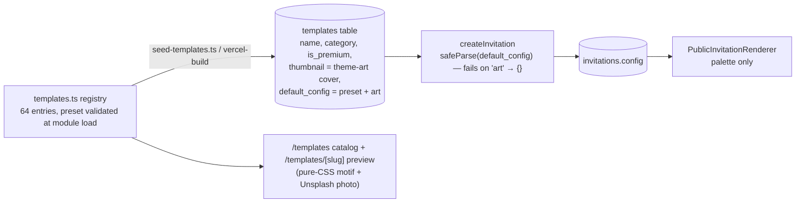

<!-- SUMMARY (first 7 lines — greppable) -->
# template-system.md — how templates are defined and rendered today (harness foundation)
> WHAT: Template definition, sync, theming/tokens, assets, personalization, music, motion; how to add a template today; what the harness contract must change.
> STATUS: DONE (Phase 1)
> OWNER: Oracle (research)
> DEPS: module-map.md (M-004…M-013), data-model.md, ../../tools/template-harness/
> GREP: template, preset, palette, motif, renderer, tokens, personalization, music, motion, add template
> UPDATED: 2026-10-29

## 1. One-paragraph truth
A "template" today is a **row of data** (`lib/invitation/templates.ts`): category, style tags, a CSS motif for the catalog card, a tier, one of 18 four-colour palettes, a serif/sans flag and a preset `DetailConfig`. Guests never see the motif, the font flag, or the theme art: the public renderer (`components/invitation/public-renderer.tsx`, M-013) has **one layout for every template** and reads only `config.theme.paletteId` → `{bg, ink, accent, soft}` Tailwind classes. Two templates with the same palette render identically to a guest. The rich per-template look exists only on the marketing preview page (`app/templates/[slug]/preview-client.tsx`, M-005), which is a mock with sample copy, not the renderer. [OBSERVED code; C-INV-001]

## 2. Lifecycle

## 3. Catalog statistics [OBSERVED registry, 2026-10-29]
- **64 templates**, 27 categories: wedding 15, birthday 6, anniversary 4, holiday-gathering 4, aqiqah-khitanan 3, syukuran 3, baby-shower 3, corporate 3, bridal-shower 2, graduation 2, reunion 2, product-launch 2, and 1 each for 15 business/community categories.
- Tiers: free 34 · premium 24 · signature 6. Fonts: serif 33 · sans 31 (not honoured by the renderer). Motifs: 12 (catalog only). Palettes: 18.
- Section mix enabled by presets: 15 full wedding presets (gallery, gift, greetings, guestbook, music, quote, RSVP, story); 13 business presets with only gallery + RSVP.

## 4. Theming and tokens
| Token surface | Where | Used by guests? |
|---|---|---|
| Palette hex `{bg, ink, accent, soft}` ×18 | `templates.ts` `templatePalettes` | Catalog only |
| Same palettes as Tailwind arbitrary classes | `public-renderer.tsx` `palettes` | Yes — the **only** per-template variable |
| Font flag `serif`/`sans` | `templates.ts` | No (renderer always uses `font-serif` headings + body sans) |
| `settings.fontFamily` | config schema | No |
| Motif (arch, floral, deco…) | catalog CSS | No |
| Platform tokens (oklch rose editorial, spacing, easing) | `tokens.css`, `app/globals.css` | Marketing site only |
The two palette tables must be kept in sync by hand (comment in templates.ts) — drift risk.

## 5. Assets
- **Cover image:** `config.theme.cover.imageUrl` (any URL ≤ 500 chars) rendered at 25 % opacity behind the cover.
- **Gallery:** `media_assets` (type `photo`) ordered by `sort_order`; plain ``, square crop, originals (≤ 5 MB each), no resizing, no WebP/AVIF, no `srcset`.
- **Theme art:** ~105 Unsplash IDs in 22 pools hot-linked through `unsplash.com/photos/<id>/download?force=true&w=…` for catalog cards; stored into `templates.thumbnail` and `default_config.art`. License: Unsplash License (free commercial use) [CLAIMED in file header] — but the download endpoint is meant for download tracking, not display, and the URLs are outside our CSP `img-src`.
- **Fonts:** Manrope + Instrument Serif via `next/font/google` (self-hosted at build, SIL OFL 1.1) [OBSERVED layout.tsx]. No per-template font loading.
- **Audio:** none shipped; `config.music.assetUrl` exists, the renderer ignores it.

## 6. Personalization
- Canonical guest URL `/i/:invitationSlug/:guestSlug` (path parameter, not `?to=`). Guest name comes from the `guests` table, React-escaped (hostile names render inert [OBSERVED H-INV-003]).
- Without a guest slug (`/i/:slug`) the page renders but RSVP/wishes are disabled.
- No free-text `?to=Nama` mode (common in Indonesian resellers' workflow, risky for XSS/abuse — we should keep it off but offer bulk link generation instead).

## 7. Music and motion
- Music: config only (enabled, assetUrl, title, autoplay); no `<audio>`, no unlock-on-open gesture, no mute control [OBSERVED C-INV-001: musicControl=false].
- Motion: none on the guest page (no keyframes, no reveal on scroll, no `prefers-reduced-motion` handling because there is nothing to reduce). Marketing CSS has ~56 animation/keyframe declarations.
- 3D: none.

## 8. How to add a template today
1. Append a `make({...})` entry in `lib/invitation/templates.ts` (unique id/slug/name, category, palette).
2. If a new palette: add hex to `templatePalettes` **and** Tailwind classes to `public-renderer.tsx`.
3. Optionally add a theme-art pool mapping in `theme-art.ts`.
4. Run `pnpm db:seed:templates` (or deploy: `vercel-build` seeds).
Result: a new catalog card and preview; guests get the shared layout in the new colours.

## 9. What the harness contract must change (input to Phase 7)
1. A template must own its **section components and layout** (cover, couple, events, gallery, gift, RSVP, wishes, closing), not just colours.
2. Declared **tokens** (colour, type pair, spacing, radius, motion) consumed by the renderer, with one source of truth (no hand-synced tables).
3. Declared **assets with licenses and byte budgets** (fonts, images, audio, 3D) — today nothing records license or weight.
4. Declared **feature flags and slots** mapped to `DetailConfig` sections, so the editor shows only what the template renders.
5. **Motion level** + reduced-motion fallback, **3D declaration** + low-end fallback.
6. Event **timezone** per event and locale-aware labels (WIB/WITA/WIT).
7. Gates that run the template against hostile/long/RTL/emoji guest names and timezone fixtures — the seed fixture used for C-INV-001/002 is the starting set.
