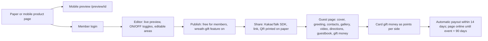

# Barunson Mcard (BRN): Tier A teardown dossier (international, Korea)

> **Status: v1, session 08 (2026-11-03).** Evidence level **B** (3 valid guest-page captures; `../../_handoff/review-20261101.md` §2). §4 rests on three **vendor sample previews** C-BRN-101…103 (`mcard.barunsoncard.com/preview/<productId>`, fictional sample fields per S-BRN-003). None has a cover gate, so cold load and structure are both eligible. The capture feature detector reads Indonesian/English keywords and flagged nothing on these Korean pages, so features are **read per page** from the template's static area labels (S-BRN-005) and the vendor's own pages, never from detector flags.
>
> Evidence used (times UTC): discovery `raw/barunson/discovery-BRN.json`; **S-BRN-001** robots (none: `/robots.txt` redirects to a soft-404 page) + headers + homepage, **S-BRN-002** six product pages, **S-BRN-003** D-008 check of `/preview/1205`, **S-BRN-004** customer centre and FAQ (2026-11-01 17:05–17:08Z); **C-BRN-101…103** (2026-11-01 17:30–17:32Z, REA driver, Lighthouse 12.8.2); **S-BRN-005** (2026-11-03 16:51:52Z robots re-check: one redirect to `/CustomErrors/404`, HTTP 200 HTML, no rules → allowed; 16:51:56Z one re-read of `/preview/1205`, HTTP 200, 27,492 bytes, structural labels only). Tables generated by `_tools/capture/dossier-digest.py`. Private copy: `$INVITESION_PRIVATE_DIR/pages/barunson/` (not committed).
>
> **Privacy:** the sample previews use fictional names (S-BRN-003); none is repeated here (D-021). No account, order, gift payment or guestbook entry was used.

## 1. Snapshot
| Item | Finding | Evidence |
|---|---|---|
| Positioning | Mobile invitations (모바일 청첩장) from a paper-stationery brand: "matching paper + mobile sets", live preview while typing, ≈ 100 premium skins, ON/OFF feature toggles | [CLAIMED S-BRN-001] |
| Segment | Weddings, first birthdays (돌잔치 areas in the shared template), birthdays, housewarmings, baby and party cards; product-code prefixes MC/MB/MF/MP | [CLAIMED S-BRN-001] / [OBSERVED labels S-BRN-005] / prefixes [INFERRED] |
| Size signals | Tranco 638,848 (the `mcard` host) | [ESTIMATE 2026-10-29] |
| Pricing (KRW) | Standard designs list **50,000** and are discounted to **free for members**; licensed designs (Disney, Karim Rashid) **9,900**; invitations stay online until **90 days after the event** | [OBSERVED S-BRN-002] / licences [CLAIMED S-BRN-001] |
| Monetization hooks | Free mobile invitations are tied to a **flower-wreath gift feature that cannot be switched off**; guests can pay **gift money (축의금) by card**, held as points per side and paid out automatically, without fee, within 14 days after the wedding | [CLAIMED S-BRN-004] |
| Editing window | Unlimited edits until 90 days after the wedding, even after a QR code was printed on the paper invitation | [CLAIMED S-BRN-004] |
| Catalog | 72 product-detail links on the homepage; every product page links "모바일초대장 미리보기" → `/preview/<productId>` | [OBSERVED S-BRN-001, S-BRN-002] |

## 2. Funnel and flows

- Product → preview links are [OBSERVED S-BRN-002]; editor, publishing and payouts are [CLAIMED S-BRN-001/004] (no account, R1).
- **Paper ↔ mobile:** the printed invitation carries a QR code to the mobile invitation, which stays editable after printing. [CLAIMED S-BRN-004]
- RSVP, host dashboards and reseller channels: not described on the pages read. [UNKNOWN]

## 3. Builder / editor
- **Area-based template model:** each template is a set of areas (`Template_ID`, `Area_ID`, `Area_Name`) with a per-area editability flag (`Edit_YN`). [OBSERVED S-BRN-003]
- The guest page ships the editor's option lists: five Nanum font choices (Gothic, Gothic Coding, Myeongjo, Pen Script, Brush Script) and a vertical-alignment setting. [OBSERVED S-BRN-005]
- Live preview while typing; ON/OFF toggles per feature. [CLAIMED S-BRN-001]
- Autosave, undo, media limits: [UNKNOWN].

## 4. Guest invitation (three vendor samples)
### 4.1 What was measured, and its limits
- Targets: `/preview/1260`, `/1205`, `/1096`, the vendor's official preview links. No cover on any (`coverGate` false → false), so Lighthouse cold load and post-visit structure are both valid. Layout is `
`-based: `sectionCount` = 0 is a detector artefact, not "no sections" (LATEST §6).
- Features come from the area labels in the static HTML of `/preview/1205` (S-BRN-005); 1260 and 1096 share the renderer [INFERRED, high: same scripts and fonts], but their area sets were not re-read.

### 4.2 Cold load (Lighthouse 12.8.2 mobile, simulated Slow 4G + 4× CPU, 412×915, cold cache)
| Capture | Theme | Perf | A11y | BP | SEO | FCP s | LCP s | TBT ms | CLS | LH req | LH KiB | JS KiB | Img KiB | Font KiB |
|---|---|---|---|---|---|---|---|---|---|---|---|---|---|---|
| C-BRN-101 | 1260 | 55 | 83 | 96 | 42 | 19.52 | 23.18 | 0 | 0.000 | 55 | 4,447 | 336 | 1,300 | 2,432 |
| C-BRN-102 | 1205 | 55 | 83 | 93 | 42 | 19.38 | 23.15 | 0 | 0.000 | 53 | 4,461 | 336 | 1,316 | 2,432 |
| C-BRN-103 | 1096 | 55 | 83 | 93 | 42 | 12.71 | 15.79 | 0 | 0.009 | 70 | 5,876 | 336 | 2,354 | 2,801 |
| **Median (3 themes)** | | **55** | **83** | 93 | 42 | **19.38** | **23.15** | **0** | 0.000 | 55 | **4,461** | 336 | 1,316 | **2,432** |

[OBSERVED C-BRN-101…103]. **Fonts are 48–55 % of cold-load bytes:** Nanum Myeongjo from Naver's CDN (`pstatic.net`) arrives as 2,432 KiB in two requests on 101/102; 103 adds a 1,755 KiB Cafe24 face from jsDelivr. Behind 23 render-blocking stylesheets, first paint takes 12.7–19.5 s while the main thread is idle (TBT 0).

### 4.3 After the visit (our CDP session, unthrottled; not Lighthouse)
| Capture | Cover / click / opening | CDP req | CDP KiB | Img KiB | Font KiB | DOM | Doc height |
|---|---|---|---|---|---|---|---|
| C-BRN-101 | not detected / none / no cover | 55 | 4,446 | 1,300 | 2,432 | 191 | 5,325 px |
| C-BRN-102 | not detected / none / no cover | 52 | 4,427 | 1,316 | 2,432 | 187 | 5,369 px |
| C-BRN-103 | not detected / none / no cover | 69 | 5,843 | 2,354 | 2,801 | 218 | 4,933 px |

[OBSERVED]. 0 lazy images out of 18–24; no `<audio>` and no video element on any sample; no iframe.

### 4.4 Guest experience as observed (structure only, no copy)
- **Area sequence (template labels):** cover design → main design → invitation text → greeting → groom/bride contacts and parents' contacts → host → gallery (PhotoSwipe lightbox) → video → directions (오시는 길) → guestbook (방명록) → gift-money transfer (축의금송금) → gift → share. Ceremony fields: year, month, day, weekday, AM/PM, hour, minute, venue name, hall. First-birthday templates add baby-info areas (profile, body, footer). [OBSERVED S-BRN-005]
- **No RSVP area** among the static labels; RSVP may be absent or client-rendered. [OBSERVED absence] / [UNKNOWN]
- **No background music** on the three samples (no `<audio>`). [OBSERVED]
- **Sharing:** Kakao JavaScript SDK + an SNS share script. [OBSERVED S-BRN-005]

### 4.5 Assets, fonts, third parties, accessibility, localization
- **Fonts:** Nanum Myeongjo / Gothic (Naver CDN; Nanum fonts are OFL [INFERRED, high]); Cafe24 Ssurround Air (jsDelivr; licence [UNKNOWN]); Google Fonts 229–361 KiB; 2 `font-display` issues per page. [OBSERVED]
- **Third parties:** jQuery CDN, `kakao.com` / `kakaocdn.net`, `pstatic.net`, Google Fonts, jsDelivr; HTTP/1.1, h2 and h3. [OBSERVED LH + CDP]
- **Accessibility:** automated 83; failing `image-alt` on all three; zoom allowed. [OBSERVED]
- **SEO:** Lighthouse SEO 42; no OG image or description on the samples. [OBSERVED]
- **Localization:** `lang="ko"`; Korean only on the pages read. [OBSERVED]

### 4.6 Against our own guest page (same protocol)
| | Barunson (median of 3 themes) | Invitesion C-INV-005 (one run; local production build, no middleware) |
|---|---|---|
| Perf / LCP / TBT / CLS (Lighthouse lab) | 55 / 23.15 s / **0 ms** / 0.000 | 93 / 2.62 s / 209 ms / 0 |
| INP | not measured | not measured |
| Transfer / requests at cold load (Lighthouse) | 4,461 KiB / 55 | 321 KiB / 26 |
| Accessibility (automated) | 83 | 96 |

**Scope:** lab measurements under one protocol. Ours transfers ≈ 13.9× less at cold load with better Perf, LCP and automated a11y; **Barunson's TBT (0 ms) beats ours (209 ms)**, so its problem is font and stylesheet delivery, not script. INP was not measured; C-INV-005 omits `middleware.ts` (placeholder Clerk keys, D-012, P-INV-010), so real-key auth, middleware, CSP and locale-cookie behaviour are not covered. [OBSERVED] / interpretation [INFERRED, high]

## 5. Tech fingerprint
| Layer | Finding | Confidence |
|---|---|---|
| Server | Microsoft IIS 10 / ASP.NET; custom error pages (`/CustomErrors/404`) | high [OBSERVED S-BRN-001, S-BRN-005] |
| Guest pages | Client-rendered from embedded JSON by `preview.js`; jQuery 1.12.4, Swiper bundle, PhotoSwipe, Kakao SDK | high [OBSERVED S-BRN-003, S-BRN-005] |
| Marketing | jQuery 1.12.4, Swiper 4.5.1, AOS 2.3.1, Naver analytics, Spoqa Han Sans Neo; Cloudflare | high [OBSERVED S-BRN-001; longlist] |
| Payments | Card gift money with per-side points | [CLAIMED S-BRN-004]; provider [UNKNOWN] |

## 6. Public API surface
No endpoints observed: the preview embeds its data as JSON in the HTML. See `api-observed.md`.

## 7. Mobile app
None identified for the mobile-card service in the pages read. [UNKNOWN]

## 8. Growth and SEO
- **Paper → mobile funnel:** QR codes on printed invitations lead guests to the mobile page. [CLAIMED S-BRN-004]
- **Free mobile invitation for members** as an acquisition hook, monetized through gifts. [OBSERVED S-BRN-002] / [CLAIMED S-BRN-004]
- **Licensed designs** (Disney, Karim Rashid) as premium differentiation. [CLAIMED S-BRN-001]
- KakaoTalk sharing as the main distribution channel. [OBSERVED SDK]

## 9. Monetization and pricing psychology
- **Anchor then give away:** a 50,000-won list price shown as free for members. [OBSERVED S-BRN-002]
- **Gift-side revenue:** a non-removable flower-wreath gift feature on free invitations; card gift money with free payout within 14 days (float [INFERRED, medium]). [CLAIMED S-BRN-004]
- **Licensed premium:** 9,900 won for licensed designs. [OBSERVED S-BRN-002]
- **Bundle with paper:** mobile as the companion of a paid paper order. [CLAIMED S-BRN-001]

## 10. Strengths, weaknesses, public complaints
- **Strengths:** the closest foreign analogue to the Indonesian scroll invitation (contacts, gallery, directions, guestbook, gift money); paper ↔ mobile integration; card-paid gift money with automatic per-side payout; per-area editability; almost no main-thread work (TBT 0); zoom allowed. [OBSERVED/CLAIMED as tagged]
- **Weaknesses:** 2.4–2.8 MB of Korean web fonts and 23 render-blocking stylesheets (FCP 12.7–19.5 s on simulated Slow 4G); no lazy loading; SEO 42 without OG tags; `image-alt` failures; jQuery 1.12.4 on IIS; a gift upsell that cannot be switched off. [OBSERVED / CLAIMED]
- **Public complaints:** the mobile-card homepage links no store listing in its static HTML (S-BRN-006, s14); Korean review sources were not read. [UNKNOWN]

## 11. Patterns to learn, to avoid, and our counter-move
| Learn (principle) | Avoid | Our counter-move |
|---|---|---|
| Paper and digital as one product: a printed QR opens the live, still-editable invitation | — | Print/e-card export with a QR to the live page (F-090) |
| Gift money held per side (bride/groom) and paid out automatically | Non-removable gift upsells | QRIS gift (F-022) with per-side attribution and transparent payout, opt-in only |
| Templates as editable areas with per-area lock flags | Shipping full display-font files to guests | Template harness font budget (subset WOFF2, `font-display: swap`) as a performance gate |
| One-tap contact buttons for couple and parents | Render-blocking stylesheet chains | Contact links in the couple module (F-006) |

## 12. Mapping to our modules and features
| Barunson capability | Ours | Modules | Verdict |
|---|---|---|---|
| Couple and parents with contacts | F-006 partial (nicknames only, no contact buttons) | M-013, M-018 | gap |
| Gallery with lightbox, video | F-008 partial (no lightbox), F-009 missing | M-013, M-027 | gap |
| Directions | F-011 partial | M-013 | partial |
| Guestbook | F-019 full | M-013, M-014 | parity |
| Card gift money, per-side payout | F-021 partial, F-022 missing | M-013, M-025 | gap |
| Messenger share (Kakao) | F-027 missing (WhatsApp equivalent) | M-013 | gap |
| Paper + QR to the mobile page | F-090 missing | — | gap |
| Edit after publish, online after the event | F-061 full, F-064 full (12 months) | M-011 | parity; **we lead** on duration |
| Per-area editability, font choices | F-036 missing | M-013, M-018 | gap |
| First-birthday and other event templates | F-040 config-only | M-009 | partial |
| Guest-page weight and a11y | C-INV-005 321 KiB, a11y 96, TBT 209 ms | M-012, M-013 | **we lead** on bytes, LCP, a11y; **BRN leads on TBT** (lab, with C-INV-005 limits) |
