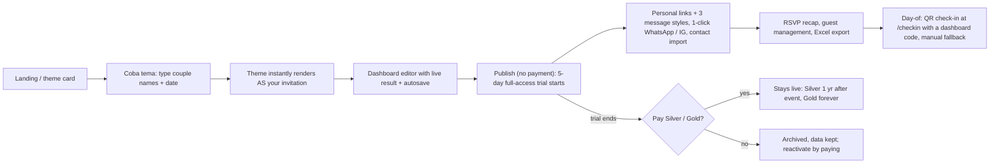

# Enviory (ENV): Tier A teardown dossier

> **Evidence status (D-031, s12; verified s13). Two separate questions.**
> - **G1, robots applicability: resolved, not applicable.** Today's `enviory.com/robots.txt` lists `anthropic-ai` and `Claude-Web` only inside Cloudflare's managed "Training crawlers" section (S-ENV-004), a documented training opt-out under D-030. The capture-day file was not preserved; the same-day note (S-ENV-002: `*` Allow, AI training crawlers Disallow) is consistent with the same block [INFERRED], and whether `Claude-Web` was listed then is [UNKNOWN].
> - **G2, challenge sequence: open (Q-O09).** A plain fetch of the demo guest page met a Cloudflare JS challenge at 11:20 WIB on 2026-10-29 (S-ENV-002); browser captures of the same route followed (C-ENV-111…116 from 11:41 WIB, C-ENV-117…123 the next day). The browser was never challenged and was the protocol's designated client, but the written rule does not draw that distinction.
> - **Consequence until Q-O09 is answered:** C-ENV-111…123 are **provisional**. They are kept with provenance and excluded from every unconditional benchmark figure, coverage count and aggregate; figures that include them appear only in separately labelled sensitivity results. **§4 and every guest-page number in this dossier rest on them and are provisional.** Sections built on S-ENV-001 (positioning, pricing, catalog) are not affected by G2; S-ENV-001 itself was read one minute before the robots read (process deviation noted in `../../02-competitor-discovery/robots-applicability-s12.md` §2, allowed under today's file). No new request goes to Enviory's demo guest pages.
> - *Superseded framing:* s11 recorded Enviory as "policy-contested" under D-026 (D-028, S-ENV-003). D-030 replaced that reading.

> **Status: v2, session 07 (2026-11-01).** §4 is rebuilt from **direct guest-page evidence** (C-ENV-111…123) and replaces v1's provisional wrapper analysis; §5, §6, §10, §11 and §12 are corrected accordingly (most importantly: Google Tag Manager runs on the preview wrapper, **not** on guest pages). Sections 1–3 and 7–9 are unchanged from v1 (S-ENV-001, 2026-10-29). Evidence level **A** (`../../_handoff/review-20261101.md` §2). Still not done: the vendor's "8-step flow" page, user complaints (§10), the `/tema` catalog crawl, audio-playback evidence, a reduced-motion run, and 360×800 captures (protocol v2).
>
> Evidence used: **S-ENV-001**, the public homepage read as a visitor (WebFetch, 2026-10-29 ≈ 11:19 WIB). **S-ENV-002**, robots.txt plus one plain fetch of the official full-preview demo (2026-10-29 ≈ 11:20 WIB): a Cloudflare JS challenge for non-browser clients, nothing bypassed (R1). **D-ENV**, demo discovery (session 02). **C-ENV-101…106**, preview-wrapper captures (2026-10-29 10:37–10:49 WIB). **C-ENV-111…116** (11:41–11:50 WIB) and **C-ENV-117…123** (2026-10-30 05:06–05:24 WIB), guest-page captures of the vendor's official full-preview demo, `enviory.com/<pseudonymized demo slug>?tpl=<theme>`. **B-ENV-001/002**, browser probes of the cover controls. Digest regenerated in session 07 with `_tools/capture/dossier-digest.py` from those summaries. The demo couple's names are redacted in every committed summary (D-017). All prices are IDR as displayed on 2026-10-29.

## 1. Snapshot
| Item | Finding | Tag |
|---|---|---|
| Positioning | "Undangan digital & website pernikahan premium — proses instan". The marketing sells motion as a three-act stage: *Reveal beauty* (cover, guest name from the personal link, music starts), *Flow through story* (story, gallery, rundown and countdown animate on scroll), *Fade into memory* (RSVP, wishes, check-in QR) | [OBSERVED S-ENV-001] |
| Segment | Premium **weddings only**: all 18 homepage themes are wedding themes. No khitanan/aqiqah/birthday/corporate themes are listed | [OBSERVED S-ENV-001] |
| Languages | Indonesian UI and copy, with English taglines; the guest pages mix Indonesian controls with English section titles in some themes (velora-linear) | [OBSERVED S-ENV-001, C-ENV-123] |
| Company signals | Designer-led studio brand (one designer credited on the homepage); WhatsApp + email CS, Mon–Sat 10:00–21:00 WIB; business address in Kab. Bekasi; done-for-you option ("minta undangan dibuatkan oleh admin, konsultasi gratis") | [OBSERVED S-ENV-001] |
| Size | "8,8 juta pengguna" | [CLAIMED, longlist probe 2026-10-29] |
| Traffic / installs | Not in the Tranco top 1M; no Play Store app found | [ESTIMATE Tranco, probe 2026-10-29] / [OBSERVED probe] |
| Plans | **Free trial**: 5 days of full access, starting at the first publish, once per account. On expiry the invitation is archived and data + RSVPs are kept. **Silver Rp 75.000** (struck-through Rp 99.000): 2 theme variants, active 1 year after the event. **Gold Rp 125.000** (struck-through Rp 199.000): 3 variants, active "selamanya" (while the service runs, T&C apply), priority support. Both are one-off per invitation with unlimited guests | [OBSERVED S-ENV-001] |
| Included in both plans | Personal guest links + 3 message styles + 1-click WhatsApp/Instagram share, RSVP + guestbook, QR check-in, gallery up to **10 photos**, map, rundown, love story, dress code, countdown, music (catalog + MP3 upload), digital envelope (**2 accounts + QR**), visit analytics, contact import, Excel (.xlsx) export | [OBSERVED S-ENV-001] |
| Reseller | Prepaid quota usable as balance for Silver or Gold: 10 = Rp 380.000 (Rp 38k each), 25 = Rp 790.000 (Rp 31.6k), 50 = Rp 1.300.000 (Rp 26k). Resale floor Rp 75.000; quota never expires; custom domain is an add-on (contact sales). Separate referral program with a **35 %** commission | [OBSERVED S-ENV-001] |
| Payments / refund | QRIS, GoPay/OVO/DANA/LinkAja, bank transfer/VA and cards via **Midtrans**. 100 % refund up to 7 days after publishing | [OBSERVED S-ENV-001] |
| Watermark | A vendor credit line is present on the official demo guest pages (credit-line detector matched on all 13 captures); whether paid invitations carry it is not stated in plans or FAQ | [OBSERVED C-ENV-111…123] / paid [UNKNOWN] |
| Catalog | **18 themes** on the homepage: romantis 6 (Rocaille, Velora·Linear, Hydrangea, Velora, Aurelia, Noctivelle), editorial 9 (Cartouche, Vellum, Foil Press, Chromatype Soft, Loam, Way Lantern, Atelier Archive, Observatory, Unspoken Letter), sinematik 2 (Cinema, Noir Sands), interaktif 1 (Way Lantern Interaktif: navigation by a miniature globe). Two are marked "Populer" (Hydrangea, Noir Sands). Every theme is included in every plan, with no per-template price. Release cadence unknown | [OBSERVED S-ENV-001] / cadence [UNKNOWN] |

## 2. Funnel and flows

- Steps to a shareable link: **4** (pick theme, type names, fill details, publish). There is no payment wall before publishing, and an "instant, no queue" promise. [CLAIMED S-ENV-001]
- Time to publish: "instan" for a named draft, and "biasanya 15–30 menit" for full details, which can be done in parts thanks to autosave. [CLAIMED S-ENV-001]
- The official demo guest page carries a vendor "change data" button (pencil + "Ganti Data") that sends a visitor into the same try-with-your-names flow, so the demo itself is a funnel entry. [OBSERVED button label, C-ENV-122/123; behaviour not exercised (R1: no form input on third-party sites)]
- Friction we can infer: the trial clock starts at publish, so hosts may delay sharing; the 10-photo gallery cap; archive on trial expiry (loss aversion is part of the design). [INFERRED, medium]
- The vendor's "delapan langkah" flow page and the creator flow itself were not observed: no signup (no-signup research default). [UNKNOWN]

## 3. Builder / editor
| Aspect | Finding | Tag |
|---|---|---|
| Model | Form-based dashboard with a live result ("setiap perubahan langsung terlihat"); theme changeable at any time | [CLAIMED S-ENV-001] |
| Autosave | Yes ("setiap perubahan tersimpan otomatis") | [CLAIMED S-ENV-001] |
| Theme variants | One invitation, one base link, **2–3 visual variants** (e.g. formal for family, casual for friends) sharing the same event data | [CLAIMED S-ENV-001] |
| Media constraints | Gallery ≤ 10 photos; music from a catalog or an uploaded MP3 | [CLAIMED S-ENV-001] |
| Guests | Contact import, personal links, 3 message templates, Excel export | [CLAIMED S-ENV-001] |
| Validation, undo, AI helpers | Not observed | [UNKNOWN] |

## 4. Guest-facing invitation deep dive
> **PROVISIONAL (D-031, Q-O09).** Every capture in §4 (C-ENV-111…123) waits on Q-O09. The tables below are kept as recorded and are **sensitivity results only**: they enter no unconditional benchmark figure, coverage count, tier aggregate or matrix cell (`../../04-template-benchmarks/benchmark-provisional.csv`; regenerate with `_tools/capture/dossier-digest.py --competitor enviory --sensitivity …`, whose output is labelled SENSITIVITY). Without them, Enviory has no unconditional guest-page measurement, like IDI, SMO and PLO. The comparisons in §4.6 and §12 are provisional in the same way.

### 4.1 What was measured (methodology)
- **Preview wrapper ≠ guest page.** The "Lihat demo" links (`/tema/<slug>/pratinjau`, C-ENV-101…106) are a 126–129-node shell with a theme switcher around a same-origin iframe. They stay as evidence of the marketing surface only (v1 §4.2 numbers: wrapper median Perf 58, TBT 4.8 s, mostly Google Tag Manager). They never feed thresholds (D-006).
- **Direct guest pages** = the vendor's official full-preview demo, one demo couple rendered in each theme via `?tpl=` (C-ENV-111…123). Unique demo coverage is **6 themes**, from 13 attempts:

| Theme | Captures | State of the visit | Layout family |
|---|---|---|---|
| Hydrangea | C-ENV-111 | rendered after a pre-D-016 synthetic click: 14 sections; gate opening **unverified** | A |
| Velora | C-ENV-114 | rendered, pre-D-016 (same caveat) | A |
| Aurelia | C-ENV-115 | rendered, pre-D-016 | A |
| Noctivelle | C-ENV-116 | rendered, pre-D-016 | A |
| Rocaille | C-ENV-122 opened · C-ENV-112/117/119/121 closed | **opened** by the D-016 trusted click (`landing=inside`): 24 detected blocks; four earlier attempts stayed on the cover, each documenting one failure mode (C-ENV-112 no control match, 117 synthetic click ignored, 119 click during the 10+ s intro, 121 click during REA's scenario) | B |
| Velora·Linear | C-ENV-123 opened · C-ENV-113/118/120 closed | **opened** (D-016, `landing=inside`); earlier attempts missed the text-less "OPEN" control | B |

- **Lighthouse never clicks**, so all 13 guest-page Lighthouse runs are valid **cold-load** samples (cover state). Bytes after the open + scroll come from our CDP session and are reported separately (§4.3). The two are never added together.

### 4.2 Cold-load measurements (Lighthouse 12.8.2 mobile, simulate Slow 4G / 4× CPU, 412×915 @2.625, cold cache)
One row per theme; themes captured more than once show the median and the range of their runs.

| Theme | Runs | Perf | LCP s | FCP s | TBT ms | CLS | Transfer KB (LH) | Req (LH) |
|---|---|---|---|---|---|---|---|---|
| Hydrangea | 1 | 39 | 11.72 | 2.00 | 1,380 | 0 | 2,052 | 39 |
| Rocaille | 5 | 50 (43–54) | **37.39 (4.41–56.44)** | 4.25 | 641 (348–1,138) | 0 | **9,899 (6,896–10,265)** | 37 |
| Velora·Linear | 4 | 52.5 (45–61) | 4.55 (4.17–13.32) | 2.08 | 862 (470–1,722) | 0.019 | 1,708 (1,343–2,210) | 43 |
| Velora | 1 | 45 | 16.03 | 4.12 | 562 | 0 | 2,639 | 42 |
| Aurelia | 1 | 36 | 18.35 | 4.23 | 978 | 0 | 3,264 | 37 |
| Noctivelle | 1 | 38 | 11.61 | 1.97 | 1,613 | 0 | 2,169 | 39 |
| **Median of 6 themes** | | **42** | **13.87** | **3.10** | **920** | **0** | **2,404** | **39** |

[OBSERVED C-ENV-111…123]. Other categories: Accessibility **100 in 13/13 runs** (automated checks only), Best Practices 75–79, SEO 54–58 (expected: invitation pages are `noindex` by design, S-ENV-001 FAQ). Worse-side p75 across themes: Perf 38, LCP 17.8 s, TBT 1,280 ms, transfer 3,107 KB; best: Perf 52.5, LCP 4.55 s, TBT 562 ms, transfer 1,708 KB.
- **LCP is unstable for long cover intros:** the same rocaille URL produced LCP 4.41, 4.59, 37.39, 55.74 and 56.44 s. Its cover zooms in for 10+ s (B-ENV-001), so the largest-paint candidate keeps changing under simulated throttling. Use theme medians with their ranges, never a single run. [OBSERVED] / cause [INFERRED, medium]
- **Rocaille's cover alone downloads ≈ 6.4 MB of images before any tap** (CDP, closed state, four runs) and Lighthouse counts 6.9–10.3 MB. [OBSERVED]
- Main-thread cost is moderate next to the wrapper: guest-page TBT 348–1,722 ms against 3.9–5.8 s on the wrapper, because the guest page loads no tag manager (§4.5). The platform's dev server ran on the capture host, so TBT carries the usual caveat (protocol §6). [OBSERVED]

### 4.3 After the open: transfer and structure (CDP, unthrottled, whole visit including our scroll)
| Capture | Theme | State | CDP KB | Images KB | JS KB | Requests | DOM nodes | Blocks detected |
|---|---|---|---|---|---|---|---|---|
| C-ENV-122 | Rocaille | opened | **27,504** | 27,070 | 300 | 59 | 561 | 24 (12 sections, each a `div` + `section` pair) |
| C-ENV-123 | Velora·Linear | opened | 2,482 | 2,066 | 282 | 64 | 605 | 24 (12) |
| C-ENV-111 | Hydrangea | rendered | 2,196 | 1,704 | 300 | 54 | 458 | 14 |
| C-ENV-114 | Velora | rendered | 1,883 | 1,406 | 284 | 64 | 487 | 14 |
| C-ENV-115 | Aurelia | rendered | 4,811 | 4,336 | 283 | 60 | 462 | 14 |
| C-ENV-116 | Noctivelle | rendered | 3,001 | 2,530 | 281 | 49 | 467 | 14 |
| C-ENV-112/117/119/121 | Rocaille | closed | 6,806–6,823 | 6,404 | 274–290 | 34–36 | 130–132 | 1 |
| C-ENV-113/118/120 | Velora·Linear | closed | 1,265–1,283 | 865 | 272–288 | 40–42 | 148–150 | 1 |

[OBSERVED]. JS is first-party only and nearly constant (272–300 KB, 15–17 bundle chunks per REA), so theme weight is **images**: 0.9 MB (velora-linear cover) to 27 MB (rocaille opened). Lazy loading is used but limited (8–12 lazy of 20–55 images).

### 4.4 Guest experience as observed (structure only, no copy)
Two layout families share one engine:
- **Family A (hydrangea, velora, aurelia, noctivelle), 14 sections:** hero with the couple's names → quote block carrying a Qur'an citation marker ("QS. …") → bride and groom profiles → save the date (countdown detected; add-to-calendar button) → ceremony → venue with a **click-to-load map** (a tap-to-load placeholder instead of an embedded map on first paint) and a directions button → love story → gallery carousel (previous / next / play) → event rundown → dress code → gifts (tabs for bank transfer, gift and QRIS; two bank accounts with copy-number buttons) → RSVP and wishes as two tabs (three-state attendance: attending / unsure / unable; a number field for guests; a message) → thank-you. The four themes report the identical document height (13,009 px), section list and fonts with different image weight, so they are one layout with per-theme art [INFERRED, medium]; a `?tpl=` fallback to one default theme cannot be ruled out without a visual comparison, which stays private.
- **Family B (rocaille, velora-linear), 12 sections:** opening → quote → couple → save the date → events → love story → gallery → rundown → dress code → gifts → RSVP → thank-you, with a **sticky section navigation** whose 12 Indonesian labels map one-to-one to the sections, a **music pause control**, a **guest-count stepper** (− / +) and **one combined submit for attendance and wishes**; gift tabs are bank transfer and "QRIS & Kado".
- **Cover gate (both families):** a full-screen `role="dialog"` named "Buka undangan". Three control styles were observed: a visible text button (family A, visible only after ≈ 10 s on hydrangea), a text-less photo-frame button behind a 10+ s zoom-in intro (rocaille), and a text-less wax-seal button labelled only "OPEN" (velora-linear). Family A's cover also shows a guest salutation line. A synthetic `click()` does not open rocaille; a trusted tap on the settled control does (B-ENV-001, C-ENV-117 vs C-ENV-122). [OBSERVED]
- **Audio:** one looping MP3 `<audio>` element, not `autoplay` (so it can only start from the open tap, which matches the vendor's "music starts on open" claim). After the open the control reads "pause music", consistent with playback having started, but playback itself was **not** observed (no media-state evidence was recorded). [OBSERVED element and label] / playback [UNKNOWN]
- **Personalization:** the demo URL carries no guest parameter, so per-guest naming was not exercised on this page; the vendor claims a guest name from the personal link (§1). [UNKNOWN on the guest page] / [CLAIMED S-ENV-001]
- **Not seen on the guest pages:** QR check-in pass, livestream, calendar file download beyond the add-to-calendar button, share button. Family B's text-based feature flags missed headings that do exist (the detector relies on rendered text; family B splits titles for animation), so a missing flag there means [UNKNOWN], not "none".

### 4.5 Assets, fonts, third parties, accessibility, localization
- **Fonts:** family A Libre Caslon Display + Montserrat + Ballet; family B Halant + Playfair Display + Ballet; all served by Google Fonts (OFL [INFERRED, high: Google Fonts catalogue]), plus one self-hosted `normal.woff2` (≈ 35 KB, licence [UNKNOWN]). 0 `font-display` issues. [OBSERVED]
- **Third parties:** on every guest page the Lighthouse third-party summary lists **only Google Fonts** (52–60 KB, 0 ms blocking) and every script comes from `enviory.com`. **Correction of v1:** Google Tag Manager (2.8–4.4 s of blocking) belongs to the preview wrapper, not to the page guests receive. [OBSERVED C-ENV-101…106 vs C-ENV-111…123]
- **Accessibility:** automated score 100 on all guest-page runs; `lang="id"`; zoom allowed; a `prefers-reduced-motion` stylesheet rule exists. Whether animations actually stop under reduced motion was not tested (no reduced-motion run yet). [OBSERVED] / behaviour [UNKNOWN]
- **Timezone:** no WIB/WITA/WIT token appears in the rendered text of any guest page under our detector; whether times are labelled inside images or not at all is [UNKNOWN].
- **Long names, RTL, in-app browsers:** not testable without typing into the vendor's customizer (out of scope on third-party sites); in-app-browser behaviour needs protocol v2. [UNKNOWN]
- **Sharing / SEO:** OG image, title and description present on guest pages; `noindex` by design. [OBSERVED / CLAIMED S-ENV-001]

### 4.6 Against our own guest page (same protocol)
| | Enviory (median of 6 themes) | Invitesion C-INV-005 (own guest page, REA driver, 2026-10-30; local production build, no middleware) |
|---|---|---|
| Perf / LCP / TBT / CLS (Lighthouse lab) | 42 / 13.87 s / 920 ms / 0 | 93 / 2.62 s / 209 ms / 0 |
| INP | not measured | not measured |
| Transfer / requests at cold load (Lighthouse) | 2,404 KiB / 39 | 321 KiB / 26 |
| Accessibility (automated) | 100 | 96 |
| Cover gate, music, countdown, calendar, map facade, section nav, gift tabs + QRIS, guest-count stepper | present (as observed above) | absent (F-003, F-004 config-only, F-005, F-022 missing; `01-codebase-audit/feature-inventory.csv`) |

**Scope (s08 correction, brief 05 Task C):** lab measurements under one protocol (Lighthouse cold load; Enviory = median of six themes, ours = one C-INV-005 run). Ours transfers **≈ 7.5× less at load** (321 vs 2,404 KiB; 26 vs 39 requests, where v2 wrote 18 = C-INV-005's CDP request count, a different source) with better Perf (93 vs 42), LCP (2.62 vs 13.87 s) and TBT (209 vs 920 ms); CLS ties at 0. INP was not measured, so "faster" is limited to these lab metrics. C-INV-005 is a local production build without `middleware.ts` (placeholder Clerk keys, D-012, P-INV-010): real-key auth, middleware, CSP and locale-cookie behaviour are not covered. "KB" elsewhere in this dossier means KiB (1,024 bytes). Enviory delivers a far richer guest experience and a perfect automated a11y score. The counter-move is to add the experience **inside** a weight budget, not to copy the weight. [OBSERVED both] / interpretation [INFERRED, high]

## 5. Tech fingerprint
| Layer | Finding | Confidence |
|---|---|---|
| Front end | Next.js (REA `next-runtime` fingerprint, `next` globals on guest pages), React implied, **Turbopack** chunks, Tailwind; guest pages ship 15–17 first-party chunks (≈ 272–300 KB JS) | high [OBSERVED C-ENV-101…106, C-ENV-111…123] |
| Edge / CDN | Cloudflare (`server: cloudflare`), HTTP/3 on every guest-page request | high [OBSERVED S-ENV-002, C-ENV-*] |
| Origin hosting | Unknown behind Cloudflare | [UNKNOWN] |
| Analytics | Google Tag Manager on the preview wrapper and marketing pages; **none on guest pages** under this method | high [OBSERVED] |
| Payments | Midtrans | high [OBSERVED S-ENV-001 FAQ; longlist stack hint] |
| Bot protection | Cloudflare managed JS challenge for non-browser clients on the demo guest page (HTTP 403 "Just a moment…"); real browsers pass without a challenge (13/13 guest-page captures) | high [OBSERVED S-ENV-002, C-ENV-111…123] |
| AI-crawler policy | robots.txt: `*` Allow, but **Disallow: /** for AI training crawlers (GPTBot, ClaudeBot, CCBot, Google-Extended, Bytespider, Amazonbot, Applebot-Extended, anthropic-ai, cohere-ai, meta-externalagent, …). User-initiated agents are not blocked, so our observation is allowed. **s11 correction:** D-026 (s10) reclassified `anthropic-ai` and `Claude-Web` as legacy user-initiated agent tokens, and both carry `Disallow: /` today, so under D-026 this origin is opted out. See the header, D-028 and Q-O08 | [OBSERVED S-ENV-002, S-ENV-003] |
| WhatsApp | 1-click share + message templates; no official-API blast claimed | [CLAIMED S-ENV-001] |
| Media | Cloudflare-served images; theme art is the dominant weight (§4.3) | medium [INFERRED] |

## 6. Public API surface
No endpoints observed under this method: REA `analyze-web-bundle` returned no endpoint observations on any of the 13 guest-page captures (and only low-confidence minified candidates on the wrapper). RSVP and wishes were not submitted and the customizer was not used (R1), so write paths stay [UNKNOWN]. Details: `api-observed.md`.

## 7. Mobile app
None. Hosts check guests in on the web at `enviory.com/checkin` with a dashboard code (staff need internet). [OBSERVED probe 2026-10-29: no Play listing] / [CLAIMED S-ENV-001]

## 8. Growth and SEO
- Theme pages per theme (`/tema/<slug>`, `/tema/<slug>/pratinjau`) with keyword titles ("Pratinjau Tema Hydrangea — Undangan Digital | Enviory"); homepage title targets "Undangan Digital & Website Pernikahan Premium". [OBSERVED D-ENV, C-ENV-101…106]
- The official demo guest page doubles as an acquisition surface: a "change data" button invites the visitor to try the theme with their own names. [OBSERVED C-ENV-122/123]
- Social proof: three named testimonials, each tied to a theme and city; a "Showcase & Partner" page (`/showcase`, not opened: it may list real customer invitations, R1). [OBSERVED S-ENV-001, D-ENV]
- Channels: reseller quota program (WO, vendors, freelancers), 35 % referral, WhatsApp CS, done-for-you creation. [OBSERVED S-ENV-001]
- Guest pages are `noindex` (privacy framing in the FAQ) but carry a vendor credit line on the demo. [CLAIMED S-ENV-001] / [OBSERVED C-ENV-111…123]
- Opts out of AI training crawlers (see §5).

## 9. Monetization and pricing psychology
- **Reverse trial after publish**: full features for 5 days once guests already have the link, then archive. Loss aversion does the selling, and "tanpa kartu kredit — publikasikan dulu, bayar kalau sudah puas" removes up-front risk. [OBSERVED S-ENV-001] / effect [INFERRED, high]
- **Anchor pricing**: struck-through Rp 99k → 75k and Rp 199k → 125k. [OBSERVED]
- **Permanence as the upsell**: Silver archives 1 year after the event, Gold is "forever"; variants (2 vs 3) are the second differentiator. Every feature is in both tiers, so the price ladder is about time and style, not capability. [OBSERVED] / [INFERRED, high]
- **Reseller economics**: Rp 26k–38k cost against a Rp 75k resale floor, i.e. a 49–65 % gross margin for the reseller at the floor price; the floor protects retail pricing. [OBSERVED prices] / margin computed
- 7-day refund and no subscription. [OBSERVED]

## 10. Strengths, weaknesses, complaints
- **Strengths:** coherent premium art direction (18 named, mood-scripted themes); name-first instant preview, also reachable from the demo guest page; reverse trial; QR check-in in every tier including the trial; per-audience variants on one link; full Midtrans rail coverage; xlsx export. On the guest page: **automated a11y 100**, no third-party scripts besides fonts, a click-to-load map, a sticky section navigation, a three-state RSVP with a guest-count stepper and a combined wishes submit, gift tabs incl. QRIS, a music pause control, reduced-motion CSS. [OBSERVED/CLAIMED as tagged above]
- **Weaknesses:** image weight (median 2.4 MB at load; rocaille 6.4 MB before any tap and 27.5 MB once opened and scrolled); slow and unstable LCP behind long cover intros (median 13.9 s, rocaille 4.4–56.4 s); text-less cover controls (photo frame, wax seal labelled only "OPEN") that depend on a settled, trusted tap; English section titles in an Indonesian product (velora-linear); 10-photo gallery cap; weddings only; no official WhatsApp blast; digital envelope capped at 2 accounts; non-browser clients get a Cloudflare challenge, so in-app browsers need verification (protocol v2). [OBSERVED/INFERRED]
- **User complaints:** the marketing homepage links no store listing (S-ENV-005, s14; the demo guest route stays untouched under D-031). X needs a login, which this research does not use, and forums were not searched. [UNKNOWN]

## 11. Patterns to learn from (principle level, no visual cloning)
| Learn (principle) | Avoid | Our counter-move |
|---|---|---|
| Name-first instant preview, reachable even from a demo guest page | Multi-MB cover art that loads before the guest has tapped anything | Harness gates: per-tier image and cover budgets; covers render from a small poster image, theme art loads after the open |
| Guest pages free of tag managers; analytics kept on marketing surfaces | Long cover intros that push LCP past 10 s and swallow early taps | Cover intro ≤ 1.5 s, control tappable from first paint, `prefers-reduced-motion` skips the intro (motion-system skill) |
| Click-to-load map instead of an embedded map on first paint | Text-less, low-contrast cover controls ("OPEN" only) | Cover control = real button with a visible Indonesian label and an accessible name (a11y gate) |
| Sticky section navigation for long invitations | English section titles in Indonesian products | Externalized Indonesian strings by default (brief §3) |
| Three-state RSVP + guest-count stepper + one combined submit with the wish | Gallery caps that frustrate hosts | Upload-time image processing (AVIF/WebP, responsive sizes) instead of a count cap |
| Reverse trial that starts at publish; one link with 2–3 audience variants | Weddings-only catalog | Multi-niche playbooks (khitanan, aqiqah, corporate, tahlilan) with the same craft |

## 12. Mapping to our codebase (F-IDs from `01-codebase-audit/feature-inventory.csv`, M-IDs from `module-map.md`)
| Enviory capability | Our feature (status today) | Modules | Gap type |
|---|---|---|---|
| Personal guest link + name on cover | F-001 full, F-002 full | M-012, M-013 | parity |
| Cover gate (dialog with a named control) + music start on the open tap | F-003 missing, F-004 config-only | M-013 | missing |
| Music pause control | F-004 config-only (music + mute never rendered) | M-009, M-013 | missing |
| Countdown, add-to-calendar | F-005 missing, F-012 missing | M-013 | missing |
| Love story, wishes wall | F-007 full, F-019 full | M-013, M-014 | parity |
| Gallery carousel (≤ 10 photos) | F-008 partial | M-013, M-027 | partial |
| Rundown / multi-event, maps, dress code | F-010 partial, F-011 partial, F-025 config-only | M-009, M-013 | partial |
| Click-to-load map placeholder | no F-ID yet → Phase 5 matrix | M-013 | missing (new; also a performance pattern) |
| Sticky section navigation | no F-ID yet → Phase 5 matrix | M-013 | missing (new) |
| RSVP three-state + guest-count stepper + combined wish submit | F-013 full, F-015 partial, F-014 missing | M-014 | partial |
| Digital envelope (2 accounts + QR) in tabs, copy number | F-021 partial, F-022 missing | M-013 | partial |
| Guest check-in QR + scanner (+ manual) | F-026 missing, F-055 missing, F-056 full | M-019, M-021 | missing |
| Contact import, xlsx export | F-046 missing, F-047 full (CSV only) | M-019, M-020 | partial |
| Message templates + 1-click WhatsApp/IG share | F-050 partial, F-027 missing | M-019 | partial |
| Visit analytics | F-059 partial | M-021 | partial |
| Live result while editing, autosave | F-069 missing, F-070 missing | M-018 | missing |
| Music catalog + MP3 upload | F-072 missing | M-027, M-028 | missing |
| Switch theme any time; try-with-your-names from the demo | F-074 partial | M-006, M-018 | partial |
| Per-audience theme variants on one link | no F-ID yet → Phase 5 matrix | M-006, M-012, M-013 | missing (new) |
| Reverse trial (publish first, pay later) | no F-ID; our publish gate F-075 requires payment first | M-011, M-024 | missing (new, strategic) |
| Active period (Silver 1 yr / Gold forever) | F-064 full (12 months) | M-011 | partial |
| Custom domain add-on | F-066 missing | M-032 | missing |
| Reseller quota, referral 35 % | F-079 missing, F-080 missing | M-024, M-025, M-031 | missing |
| QRIS / e-wallet / VA / cards via Midtrans | F-081 partial, F-082 missing | M-025, M-026 | partial |
| Cinematic motion, interactive (globe) theme | F-037 missing, F-036 missing, F-038 missing | M-007, M-013 | missing |
| Price per invitation | F-085: ours Rp 149k / Rp 299k vs ENV Rp 75k / Rp 125k (ours is about 2× ENV, and ENV includes QR check-in and music upload that we lack) | M-003 | packaging question for Phase 5 |
| Guest-page weight and speed at load | C-INV-005: 321 KB, LCP 2.62 s, TBT 209 ms vs ENV median 2.4 MB, 13.9 s, 920 ms | M-012, M-013 | **we lead** (measured, same protocol) |
| Automated accessibility on the guest page | ours 96 (11–16 contrast failures, C-INV-001/002) vs ENV 100 | M-013 | ENV leads |
| Livestream link, verse block, multi-niche configs | F-024 full, F-029 full, F-039/F-040 config-only | M-009, M-013 | we lead on livestream and niches (ENV shows none); verse block: both (ENV family A shows a citation marker) |

Changes since v1: §4 rebuilt from 13 direct guest-page captures (6 unique themes; opened vs rendered vs closed separated; cold-load vs post-open bytes separated; per-theme medians); GTM finding corrected to the wrapper only; new observed guest features (click-to-load map, section navigation, music pause, stepper, combined submit, gift tabs with QRIS, demo-page "change data" entry); watermark row now observed on demos; strengths/weaknesses, patterns and mapping updated; our comparison moved from C-INV-001 to C-INV-005 (REA driver, same as the competitor captures).
