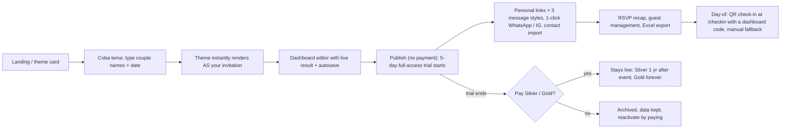

# Enviory (ENV): Tier A teardown dossier

> **Status: v1, session 04 (2026-10-29).** Sections 1–3 and 5–12 have usable evidence. **Section 4 measurements are provisional:** the six captures C-ENV-101…106 hit the vendor's *preview wrapper* (see §4.1). Guest-page re-captures C-ENV-111…116 are queued (`04-template-benchmarks/queues/queue-tier-a-3.tsv`). Not yet done: the vendor's "8-step flow" page, user complaints (§10), and the `/tema` full catalog crawl.
>
> Evidence used: **S-ENV-001**, the public homepage read as a visitor (WebFetch, 2026-10-29 ≈ 11:19 WIB). **S-ENV-002**, robots.txt plus one plain fetch of the official full-preview demo (2026-10-29 ≈ 11:20 WIB): it returned a Cloudflare JS challenge, and nothing was bypassed (R1). **D-ENV**, demo discovery from session 02. **C-ENV-101…106**, batch-A captures (2026-10-29 10:37–10:49 WIB). Plus the Phase 2 longlist row (probe 2026-10-29). All prices are IDR as displayed on 2026-10-29.

## 1. Snapshot
| Item | Finding | Tag |
|---|---|---|
| Positioning | "Undangan digital & website pernikahan premium — proses instan". The marketing sells motion as a three-act stage: *Reveal beauty* (cover, guest name from the personal link, music starts), *Flow through story* (story, gallery, rundown and countdown animate on scroll), *Fade into memory* (RSVP, wishes, check-in QR) | [OBSERVED S-ENV-001] |
| Segment | Premium **weddings only**: all 18 homepage themes are wedding themes. No khitanan/aqiqah/birthday/corporate themes are listed | [OBSERVED S-ENV-001] |
| Languages | Indonesian UI and copy, with English taglines ("Every love story deserves a beautiful beginning") | [OBSERVED S-ENV-001] |
| Company signals | Designer-led studio brand (one designer credited on the homepage); WhatsApp + email CS, Mon–Sat 10:00–21:00 WIB; business address in Kab. Bekasi; done-for-you option ("minta undangan dibuatkan oleh admin, konsultasi gratis") | [OBSERVED S-ENV-001] |
| Size | "8,8 juta pengguna" | [CLAIMED, longlist probe 2026-10-29] |
| Traffic / installs | Not in the Tranco top 1M; no Play Store app found | [ESTIMATE Tranco, probe 2026-10-29] / [OBSERVED probe] |
| Plans | **Free trial**: 5 days of full access, starting at the first publish, once per account. On expiry the invitation is archived and data + RSVPs are kept. **Silver Rp 75.000** (struck-through Rp 99.000): 2 theme variants, active 1 year after the event. **Gold Rp 125.000** (struck-through Rp 199.000): 3 variants, active "selamanya" (while the service runs, T&C apply), priority support. Both are one-off per invitation with unlimited guests | [OBSERVED S-ENV-001] |
| Included in both plans | Personal guest links + 3 message styles + 1-click WhatsApp/Instagram share, RSVP + guestbook, QR check-in, gallery up to **10 photos**, map, rundown, love story, dress code, countdown, music (catalog + MP3 upload), digital envelope (**2 accounts + QR**), visit analytics, contact import, Excel (.xlsx) export | [OBSERVED S-ENV-001] |
| Reseller | Prepaid quota usable as balance for Silver or Gold: 10 = Rp 380.000 (Rp 38k each), 25 = Rp 790.000 (Rp 31.6k), 50 = Rp 1.300.000 (Rp 26k). Resale floor Rp 75.000; quota never expires; custom domain is an add-on (contact sales). Separate referral program with a **35 %** commission | [OBSERVED S-ENV-001] |
| Payments / refund | QRIS, GoPay/OVO/DANA/LinkAja, bank transfer/VA and cards via **Midtrans**. 100 % refund up to 7 days after publishing | [OBSERVED S-ENV-001] |
| Watermark | None mentioned in plans or FAQ | [UNKNOWN] |
| Catalog | **18 themes** on the homepage: romantis 6 (Rocaille, Velora·Linear, Hydrangea, Velora, Aurelia, Noctivelle), editorial 9 (Cartouche, Vellum, Foil Press, Chromatype Soft, Loam, Way Lantern, Atelier Archive, Observatory, Unspoken Letter), sinematik 2 (Cinema, Noir Sands), interaktif 1 (Way Lantern Interaktif: navigation by a miniature globe). Two are marked "Populer" (Hydrangea, Noir Sands). Every theme is included in every plan, with no per-template price. Release cadence unknown | [OBSERVED S-ENV-001] / cadence [UNKNOWN] |

## 2. Funnel and flows

- Steps to a shareable link: **4** (pick theme, type names, fill details, publish). There is no payment wall before publishing, and an "instant, no queue" promise. [CLAIMED S-ENV-001]
- Time to publish: "instan" for a named draft, and "biasanya 15–30 menit" for full details, which can be done in parts thanks to autosave. [CLAIMED S-ENV-001]
- Friction we can infer: the trial clock starts at publish, so hosts may delay sharing; the 10-photo gallery cap; archive on trial expiry (loss aversion is part of the design). [INFERRED, medium]
- The vendor's "delapan langkah" flow page and the creator flow itself were not observed: no signup (R1 allows a throwaway free tier only after a ToS check, which has not been done). [UNKNOWN]

## 3. Builder / editor
| Aspect | Finding | Tag |
|---|---|---|
| Model | Form-based dashboard with a live result ("setiap perubahan langsung terlihat"); theme changeable at any time | [CLAIMED S-ENV-001] |
| Autosave | Yes ("setiap perubahan tersimpan otomatis") | [CLAIMED S-ENV-001] |
| Theme variants | One invitation, one base link, **2–3 visual variants** (e.g. formal for family, casual for friends) sharing the same event data | [CLAIMED S-ENV-001] |
| Media constraints | Gallery ≤ 10 photos; music from a catalog or an uploaded MP3 | [CLAIMED S-ENV-001] |
| Guests | Contact import, personal links, 3 message templates, Excel export | [CLAIMED S-ENV-001] |
| Validation, undo, AI helpers | Not observed | [UNKNOWN] |

## 4. Guest-facing invitation deep dive
### 4.1 What was actually measured (methodology finding)
The official "Lihat demo" links (`/tema/<slug>/pratinjau`) are a **preview wrapper**, not the guest page. In all six captures the top document has 126–129 DOM nodes, 4 SVGs, 0 images and a "Ganti tema" button, and the demo invitation sits in 1–2 same-origin iframes [OBSERVED C-ENV-101…106]. The guest-facing page is the vendor's "Full Preview" link, `/<demo-slug>?tpl=<theme>` [OBSERVED D-ENV]. So:
- The Lighthouse numbers below cover **wrapper + iframe load**. They are useful as an upper bound, but are **not** parity thresholds until C-ENV-111…116 land.
- The structure detector only saw the wrapper, so section order, cover, audio and RSVP are not measured yet.
- Protocol consequence (adopted in session 04): if the top document has fewer than 200 DOM nodes and a same-origin iframe, the capture is flagged `wrapper` and re-targeted to the iframe's official URL.

### 4.2 Measurements (provisional, wrapper + iframe; Lighthouse 12 mobile, simulate Slow 4G / 4× CPU, 412×915)
| Capture | Theme | Perf | A11y | BP | SEO | LCP s | TBT ms | CLS | CDP KB (img) | Requests |
|---|---|---|---|---|---|---|---|---|---|---|
| C-ENV-101 | Hydrangea | 61 | 100 | 79 | 92 | 2.92 | 3,927 | 0.058 | 1,863 (922) | 75 |
| C-ENV-102 | Rocaille | 57 | 100 | 79 | 92 | 3.44 | 5,286 | 0.058 | 7,773 (6,849) | 69 |
| C-ENV-103 | Velora·Linear | 64 | 100 | 79 | 92 | 2.11 | 5,829 | 0.058 | 1,529 (608) | 75 |
| C-ENV-104 | Velora | 59 | 100 | 79 | 92 | 3.14 | 4,776 | 0.058 | 1,338 (418) | 75 |
| C-ENV-105 | Aurelia | 57 | 100 | 79 | 92 | 3.56 | 4,334 | 0.058 | 2,489 (1,572) | 70 |
| C-ENV-106 | Noctivelle | 57 | 100 | 79 | 92 | 3.60 | 4,823 | 0.058 | 2,553 (1,639) | 72 |
| **Median** | | **58** | 100 | 79 | 92 | **3.29** | **4,800** | 0.058 | 2,009 | 73.5 |

[OBSERVED C-ENV-101…106]. CDP bytes are unthrottled cold-cache transfer for the whole session. Lighthouse transfer is about 1.76–1.77 MB in every run, because Lighthouse stops at load while CDP also counts lazy media.
- **JS is constant at about 645 KB over 16 script requests** (one shared Next.js bundle per page, Turbopack chunk names), with about 170–176 KB of it unused. [OBSERVED]
- **Google Tag Manager (181 KB) is the largest single blocking source: 2.8–4.4 s of main-thread blocking per run.** [OBSERVED LH third-party summary]
- About 985 KB per run is attributed to Cloudflare-served resources with no blocking time (the image/media path). [OBSERVED]; that it is R2/Images is [INFERRED, medium]
- The identical CLS of 0.058 across six themes points to the shared shell, not the theme. [INFERRED, high]
- Fonts: Playfair Display detected; 2 self-hosted `next/font` files (~35–39 KB each), a self-hosted `normal.woff2`, and 2–4 Google Fonts files. No `font-display` issues. [OBSERVED] Licenses: Playfair Display is OFL [INFERRED, high: Google Fonts]; the self-hosted faces are [UNKNOWN].
- Good practice observed: `<html lang="id">`, zoom allowed (`maximum-scale=5`), OG image/title/description, `prefers-reduced-motion` CSS present, and 0 automated a11y failures on the wrapper. [OBSERVED]
- Caveat: the platform dev server was running on the capture host. TBT is directionally right but should be re-checked before use as a threshold (protocol §6).
- Comparison with our own guest page under the same protocol: C-INV-001 scores Perf 94, LCP 2.60 s, TBT 186 ms, 323 KB over 19 requests [OBSERVED C-INV-001]. That is about 5× lighter, and TBT is about 25× lower even allowing for the wrapper caveat.

### 4.3 Guest experience as described by the vendor (to be verified by C-ENV-111…116)
Cover addressed to the guest's name from the personal link → music starts on open → story, gallery, rundown and countdown animate on scroll → RSVP (status, pax, message) → wishes → the guest receives a check-in QR on the page → digital envelope (2 accounts + QR), map, dress code. Invitation pages carry `noindex`. Link previews still render in WhatsApp/Instagram. [CLAIMED S-ENV-001]

## 5. Tech fingerprint
| Layer | Finding | Confidence |
|---|---|---|
| Front end | Next.js (REA `next-runtime` fingerprint), React implied, **Turbopack** build (`turbopack-*.js` chunks), Tailwind | high [OBSERVED C-ENV-101…106] |
| Edge / CDN | Cloudflare (`server: cloudflare`, HTTP/3) | high [OBSERVED S-ENV-002, C-ENV-*] |
| Origin hosting | Unknown behind Cloudflare | [UNKNOWN] |
| Analytics | Google Tag Manager on preview pages | high [OBSERVED] |
| Payments | Midtrans | high [OBSERVED S-ENV-001 FAQ; longlist stack hint] |
| Bot protection | Cloudflare managed JS challenge for non-browser clients on the demo guest page (HTTP 403 "Just a moment…"); a Turnstile/challenge entity seen in C-ENV-102 | high [OBSERVED S-ENV-002, C-ENV-102] |
| AI-crawler policy | robots.txt: `*` Allow, but **Disallow: /** for AI training crawlers (GPTBot, ClaudeBot, CCBot, Google-Extended, Bytespider, Amazonbot, Applebot-Extended, anthropic-ai, cohere-ai, meta-externalagent, …). User-initiated agents are not blocked, so our observation is allowed (session 03 rule) | [OBSERVED S-ENV-002] |
| WhatsApp | 1-click share + message templates; no official-API blast claimed | [CLAIMED S-ENV-001] |
| Storage / images | Cloudflare-served media | medium [INFERRED] |

## 6. Public API surface
No endpoints were observed from normal page use. REA bundle analysis returned only low-confidence endpoint candidates, and RSVP/wishes were not submitted (R1). See `api-observed.md`. Revisit after C-ENV-111…116.

## 7. Mobile app
None. Hosts check guests in on the web at `enviory.com/checkin` with a dashboard code (staff need internet). [OBSERVED probe 2026-10-29: no Play listing] / [CLAIMED S-ENV-001]

## 8. Growth and SEO
- Theme pages per theme (`/tema/<slug>`, `/tema/<slug>/pratinjau`) with keyword titles ("Pratinjau Tema Hydrangea — Undangan Digital | Enviory"); homepage title targets "Undangan Digital & Website Pernikahan Premium". [OBSERVED D-ENV, C-ENV-*]
- Social proof: three named testimonials, each tied to a theme and city; a "Showcase & Partner" page (`/showcase`, not opened: it may list real customer invitations, R1). [OBSERVED S-ENV-001, D-ENV]
- Channels: reseller quota program (WO, vendors, freelancers), 35 % referral, WhatsApp CS, done-for-you creation. [OBSERVED S-ENV-001]
- Guest pages are `noindex` (privacy framing in the FAQ), so no watermark-backlink loop was observed. [CLAIMED S-ENV-001] / [UNKNOWN] watermark
- Opts out of AI training crawlers (see §5).

## 9. Monetization and pricing psychology
- **Reverse trial after publish**: full features for 5 days once guests already have the link, then archive. Loss aversion does the selling, and "tanpa kartu kredit — publikasikan dulu, bayar kalau sudah puas" removes up-front risk. [OBSERVED S-ENV-001] / effect [INFERRED, high]
- **Anchor pricing**: struck-through Rp 99k → 75k and Rp 199k → 125k. [OBSERVED]
- **Permanence as the upsell**: Silver archives 1 year after the event, Gold is "forever"; variants (2 vs 3) are the second differentiator. Every feature is in both tiers, so the price ladder is about time and style, not capability. [OBSERVED] / [INFERRED, high]
- **Reseller economics**: Rp 26k–38k cost against a Rp 75k resale floor, i.e. a 49–65 % gross margin for the reseller at the floor price; the floor protects retail pricing. [OBSERVED prices] / margin computed
- 7-day refund and no subscription. [OBSERVED]

## 10. Strengths, weaknesses, complaints
- Strengths: coherent premium art direction (18 named, mood-scripted themes); name-first instant preview; reverse trial; QR check-in in every tier including the trial; per-audience variants on one link; full Midtrans rail coverage; xlsx export; a11y 100 and reduced-motion CSS on the wrapper. [OBSERVED/CLAIMED as tagged above]
- Weaknesses: heavy main thread (≈ 645 KB JS + GTM; provisional TBT ≈ 4.8 s median); image-heavy themes (Rocaille 6.8 MB of images unthrottled); 10-photo gallery cap; weddings only; no official WhatsApp blast; digital envelope capped at 2 accounts; Cloudflare challenges can block non-browser clients, so in-app-browser behaviour needs verification (protocol §3). [OBSERVED/INFERRED]
- User complaints: **not researched yet** (there is no Play listing; X/forums are next). [UNKNOWN]

## 11. Patterns to learn from (principle level, R2: no visual cloning)
| Steal-worthy principle | Avoid | Our counter-move |
|---|---|---|
| Name-first instant preview: the catalog renders *your* names and date before signup | GTM / marketing tags on guest pages (seconds of TBT on mid-range Android) | Harness gate: no third-party script on guest pages outside an allowlist; perf budget per tier |
| Reverse trial that starts at publish | Shipping the whole app bundle to every guest page | Static or lightly hydrated guest pages; motion as lazy islands (Phase 7/8) |
| One link, 2–3 audience variants (family formal / friends casual) | Multi-MB texture images | Image budget gate (AVIF/WebP, responsive sizes) |
| Every theme sold through a short mood scene (place, light, material) | Weddings-only catalog | Multi-niche playbooks (khitanan, aqiqah, corporate) with the same craft |
| Three-act motion vocabulary (reveal → flow → memory) | Gallery caps that frustrate hosts | Motion presets named by act in `invitesion-motion-system`, with reduced-motion fallbacks |
| QR check-in and xlsx export in every tier, including the trial | Bot challenges that may break link previews or in-app browsers | Performance + reliability as the brand promise (C-INV-001 is already 323 KB) |

## 12. Mapping to our codebase (F-IDs from `01-codebase-audit/feature-inventory.csv`, M-IDs from `module-map.md`)
| Enviory capability | Our feature (status today) | Modules | Gap type |
|---|---|---|---|
| Personal guest link + name on cover | F-001 full, F-002 full | M-012, M-013 | parity |
| Cover open + music start | F-003 missing, F-004 config-only | M-013 | missing |
| Countdown | F-005 missing | M-013 | missing |
| Love story, wishes wall | F-007 full, F-019 full | M-013, M-014 | parity |
| Gallery (≤ 10 photos) | F-008 partial | M-013, M-027 | partial |
| Rundown / multi-event, maps, dress code | F-010 partial, F-011 partial, F-025 config-only | M-009, M-013 | partial |
| RSVP status + pax + message | F-013 full, F-015 partial, F-014 missing | M-014 | partial |
| Digital envelope (2 accounts + QR) | F-021 partial, F-022 missing | M-013 | partial |
| Guest check-in QR + scanner (+ manual) | F-026 missing, F-055 missing, F-056 full | M-019, M-021 | missing |
| Contact import, xlsx export | F-046 missing, F-047 full (CSV only) | M-019, M-020 | partial |
| Message templates + 1-click WhatsApp/IG share | F-050 partial, F-027 missing | M-019 | partial |
| Visit analytics | F-059 partial | M-021 | partial |
| Live result while editing, autosave | F-069 missing, F-070 missing | M-018 | missing |
| Music catalog + MP3 upload | F-072 missing | M-027, M-028 | missing |
| Switch theme any time | F-074 partial | M-006, M-018 | partial |
| **Per-audience theme variants on one link** | no F-ID yet → add to the Phase 5 matrix | M-006, M-012, M-013 | missing (new) |
| **Reverse trial (publish first, pay later)** | no F-ID; our publish gate F-075 requires payment first | M-011, M-024 | missing (new, strategic) |
| Active period (Silver 1 yr / Gold forever) | F-064 full (12 months) | M-011 | partial |
| Custom domain add-on | F-066 missing | M-032 | missing |
| Reseller quota, referral 35 % | F-079 missing, F-080 missing | M-024, M-025, M-031 | missing |
| QRIS / e-wallet / VA / cards via Midtrans | F-081 partial, F-082 missing | M-025, M-026 | partial |
| Cinematic motion, interactive (globe) theme | F-037 missing, F-036 missing, F-038 missing | M-007, M-013 | missing |
| Price per invitation | F-085: ours Rp 149k / Rp 299k vs ENV Rp 75k / Rp 125k (ours is about 2× ENV, and ENV includes QR check-in and music upload that we lack) | M-003 | packaging question for Phase 5 |
| Guest-page weight / TBT | C-INV-001: 323 KB, TBT 186 ms | M-012, M-013 | **we lead** (provisional) |
| Livestream link, verse block, multi-niche configs | F-024 full, F-029 full, F-039/F-040 config-only | M-009, M-013 | we lead (ENV shows none) |

Changes since the previous version: first version.
