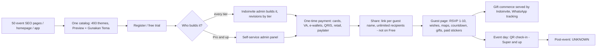

# Indoinvite (IDI): Tier A teardown dossier

> **Status: v1, session 08 (2026-11-03). No guest-page measurement.** Evidence level **C** (marketing, pricing, catalog structure, store metadata and non-identifying facts from one real-event page; `../../_handoff/review-20261101.md` §2). Indoinvite publishes **no safe placeholder demo**: its `/preview/contoh-undangan-online-*` pages are SEO articles with a theme catalog (D-020), the catalog "Preview" links open sample accounts that render **real events** (S-IDI-003), customer showcases are out of scope (R1), and the video samples are JavaScript modals (S-IDI-004). This dossier therefore exists under **ADR-W1** (`../../09-masterplan/12-decision-log.md`) and reports **no guest-page performance, structure or interaction numbers**. C-IDI-101…107 measured the catalog page; `benchmark-exclusions.csv` keeps them out of every aggregate (`scope=all`, `page_class=catalog`), and `dossier-digest.py` masks them.
>
> Evidence used (times UTC): **D-IDI** discovery (2026-10-29: 50 event SEO pages + 3 other demo-shaped links, 35 customer-showcase links dropped); longlist row (Play listing + homepage probe 2026-10-29, Tranco 2026-10-27); **C-IDI-101…107** (catalog pages; structure facts only, from the s07 node-map analysis); **S-IDI-001** `robots.txt`, **S-IDI-002** wedding catalog page, **S-IDI-003** one catalog preview (real event, stopped at D-008, non-identifying facts only) (2026-11-01 17:30Z); **S-IDI-004** `/contoh/undangan-online-video`, **S-IDI-005** `/contoh/undangan-jasa-desain` (2026-11-03 16:35Z); **S-IDI-006** `/harga` (2026-11-03 16:39Z, one plain fetch, Android UA, HTTP 200, 342,849 bytes, no challenge). Private page copy: `$INVITESION_PRIVATE_DIR/pages/indoinvite/harga.html` (not committed).
>
> **Privacy:** no account id, preview URL, name, handle or phone number from the catalog's sample accounts is recorded anywhere (D-020); those previews are never opened again (brief 05 §8). No account, form, checkout, RSVP, wish, sticker or gift purchase was used.

## 1. Snapshot
| Item | Finding | Evidence |
|---|---|---|
| Positioning | Mass-market digital invitations for **every life event**, built **for** the customer by staff ("Dibuatin Admin Terima Beres") or by the customer from the Pro tier up; "Buat Undangan Gratis Hanya 5 Menit"; "sekali bayar, tanpa masa aktif, sebar ke tamu tanpa batas" | [OBSERVED S-IDI-006] / claims [CLAIMED] |
| Segment breadth | 50 event-type SEO pages: Islamic (aqiqah, khitanan, tahlilan, haul, pengajian, halal bi halal, bukber, umroh), Christian and Catholic (baptis, komuni suci pertama, misa syukur, natal, peneguhan sidi, pentahbisan), Balinese Hindu (mepandes, melaspas, ngenteg linggih, pitra yadnya, menek kelih), further ceremonies such as adhi thiruvila and pembeatan, Javanese life cycle (tedhak siten, 3 and 7 bulanan), mourning (hari kematian, 40 and 100 hari), business (grand opening, office and house openings, meetings, fashion show, dinner), school (wisuda, farewell, thesis exam), social (arisan, reunion, birthday, anniversary, donation) and even a divorce-hearing summons | [OBSERVED D-IDI slugs] |
| Size signals | Android `com.indoinvite.apps` 500K+ installs, 4.9★, updated 2026-10-14; Tranco 195,168; "1,4 juta undangan, 4,5 juta tamu"; press logos Liputan6, Merdeka.com, Kontan.co.id | [ESTIMATE Play 2026-10-29, Tranco 2026-10-27] / [CLAIMED homepage 2026-10-29, S-IDI-006] |
| Pricing, one-time ("Satuan", IDR, 2026-11-03) | Free **0** · Basic **39,000** · Klasik **59,000** · Pro **69,000** · Super **99,000** · Premium **119,000**; no strikethrough anchors | [OBSERVED S-IDI-006] |
| Pricing, subscription ("Berlangganan") | 1 month **400,000** · 3 months **1,150,000** · 6 months **2,300,000** · 1 year **4,600,000** (a flat Rp 383,333 per month from 3 months on, 4.2 % below the monthly rate): many invitations, Premium features, print export, landing-page option, custom domain; invitations active for the term | [OBSERVED S-IDI-006] / per-month figures derived |
| Free tier | "Uji coba gratis tanpa batasan waktu": no time limit, but **"Bisa Disebar" (sharing) is excluded**, plus no music and no gallery, so the free invitation is a non-shareable trial | [OBSERVED S-IDI-006] / interpretation [INFERRED, high] |
| Catalog | Wedding catalog page lists **493 entries** (theme ids 2–518, every entry badged "New"); largest families Slide 86, Customs 28, Happy 28, Simple 22, Baby 22, Elegan 20, Luxury 19, Signature 19; the same catalog serves every event type; **"Akses Seluruh Tema" on every tier** (no theme gating). The homepage claims 300–400 themes | [OBSERVED S-IDI-002, S-IDI-006] / [CLAIMED homepage] |
| Payment methods (logos) | Cards (Visa, Mastercard, JCB); bank virtual accounts (BCA, BNI, BRI, Mandiri, Permata); e-wallets (OVO, DANA, a `link` logo = LinkAja); QRIS; retail outlets (Alfamart, Alfamidi, Indomaret); paylater (Kredivo) | [OBSERVED S-IDI-006] / LinkAja [INFERRED, high] |
| Watermark | [UNKNOWN] (no guest page measured) | — |

### 1.1 Tier gating (26 feature rows per one-time card; green/red icons on S-IDI-006)
| Threshold | Features (as labelled) |
|---|---|
| Every tier, Free included | Done-for-you by admin; access to all themes; change guest name; no expiry; RSVP and wishes; maps location; unlimited recipients; countdown and save-to-calendar; physical gift drop-off ("Titip Kado Fisik"); greeting stickers ("Stiker Ucapan"); gallery **0 / 0 / 0 / 10 / 15 / 20 HD** photos; revisions **"Limit" / 2× / 3× / unlimited** (Free / Basic / Klasik / Pro+) |
| From Basic (39k) | Sharing ("Bisa Disebar") |
| From Klasik (59k) | Music |
| From Pro (69k) | Bank account for gifts ("Rekening Titip Hadiah"); **self-service admin panel** ("Buat/Edit Sendiri") |
| From Super (99k) | Streaming and video link; auto scroll; **QR check-in for guests** |
| Premium only (119k) | Custom music; love story; embedded Google Maps; video/streaming; reply to wishes; font style; theme colour |

The package subtitles state what is missing ("Tanpa musik, titip hadiah dan foto", "Tanpa galery dan titip hadiah"), so the ladder sells by removal. [OBSERVED S-IDI-006]

## 2. Funnel and flows

- Everything up to the catalog is [OBSERVED D-IDI, S-IDI-002, S-IDI-006]; steps behind registration are [CLAIMED] from the pricing card labels (no signup, R1). Time to publish: "5 menit" [CLAIMED]; observed [UNKNOWN].
- **Service-first production:** staff build the invitation on every tier, and the customer only edits it themselves from Pro (Rp 69,000). Revisions are therefore a tier feature (Free "Limit", Basic 2×, Klasik 3×, Pro+ unlimited). [OBSERVED S-IDI-006] / staffing model [INFERRED, high]
- **Guest personalization:** each catalog preview link carries a guest parameter (`kpd`, "kepada"), and every tier lists "Ubah Nama Tamu" and unlimited recipients. [OBSERVED S-IDI-002 URL shape, S-IDI-006]
- **Host day-of:** "QRCode Check-in Tamu" from Super; robots.txt disallows `/pernikahan-qr/`, plausibly that flow's route. [OBSERVED S-IDI-006, S-IDI-001] / route meaning [INFERRED, medium]
- **Reseller / power user:** the subscription is the multi-invitation route (custom domain, landing-page option, print export). White-label branding, client management and payouts [UNKNOWN].

## 3. Builder / editor
- **Two modes:** done-for-you by Indoinvite admins (all tiers) and a self-service "Panel Admin" (Pro+). [OBSERVED S-IDI-006]
- **Content and theme are decoupled:** one sample account per event type renders under any theme id, so a theme is a parameter over the same data, consistent with "access to all themes" on every tier. [OBSERVED S-IDI-002] / free theme switching [INFERRED, high]
- **Customization gates:** music from Klasik, custom music, font style and theme colour only on Premium; gallery 10/15/20 photos (Pro/Super/Premium, "HD" on Premium). [OBSERVED S-IDI-006]
- **Adjacent tools:** an AI copy tool (`/undangan-gpt`) and an image-style converter linked from the video page; video invitations (117 samples behind modals); a design service for 2D invitations and logos from Rp 50,000. [OBSERVED links S-IDI-004, S-IDI-005] / behaviour [UNKNOWN]
- Live preview, autosave, undo, media size limits, music library: [UNKNOWN] (editor not observed).

## 4. Guest invitation: no guest-page measurement
### 4.1 Why nothing is measured (ADR-W1)
- 0 valid guest-page captures. The three demo-shaped public surfaces are an SEO catalog (D-020), account previews that render real events (S-IDI-003, never revisited), and video modals (S-IDI-004). Customer showcases (`/hasil/*?contoh`) were dropped in s04 (R1).
- C-IDI-101…107 measure the **catalog page**; their Lighthouse values are not guest-page benchmarks and are not reported here (register rows, masked by `dossier-digest.py`; C-IDI-104 also failed Lighthouse).
- **Confidence:** every IDI guest-experience statement below is a vendor claim or a single-page observation. Conclusions about IDI guest-page quality are **low confidence** (ADR-W1 "Affected conclusions").

### 4.2 The catalog page (vendor SEO surface, not a guest page)
- Layout: an SEO article (0–≈ 4,000 px) followed by all 493 numbered themes, each with a thumbnail, "Preview" and "Gunakan Tema"; page height ≈ 96,600–96,940 px and ≈ 36,200 DOM nodes; the wedding catalog's HTML alone is 2.36 MB. [OBSERVED C-IDI-105 node map, S-IDI-002]
- Thumbnails come from Contabo object storage, from a bucket whose name indicates staging. [OBSERVED S-IDI-002] / staging assets in production [INFERRED, medium]
- The `rsvp`/`wishes`/`gift` feature flags on these captures come from article and catalog text, not from an invitation. [INFERRED, s07]

### 4.3 Non-identifying facts from one real-event page (S-IDI-003; one theme, one account)
- **Guest-side gift commerce:** 23 gift items labelled "Dilayani Indoinvite" with "N Terkirim" counters and a shipping discount, Rp 20,000–1,258,500, WhatsApp order tracking, and an option to hide the sender's name; a "JASTIO" gift drop-off service. [OBSERVED]
- **Paid greeting stickers:** Rose Rp 37,500, Special Rp 51,000, Star Rp 58,500, bought by guests. Revenue split with the host [UNKNOWN]. [OBSERVED]
- Payments: Xendit and QRIS markers. RSVP accepts 1–10 guests. [OBSERVED]
- Page build: 568 KB HTML including 207 KB of inline script, 94 `` (23 lazy), 7 iframes; jQuery, Bootstrap, AOS, GSAP + ScrollTrigger, Owl Carousel, Magnific Popup, Stellar, Waypoints. [OBSERVED] Generalizing to the catalog's other 492 themes: [UNKNOWN].

### 4.4 Guest features by tier (claimed, S-IDI-006)
RSVP and wishes, maps location, countdown and save-to-calendar, guest name in the link, physical gift drop-off and greeting stickers exist on every tier; bank-account gifts from Pro; streaming/video link, auto scroll and QR check-in from Super; love story, embedded maps, video/streaming, reply to wishes, font style, theme colour and custom music on Premium. Cover gate, audio behaviour, motion, accessibility, localization, long names and in-app browsers: [UNKNOWN].

### 4.5 Against our own guest page
No performance or accessibility comparison is possible (IDI unmeasured). Feature-level comparison is in §12; price comparison in §9.

## 5. Tech fingerprint
| Layer | Finding | Confidence |
|---|---|---|
| Backend | Laravel (`laravel_session`, `XSRF-TOKEN` cookies) on nginx 1.18 / Ubuntu | high [OBSERVED S-IDI-003] |
| Guest page (one) | jQuery + Bootstrap + AOS + GSAP/ScrollTrigger + Owl + Magnific Popup + Stellar + Waypoints | medium (one page) [OBSERVED S-IDI-003] |
| Marketing pages | jQuery, Bootstrap, Splide carousel; Google tag (`gtag`, GTM) | high [OBSERVED S-IDI-006; longlist stack hints] |
| Payments | Xendit markers + QRIS on a guest page; method logos match a Xendit-style aggregator set | high for presence [OBSERVED S-IDI-003] / gateway for checkout [INFERRED, medium] |
| Storage / edge | Contabo object storage (thumbnails); Cloudflare | high [OBSERVED S-IDI-002; longlist] |
| WhatsApp | `wa.me` links on marketing; WhatsApp tracking for gift orders | high [OBSERVED S-IDI-006, S-IDI-003] |
| Bot protection | No challenge on six plain fetches | [OBSERVED S-IDI-001…006] |

## 6. Public API surface
No endpoints observed: all reads were plain page fetches and nothing was called directly. robots.txt disallows `/cgi-bin/`, `/pernikahan-qr/` and `/admin/` for every agent, and a comment invites AI agents to read public pages. [OBSERVED S-IDI-001] See `api-observed.md`.

## 7. Mobile app
Android `com.indoinvite.apps`: 500K+ installs, 4.9★, updated 2026-10-14 [ESTIMATE Play listing 2026-10-29]. Not decompiled (D-013: no redistributable APK; no JDK 17 + JADX here), so permissions, SDKs and screens are [UNKNOWN]. No App Store link on the pricing page; iOS [UNKNOWN].

## 8. Growth and SEO
- **Programmatic event pages:** 50 `/preview/contoh-undangan-online-<event>` pages, each an article plus the full catalog, rank for "contoh undangan online <event>" queries across faiths and regions. [OBSERVED D-IDI, S-IDI-002] / ranking intent [INFERRED, high]
- **Price-led titles:** "Harga Undangan Digital Mulai Rp39.000 Tanpa Masa Aktif". [OBSERVED S-IDI-006]
- **AI-search openness:** robots.txt names AI agents only to keep the same three folders private and invites them to read public pages. [OBSERVED S-IDI-001]
- **Every guest visit is a storefront** (gifts, stickers), and every sample preview doubles as social proof. [OBSERVED S-IDI-003] / [INFERRED, high]
- Channels: Android app, Facebook, Instagram, TikTok, Telegram, press logos, WhatsApp CTA. [OBSERVED S-IDI-006]

## 9. Monetization and pricing psychology
- **Lowest entry in the set:** Rp 39,000 one-time, no expiry, unlimited recipients; the whole one-time ladder (Rp 39–119k) sits **below our cheapest package** (F-085, Rp 149,000). [OBSERVED S-IDI-006; `lib/pricing.ts` per F-085]
- **Share-gated free tier:** creation is free, sharing is paid, so conversion happens at the moment of sending. [OBSERVED] / [INFERRED, high]
- **Sell by removal:** subtitles name what each tier lacks; the steps are +51 %, +17 %, +43 %, +20 %. [OBSERVED / derived]
- **Two-sided revenue:** hosts pay for the tier; guests pay for stickers and vendor-fulfilled gifts. [OBSERVED S-IDI-003, one page] / margin [UNKNOWN]
- **Service as default, self-service as upsell:** the reverse of most DIY builders. [OBSERVED S-IDI-006]
- **Subscription for volume:** Rp 400,000 per month beats four Premium invitations a month (4 × 119,000 = 476,000). [derived from S-IDI-006]
- **No fake discounts:** no strikethrough list prices (contrast: Viding shows 6–39 % "off" on every package). [OBSERVED]
- **Payment breadth:** cards, VAs, e-wallets, QRIS, retail outlets and paylater remove checkout friction for unbanked buyers. [OBSERVED]

## 10. Strengths, weaknesses, public complaints
- **Strengths:** price leadership; the broadest event and faith coverage observed; done-for-you production at mass-market prices; all themes on every tier; guest-side revenue; broad payment methods; a well-rated Android app with 500K+ installs; a large programmatic SEO footprint. [OBSERVED/ESTIMATE as tagged]
- **Weaknesses:** sample previews expose **real customers' events** (names, parents, organiser contacts) as public examples [OBSERVED S-IDI-003]; catalog pages of 2.36 MB HTML and ≈ 36,200 nodes on one ≈ 97,000 px page [OBSERVED]; a legacy jQuery stack on the one guest page seen [OBSERVED]; theme-count claims disagree with the catalog (300–400 vs 493) [OBSERVED]; self-editing locked below Pro [OBSERVED]; thumbnails from a staging-named bucket [INFERRED, medium].
- **Public complaints (s14, S-IDI-008, paraphrased, no names):** Google Play listing 4.8★ from 3.42K reviews (500K+ installs). The three reviews the static listing shows first (Jul–Oct 2026, all positive) praise the theme variety, easy WhatsApp sharing, fast loading, a responsive admin with fast production, and the absence of an active-period limit. No complaint is visible in that sample; the full list needs Play's dynamic loader, which this research does not use, so complaint themes stay [UNKNOWN]. Three first-shown reviews are not a representative sample. [OBSERVED listing, CLAIMED by reviewers]

## 11. Patterns to learn, to avoid, and our counter-move
| Learn (principle) | Avoid | Our counter-move |
|---|---|---|
| One theme catalog for every event type, plus programmatic pages per event and faith | One unpaginated page with every theme (≈ 36k nodes) | Keep the filterable catalog (F-093) and the programmatic pages (F-092), extend event and faith coverage only with verified content |
| Content decoupled from theme, so switching costs nothing | Re-charging per theme switch (our F-074) | Free theme switching within a paid invitation |
| Charge at the moment of sharing | Paywalls that hide the product | Free draft and private preview, paid publish (F-075 already gates publishing) |
| Guest-side gifting as part of the invitation | Selling to guests without host opt-in; opaque margins | Host-enabled QRIS gift (F-022) and registry (F-023) with fees shown to the host |
| Staffed "we build it for you" option | Real customers' events as public samples | Placeholder-only previews with fictional data (M-005); assisted setup as an add-on, not the default |
| Broad local payment methods | — | Acquirer choice for QRIS checkout (F-081) covering VA and e-wallets |

## 12. Mapping to our modules and features
| Indoinvite capability | Ours | Modules | Verdict |
|---|---|---|---|
| Countdown, save to calendar | F-005, F-012 missing | M-013 | gap |
| RSVP (1–10) and wishes | F-013 full, F-015 partial, F-019 full | M-014 | parity on basics |
| Reply to wishes, moderation | F-060 missing, F-020 config-only | M-019 | gap |
| Maps: location link / embed | F-011 partial (link only) | M-013 | parity on link, gap on embed |
| Guest name in the link, unlimited recipients | personal links (F-013), F-050 partial | M-019 | parity |
| Gallery 10–20, music, custom music | F-008 partial, F-004 config-only, F-072 missing | M-013, M-027 | gap |
| Love story, streaming link | F-007 full, F-024 full | M-013 | parity |
| Video / streaming embed, video invitations | F-009 missing, F-089 missing | M-013, M-027 | gap |
| Bank-account gifts, physical gift drop-off | F-021 partial, F-023 partial | M-009, M-013 | partial |
| Vendor-fulfilled gift commerce, paid greeting stickers | none | — | not built; candidate for ideation with host opt-in and ethics review |
| QR check-in | F-026, F-055 missing | M-019 | gap |
| Font style and theme colour | palette only (F-036 missing) | M-013 | partial |
| All themes on every tier, free switching | F-074 partial (re-pay per theme) | M-018, M-025 | gap |
| Revisions by tier | F-063 config-only | M-035 | gap |
| Custom domain, print export, multi-invitation subscription | F-066, F-090, F-079 missing | M-035 | gap |
| AI copy tool | F-088 missing | M-040 | gap |
| Programmatic event pages and catalog | F-092 full (~90 pages), F-093 full (27 categories) | M-002, M-004 | parity in kind; IDI broader in faiths and life events |
| Local payment breadth | F-081 partial (acquirer not chosen), F-086 manual confirmation | M-024, M-025, M-031 | gap |
| Entry price | F-085: Rp 149k / 299k | M-003 | we are priced above IDI's whole one-time ladder |
| Android app | none | — | gap (no app) |
| Guest-page weight and accessibility | C-INV-005 (local production build, no middleware) | M-012, M-013 | **not comparable** (IDI unmeasured) |
