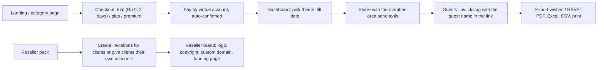

# INVI.ID (INV): Tier A teardown dossier

> **Status: v1, session 06 (2026-10-30 WIB).** All 12 sections have evidence; §4 rests on six official demo guest pages (C-INV-111…116, threshold-grade). Naming hazard: `C-INV-1xx` = INVI.ID, `C-INV-0xx` = our own Invitesion. Not done yet: the creator dashboard (no signup, R1), store search (§7), user complaints beyond the vendor's own testimonials (§10).
>
> Evidence used: **D-INV** (discovery, 66 official demos, 2026-10-29 ≈ 06:25 WIB), **C-INV-101** (theme-page wrapper, s04), **S-INV-001** (iframe targets of the theme pages, 11:25 WIB), **C-INV-111…116** (guest-page captures, 2026-10-29 11:53–11:59 WIB and 2026-10-30 01:19–01:21 WIB), **S-INV-002** (homepage `https://invi.id/` read as a visitor + one plain fetch of its HTML for prices and links + `robots.txt`, 2026-10-30 05:11 WIB), **S-INV-003** (`/reseller/` read as a visitor, 05:12 WIB), plus the Phase 2 longlist row. All prices are IDR as displayed on those dates. Testimonials on the vendor's pages name real customers: summarized only, never copied (R1/R3).

## 1. Snapshot
| Item | Finding | Tag |
|---|---|---|
| Positioning | "#1 Website Undangan Digital Terlengkap": cheap, fast, self-service website invitations plus a reseller business-in-a-box ("bisnis undangan digital dengan profit tinggi") | [CLAIMED S-INV-002, S-INV-003] |
| Segment | **Multi-niche**: weddings (50+ themes), birthdays (12), khitan (11), aqiqah/tasmiyah (11), walimatussafar, plus a video-invitation service (story/reels, Lebaran greetings) | [CLAIMED S-INV-002] / categories [OBSERVED links] |
| Languages | Indonesian only | [OBSERVED S-INV-002] |
| Company signals | WhatsApp / Instagram / email support; "virtual private server" hosting; free consultation; dated vendor testimonials (Apr–Jul 2024) | [CLAIMED S-INV-002] |
| Size | 4,000+ invitations made, 40,000+ wishes, 145+ themes, 3,000+ registered users. Theme counts conflict across the page (24+ / 50+ / 145+) | [CLAIMED S-INV-002] / conflict [OBSERVED] |
| Traffic / installs | Not in the Tranco top 1M | [ESTIMATE Tranco, longlist probe 2026-10-29] |
| Plans (end user) | **Trial Rp 0**: 2 days, 1 invitation, basic + premium themes, unlimited guests and wishes, digital envelope, love story, gallery ≤ 10, wishes export (PDF/Excel/CSV), music (list + custom), maps, gift sending, live. **Plus Rp 198.000** and **Premium Rp 298.000** list prices (1 year; gallery 10 vs 20); a standing banner "kode kupon INVI = diskon 50 %" renders Premium at Rp 149.000 | [OBSERVED S-INV-002 HTML + rendered page] |
| Active periods | Trial 2 days, 3 months, 6 months, 1 year; **membership (dashboard access) expires separately from the invitation link** | [CLAIMED S-INV-002 FAQ] |
| Reseller packs | Basic themes: **12 invitations** (10 + 2 client accounts) at Rp 18.583 each, **30** (25 + 5) at Rp 15.866, **55** (50 + 5) at Rp 13.236; free `*.invit.id` subdomain or own domain. Premium themes: **10** at Rp 44.900, **20** at Rp 34.950, free `.web.id` domain. All: 1-year account and invitations, theme updates, marketing kit (Canva/PowerPoint + reseller landing page), support group, top-ups from 2 quotas, **quota never expires** | [OBSERVED S-INV-003] |
| Resale price floor | Basic Rp 39k (no photo) / Rp 49k (with photo); Premium Rp 99k / Rp 149k. Selling below the floor = account deactivated without refund | [OBSERVED S-INV-003 FAQ] |
| White label | Reseller logo + copyright + link on the invitation, client accounts that self-edit, custom domains | [CLAIMED S-INV-003] |
| Affiliate | Commission "hingga 40 %" | [CLAIMED S-INV-002] |
| Payments | Virtual account with automatic confirmation; gateway not named | [CLAIMED S-INV-002] / gateway [UNKNOWN] |
| Watermark | Not detected on the six demos | [OBSERVED feature pass] |

## 2. Funnel and flows

- "Buat Undangan Digital Hanya 10 Menit": register + pay → edit → share; payment comes first except for the 2-day trial. [CLAIMED S-INV-002]
- Guest links follow `invi.id/<slug>`; official demos take the guest name from `?to=` (`demo.invi.id/<category>/<theme>/?to=Nama%20Tamu`). [CLAIMED S-INV-002 FAQ] / [OBSERVED S-INV-001]
- The theme page `invi.id/tema/<slug>/?to=` is a 23-node wrapper with a cross-origin iframe (Lighthouse NO_FCP on C-INV-101), so measurements use the iframe target. [OBSERVED C-INV-101, S-INV-001]
- Time to publish beyond the claim, and the dashboard itself: not observed (R1). [UNKNOWN]

## 3. Builder / editor
| Aspect | Finding | Tag |
|---|---|---|
| Model | Self-service dashboard (`/dashboard/invitation/`) on WordPress; themes built with Elementor | [OBSERVED S-INV-002 links, C-INV-111…116 generator + libraries] |
| Revisions | "Revisi sepuasnya" (unlimited edits while the membership is active) | [CLAIMED S-INV-002] |
| Media | Gallery 10 (basic) / 20 (premium) photos; music from a list or custom upload | [CLAIMED S-INV-002, S-INV-003] |
| Theme tiers | Basic vs premium differ in design quality, dress code and gallery size; premium exists for weddings only; basic → premium conversion costs Rp 35k via admin | [CLAIMED S-INV-003 FAQ] |
| Reseller tools | Client quota and accounts, revenue counter, invitation list export, custom domain, custom branding | [CLAIMED S-INV-003] |
| Live preview, autosave, validation, AI helpers | Not observed | [UNKNOWN] |

## 4. Guest-facing invitation deep dive (6 official demos)
All six are the iframe targets on `demo.invi.id` (558–1,210 DOM nodes, normal scrolling documents 4,945–11,951 px tall). The capture found and clicked the cover control ("Buka Undangan") on all six with the pre-s06 synthetic click; the content is in the DOM and scrollable afterwards, but a synthetic click does not unlock audio, so audio behaviour after a real tap is unverified. [OBSERVED C-INV-111…116]

### 4.1 Measurements (Lighthouse 12 mobile, simulate Slow 4G / 4× CPU, 412×915; CDP bytes = unthrottled cold-cache session)
| Capture | Theme | Perf | A11y | BP | SEO | LCP s | TBT ms | CLS | CDP KB | JS KB | Img KB | Font KB | Req | DOM |
|---|---|---|---|---|---|---|---|---|---|---|---|---|---|---|
| C-INV-111 | (queue D) | 28 | 88 | 93 | 66 | 22.84 | 5,615 | 0.001 | 5,489 | 766 | 3,966 | 554 | 148 | 1,052 |
| C-INV-112 | (queue D) | 35 | 86 | 100 | 66 | 5.56 | 4,279 | 0.024 | 1,940 | 759 | 368 | 519 | 117 | 1,134 |
| C-INV-113 | (queue D) | 31 | 84 | 100 | 66 | 49.00 | 3,600 | 0.021 | 9,549 | 756 | 8,172 | 437 | 118 | 558 |
| C-INV-114 | (queue D) | 13 | 81 | 93 | 66 | 4.79 | 3,773 | 1.003 | 3,532 | 766 | 1,821 | 740 | 149 | 950 |
| C-INV-115 | White Lily | 5 | 97 | 100 | 66 | 19.87 | 2,582 | 1.000 | 2,066 | 758 | 298 | 807 | 123 | 1,210 |
| C-INV-116 | Adat Art Bali | 32 | 82 | 93 | 66 | 21.03 | 2,366 | 0.006 | 2,575 | 776 | 1,120 | 491 | 139 | 1,084 |
| **Median** | | **30** | **85** | **96** | **66** | **20.45** | **3,686** | **0.023** | **3,054** | **762** | **1,470** | **536** | **131** | **1,068** |

[OBSERVED C-INV-111…116; generated by `_tools/capture/dossier-digest.py`; theme slugs for 111–114 are in `queues/queue-tier-a-4.tsv`]. Caveats: captured before REA drove visits (driver `pre-s06`); the platform dev server shared the CPU, so treat TBT as directional (protocol §6).
- **JS is a constant ≈ 760 KB** per page (WordPress + Elementor + jQuery + Swiper, Lottie on 3/6) with 291–326 KB unused. [OBSERVED]
- **Two blocking third parties on every page**: Google Tag Manager (≈ 177 KB, 0.7–1.6 s blocking) and cdnjs libraries (≈ 211 KB, 0.7–1.6 s). [OBSERVED LH]
- **CLS 1.00 on two of six demos** (C-INV-114, C-INV-115): the opening sequence or late fonts shift the whole viewport. [OBSERVED] / cause [INFERRED, medium]
- Google Maps embeds on every page (≈ 460 KB where Lighthouse lists it among the top third parties) and YouTube (≈ 1 MB) on three; images range 0.3–8.2 MB. [OBSERVED]
- SEO 66 on all six demos; which audits fail was not extracted (likely `noindex` on demos). [OBSERVED score] / cause [UNKNOWN]
- Our guest page under the same protocol: C-INV-005 Perf 93, LCP 2.62 s, 296 KB; INVI's median is **≈ 10× heavier** in CDP bytes with ≈ 18× the TBT (C-INV-005 209 ms). [OBSERVED]

### 4.2 Structure and interactions
- Detected on all six: cover gate, guest name from the link, countdown, digital gift with copy button, maps, music control, verse block, **WIB time labels**, wishes; RSVP on 5/6 (one 11-field form), live streaming on 5/6, love story and gallery on 4/6, add-to-calendar on 3/6. [OBSERVED feature pass]
- Audio: a real `<audio>` MP3 (looped on 2/6), not autoplaying before the cover click. [OBSERVED media pass]
- Motion: Elementor entrance animations + Swiper + Lottie; **`prefers-reduced-motion` CSS present on all six**. [OBSERVED]
- Fonts: Google Fonts families (Alata, Assistant, Cormorant, Jost, Bodoni Moda, Caudex, …) plus **self-hosted display faces named "ivymode", "NewYork", "sloopscript", "iskry", "Bahagia", "cuifont"**; 1–4 `font-display` issues per page. The names match commercial families (e.g. Ivy Mode, Sloop Script) and Apple's New York, whose licenses restrict web embedding. [OBSERVED names] / commercial origin [INFERRED, medium] / license status [UNKNOWN]
- i18n / a11y: `lang="id"`, zoom allowed (C-INV-114 still fails `meta-viewport`), A11y 81–97; recurring failures: `skip-link`, `color-contrast`, `heading-order`, `link-name`, `list`, `select-name`. [OBSERVED LH]
- `WordPress 7.1.4` exposed in the `generator` meta tag. [OBSERVED]
- OG image/title/description present. [OBSERVED]
- Edge cases (long names, RTL, in-app browsers): protocol v2 checks, not yet run. [UNKNOWN]

## 5. Tech fingerprint
| Layer | Finding | Confidence |
|---|---|---|
| CMS / front end | WordPress 7.1.4 + Elementor, jQuery, Swiper, Lottie (unpkg) | high [OBSERVED C-INV-111…116] |
| Hosting / edge | HTTP/3 + Cloudflare CDN entity; "virtual private server" origin | high [OBSERVED] / origin [CLAIMED S-INV-002] |
| Domains | `invi.id` (marketing + guest links), `demo.invi.id` (demos), `invit.id` (reseller subdomains), `.web.id` domains in premium reseller packs | [OBSERVED S-INV-001, S-INV-003] |
| Analytics | Google Tag Manager on guest pages | high [OBSERVED LH] |
| Payments | Virtual account, auto-confirmed; gateway unknown | [CLAIMED] / [UNKNOWN] |
| Crawl policy | `robots.txt` blocks only `/wp-admin/` (admin-ajax allowed) | [OBSERVED S-INV-002] |
| Bot protection | None met on demo or marketing fetches | [OBSERVED S-INV-001, S-INV-002] |

## 6. Public API surface
No endpoints were recorded from normal page use; RSVP and wishes were not submitted (R1). WordPress's standard `admin-ajax.php` is allowed in `robots.txt` and is the likely form endpoint. [OBSERVED robots] / [INFERRED, medium]. No `api-observed.md` yet.

## 7. Mobile app
No app link on the pages read; store search not done. [UNKNOWN]

## 8. Growth and SEO
- **Utility-tool SEO**: free tools under `/tools/` (Javanese weton calculators, photo compressor, QR-code generator, text formatter) and a prayer-time page (`/jadwal-sholat`) pull search traffic unrelated to invitations. [OBSERVED S-INV-002 links] / intent [INFERRED, high]
- Category landing pages (pernikahan, ulang tahun, khitan, aqiqah, walimatussafar), a blog, tutorials, a portfolio, a video-invitation line. [OBSERVED links]
- **Reseller distribution**: invitations are sold under resellers' own brands and domains, backed by a marketing kit and a reseller landing page. [CLAIMED S-INV-003]
- Social proof: a 5.0 rating block and dated testimonials (most recent shown: July 2024). [OBSERVED] / staleness [INFERRED, medium]

## 9. Monetization and pricing psychology
- **Coupon as a permanent discount**: the page itself publishes the 50 % code, so list prices (Rp 198k / 298k) work as anchors and the effective Premium price is Rp 149k. [OBSERVED] / [INFERRED, high]
- **Reseller-first economics**: pack prices of Rp 13–45k per invitation against enforced floors of Rp 39–149k give resellers a 62–77 % gross margin at the floor price (e.g. Rp 49k − Rp 18.6k = 62 %; Rp 149k − Rp 35k = 77 %). The floor protects INVI's retail price. [OBSERVED prices] / margins computed
- **Two clocks**: membership (editing) and the invitation link expire separately, which drives renewals; quotas never expire, which makes bulk buying safe. [CLAIMED S-INV-002/003] / [INFERRED, high]
- **Theme tier upsell**: basic → premium conversion for Rp 35k. [CLAIMED S-INV-003]
- 2-day free trial with every feature. [OBSERVED S-INV-002]

## 10. Strengths, weaknesses, complaints
- Strengths: the widest niche coverage in Tier A (wedding, birthday, khitan, aqiqah, walimatussafar); the cheapest unit economics for resellers, with white label, client accounts and custom domains; exports in four formats; reduced-motion CSS, zoom allowed, `lang="id"` and WIB labels on guest pages; real `<audio>` with gesture unlock. [OBSERVED/CLAIMED as tagged above]
- Weaknesses: Elementor weight (≈ 760 KB JS, median TBT 3.7 s, Perf 30, LCP 20.4 s); CLS 1.00 on 2/6 demos; GTM on guest pages; unverified commercial display fonts; SEO 66 on demos; conflicting theme counts; the CMS version is public. [OBSERVED]
- User complaints: only the vendor's own testimonials were seen (positive, 2024). Independent reviews not researched yet. [UNKNOWN]

## 11. Patterns to learn from (principle level, R2: no visual cloning)
| Steal-worthy principle | Avoid | Our counter-move |
|---|---|---|
| A reseller workspace with client sub-accounts, enforced price floors and white-label domains | Page-builder output shipping ≈ 760 KB of JS to every guest | Template harness performance budget; no page-builder runtime on guest pages |
| Multi-niche catalog with culture-specific events (walimatussafar, aqiqah, khitan) | Self-hosting display fonts without a license trail | Harness gate: every font in `template.manifest.json` with a license (AGENTS.md template contract) |
| Free utility tools as SEO entry points | A permanent public coupon that makes list prices meaningless | Honest, stable pricing; launch promos with an end date |
| Exports (PDF/Excel/CSV/print) for hosts and resellers | Layout shift of the whole viewport on open | CLS gate in `check`; reserve space for cover and fonts |
| Clear tiering by gallery size and theme quality | Two separate expiry clocks that confuse buyers | One active period per invitation (F-064), clearly shown |

## 12. Mapping to our codebase (F-IDs from `01-codebase-audit/feature-inventory.csv`, M-IDs from `module-map.md`)
| INVI capability | Our feature (status today) | Modules | Gap type |
|---|---|---|---|
| Personal guest link (`?to=` / slug) + name on cover | F-001 full, F-002 full | M-012, M-014, M-013 | parity |
| Cover gate + music with gesture unlock | F-003 missing, F-004 config-only | M-013, M-005, M-009 | missing |
| Countdown, add to calendar | F-005 missing | M-013 | missing |
| Love story, wishes | F-007 full, F-019 full | M-013, M-014 | parity |
| Gallery 10 / 20 photos | F-008 partial | M-013, M-027 | partial |
| Events, maps, dress code | F-010 partial, F-011 partial, F-025 config-only | M-013, M-009 | partial |
| RSVP | F-013 full, F-015 partial | M-014 | parity / partial |
| Digital envelope + copy button, gift sending | F-021 partial, F-023 partial, F-022 missing | M-013, M-009, M-025 | partial |
| Live streaming, verse block | F-024 full, F-029 full | M-013, M-006 | parity |
| WIB time labels | H-INV-002: our guest page prints UTC clock times labelled "WIB" (08:00+07 → "01.00 WIB") and shows WITA events in WIB (bug) | M-013 | **we lag** (fix in Phase 6) |
| Wishes export PDF / Excel / CSV / print | F-047 full (CSV only) | M-020 | partial |
| Music list + custom upload | F-072 missing | M-027 | missing |
| Reseller packs, client accounts, white label | F-079 missing | M-035 | missing |
| Custom domain / reseller subdomain | F-066 missing | — | missing |
| Affiliate up to 40 % | F-080 missing | — | missing |
| Free 2-day trial | no F-ID; our publish gate F-075 requires payment first | M-011 | missing (strategic, see ENV reverse trial) |
| Membership vs invitation expiry | F-064 full (one 12-month period) | M-011 | different model (ours is simpler) |
| Multi-niche (birthday, khitan, aqiqah) | F-039 / F-040 config-only | M-009 | partial (INVI has live themes) |
| Price Rp 149k effective (Premium) | F-085 full (ours Rp 149k / Rp 299k) | M-003 | price parity at our entry tier |
| Guest-page weight / CLS | C-INV-005 | M-012, M-013 | **we lead** |

Changes since the previous version: first version.
