# Invitato (IVT): Tier A teardown dossier

> **Status: v1, session 07 (2026-11-01).** All 12 sections have evidence. §4 rests on the vendor's **four official live previews**, all captured (C-IVT-101…104): two opened (C-IVT-104 with the D-016 trusted tap, C-IVT-101 with a pre-D-016 synthetic click), two stayed on their English cover (C-IVT-102/103, before the cover wording was fixed), so their structure is partial while their cold-load Lighthouse runs are valid. Evidence level **B** (`../../_handoff/review-20261101.md` §2): every published live preview is captured, but there are only four; the `/design` catalog lists 36 entries whose live-preview links were not enumerated. Not done: the creator dashboard (no signup), user complaints (§10), the `/product/rsvp-assistance` page, and whether more catalog entries have live previews (re-run discovery on `/design`).
>
> **Privacy (D-019):** the designs are named after client couples and the vendor's own posts tie at least one demo design to a real wedding (S-IVT-004/005), so these demos are not treated as synthetic placeholders. This dossier names no couple; the template slugs are pseudonymized in committed files and the couples' names and handles are redacted in the capture summaries (`../../00-setup/privacy-hygiene.md`).
>
> Evidence used (times UTC, 2026-11-01): **S-IVT-001** `invitato.net` (demo host): `robots.txt` answers 404 from GitHub Pages (no rules = allow), the homepage is a meta refresh to `invitato.id` (≈ 16:59Z, plain fetch). **S-IVT-002** `invitato.id` homepage read as a visitor (WebFetch ≈ 17:00Z; `robots.txt`: allow all + sitemap). **S-IVT-003** `/pricing`, **S-IVT-004** `/design`, **S-IVT-005** `/product/digital-guestbook` (WebFetch, one per request, ≈ 17:01–17:03Z). **D-IVT** demo discovery (session 02: 4 live previews). **C-IVT-101…104** captures (2026-10-29 11:24 WIB; 2026-10-30 04:42 and 04:48 WIB; 2026-11-01 23:53 WIB), plus the Phase 2 longlist row. Prices are IDR "starting prices" as displayed on 2026-11-01.

## 1. Snapshot
| Item | Finding | Tag |
|---|---|---|
| Positioning | Website invitations + digital guestbook + RSVP assistance, sold as a done-for-you service ("terima beres"): production by customer assistants and engineers, day-of registration by Invitato staff. Tagline on the demo host: "First Web Invitation & QRCode in Town" | [OBSERVED S-IVT-001/002] |
| Segment | Weddings first; birthdays and other events appear in testimonials, and the guestbook claims 50+ non-wedding events | [OBSERVED S-IVT-002] / counts [CLAIMED S-IVT-005] |
| Languages | Indonesian marketing; every invitation shows an ID/EN language switch; two of the four demos default to English (`lang="en"`) | [OBSERVED S-IVT-002, C-IVT-101…104] |
| Company signals | Founded 2020; "5K+ pasangan · 10+ negara · 5+ tahun"; testimonials attributed to Indonesian celebrities and influencers; WO collaborations; on-site teams with free transport in Semarang, Solo, Yogyakarta and Jakarta; a named chat persona for consultations | [OBSERVED S-IVT-002/003] / figures [CLAIMED] |
| Size | 5,000+ couples; 1,000+ wedding guestbook events and 50+ non-wedding events "per 2026"; not in the Tranco top 1M; no Play listing found | [CLAIMED S-IVT-002/005] / [OBSERVED longlist probe 2026-10-29] |
| Plans (starting prices, final price by sales quote) | **Website Invitation from IDR 400rb**: semi-customized design, all designs, colour change (some designs locked), unlimited gallery, unlimited links (sent manually), active forever, separate events, custom WhatsApp text, basic RSVP, minor + major revisions, dedicated engineer + customer assistant. **Buku Tamu Digital from IDR 2 jutaan**: on-site QR registration with tablet, label printer, usher (attire and makeup included) and technical team; includes the "Website Complete+" invitation, official WhatsApp broadcast, RSVP partner-name insert and table/seat management as a bonus, internet included. **RSVP Assistance from IDR 1 jutaan**: invitations and RSVP follow-ups sent from Invitato's official WhatsApp, staged follow-ups, on-call and final reminder, real-time dashboard with table/seat management, dedicated human PIC | [OBSERVED S-IVT-003] |
| Package names on demos | "Complete" and "Complete+ & Ultimate" appear as labels on demo pages | [OBSERVED C-IVT-102/103] |
| Free tier / trial | None; free consultation | [OBSERVED S-IVT-002/003] |
| Watermark | Demo titles end "by Invitato" and a vendor handle button is shown; on paid invitations [UNKNOWN] | [OBSERVED C-IVT-101…104] |
| Catalog | `/design`: **36 entries** (34 designs, two with Extended/Original variants) in two categories, **Royal 16** and **Minimal 20**, all produced in-house; each design is named after a couple and described by its story (Javanese palace, Moroccan, fairy tale, editorial magazine, newspaper, film date …); several are flagged "NEW" and some "colour cannot be changed". The homepage shows 4 of them with live previews | [OBSERVED S-IVT-002/004, D-IVT] |

## 2. Funnel and flows

```mermaid
flowchart LR
  A[invitato.id] --> B["Free consultation on WhatsApp (named persona)"]
  B --> C[Sales quote from a starting price]
  C --> D["Pick a design; Imagination Room: try colours, fonts, photos"]
  D --> E["Vendor produces the site (engineer + customer assistant), minor + major revisions"]
  E --> F["Publish: one link per guest (?code=…)"]
  F --> G{Distribution}
  G -->|self| H[Unlimited links sent manually, custom WhatsApp text]
  G -->|RSVP Assistance| I["Official, Meta-verified WhatsApp: invite → chat follow-up 1 → chat 2 → call 3 → table arrangement → reminder"]
  H --> J["RSVP dashboard: add/edit/delete guests, quota per guest, events per guest, report download"]
  I --> J
  J --> K["Day-of guestbook: usher scans the guest's one-time QR, or searches the name, or types it → prints labels (gift envelope + souvenir coupon, or envelope + table number) → optional selfie; greeting screen; doorprize"]
  K --> L["Report: attended / absent, arrival order, gifts and envelopes, selfies"]
```

- **Creator steps** are not self-serve: the couple consults, chooses, sends content and reviews revisions while the vendor builds. Step count and lead time ("minimum booking before the event" is an FAQ question whose answer was not expanded) are [UNKNOWN]. [OBSERVED S-IVT-002/003] / [INFERRED, high]
- **Day-of registration in three moves** (scan / search / manual), two labels per guest, optional selfie; two validation modes: **strict** (QR or listed name and quota required; international and seated weddings) and **flexi** (unlisted guests admitted by manual entry; traditional and standing weddings). Guests are never forced to show a QR. [CLAIMED S-IVT-005]
- **RSVP schemes:** standing vs seating. [CLAIMED S-IVT-002]
- Dashboard, QR app and staff tools were not observed (no account, R1). [UNKNOWN]

## 3. Builder / editor
| Aspect | Finding | Tag |
|---|---|---|
| Model | Vendor-produced site; no self-serve editor is advertised | [OBSERVED S-IVT-002/003] |
| Imagination Room | Couples adjust colours, fonts and photos on a design base; the system recommends a palette. On demo pages it appears as a panel of photo slots (bride, groom, countdown, QR card, gallery covers, backgrounds) with "reset photos" and a photo guide | [CLAIMED S-IVT-002] / panel labels [OBSERVED C-IVT-101…104; not exercised] |
| Revisions | Minor and major revisions included | [OBSERVED S-IVT-003] |
| Media | Unlimited gallery; video clips (e.g. an opening video) on request; video backgrounds observed (§4.3) | [CLAIMED S-IVT-002] / [OBSERVED] |
| Constraints | Some designs lock the palette; envelope colour fixed on one minimal design | [OBSERVED S-IVT-004] |
| Autosave, undo, validation, AI | Not applicable or not observed | [UNKNOWN] |

## 4. Guest-facing invitation deep dive

### 4.1 What was measured (methodology)
- Targets: the four official live previews, `invitato.net/template-<pseudonymized>/?code=DUMMY-P0001` (the vendor's dummy guest code). Two Royal designs (C-IVT-101 Javanese palace theme, C-IVT-104 traditional with a modern touch) and two Minimal designs (C-IVT-102 simple romantic, C-IVT-103 luxurious minimal).
- States: **C-IVT-104 opened** (D-016: tap on "Buka Undangan", method `trusted (unsettled)` because the control kept animating, landing `inside`; the content features appear only after the tap). **C-IVT-101 opened** by a pre-D-016 synthetic click (same before/after feature pattern; the click's effect is not independently verified). **C-IVT-102/103 closed**: their covers say "Tap to Open" and "Tap the envelope to unveil the celebration", which the detector did not know before the s06 wording fix; C-IVT-102 renders some content text behind the cover (gallery, RSVP, wishes), C-IVT-103 none.
- **Hazard: inner scroll container.** Every Invitato page reports a document height equal to the viewport (915 px): the invitation scrolls inside a fixed container, so window scrolling (REA's PageDown and our scroll) may not move it, and `sectionCount` (0–1) means nothing here. Because no image is lazy-loaded (0 of 15–111), the bytes are complete regardless.
- Lighthouse never clicks: all four runs are valid **cold-load** samples. Post-visit bytes (CDP) are reported separately.

### 4.2 Cold-load measurements (Lighthouse 12.8.2 mobile, simulate Slow 4G / 4× CPU, 412×915 @2.625)
| Capture | Category | Lang | Perf | A11y | BP | SEO | LCP s | FCP s | TBT ms | CLS | Transfer KB (LH) |
|---|---|---|---|---|---|---|---|---|---|---|---|
| C-IVT-101 | Royal | id | 35 | 82 | 96 | 82 | 18.47 | 4.56 | 1,020 | 0 | 4,198 |
| C-IVT-102 | Minimal | en | 36 | 85 | 100 | 91 | 19.42 | 4.53 | 925 | 0 | 6,133 |
| C-IVT-103 | Minimal | en | 39 | 83 | 100 | 82 | 14.50 | 5.51 | 764 | 0 | 8,251 |
| C-IVT-104 | Royal | id | 40 | 83 | 93 | 82 | 47.78 | 2.80 | 910 | 0 | 10,743 |
| **Median (4)** | | | **37.5** | **83** | 98 | 82 | **18.94** | 4.54 | **918** | 0 | **7,192** |

[OBSERVED C-IVT-101…104]. Images dominate the Lighthouse transfer (3.7–10.2 MB of 4.2–10.7 MB). Time to Interactive 15–49 s.

### 4.3 After the visit (CDP, unthrottled, cold cache)
| Capture | State | CDP KB | Images KB | Media (video) KB | JS KB | Fonts KB | Requests | DOM nodes |
|---|---|---|---|---|---|---|---|---|
| C-IVT-101 | opened (pre-D-016) | 19,184 | 6,743 | 11,839 | 418 | 125 | 97 | 1,083 |
| C-IVT-102 | closed | 6,227 | 4,231 | 1,430 | 398 | 111 | 46 | 347 |
| C-IVT-103 | closed | 8,950 | 8,385 | 0 | 377 | 126 | 55 | 337 |
| C-IVT-104 | opened (D-016) | **49,123** | 21,916 | **26,362** | 424 | 348 | 98 | 864 |

[OBSERVED]. Video backgrounds/clips are the heaviest single item (up to 26 MB); JS is a constant Gatsby bundle (≈ 380–420 KB, 16–22 chunks per REA).

### 4.4 Guest experience as observed (structure only, no copy)
- **Cover:** a gate with a single control: "Buka Undangan" on the Indonesian designs, "Tap to Open" or a tap-the-envelope instruction (envelope metaphor) on the English ones. [OBSERVED]
- **After opening (C-IVT-101/104):** language switch ID/EN; the couple's social-media buttons; love story; countdown; a remind-me / add-to-calendar button; venue with a location button; a quote block with a Qur'an citation marker; portraits; **livestream / video via YouTube** (two embedded players); RSVP form with 9 controls (two text fields, an event or category select, a guest-count number, two more text fields, two attendance buttons: attending / not attending, submit); **a "download access card" button = the guest's personal QR pass for check-in**; gifts as bank transfer + physical gift; wishes; time labels with **WIB** present. [OBSERVED feature flags and control labels]
- **Personalization:** an opaque guest code in the URL (`?code=`) and requests to `api.invitato.net` on load (≈ 2 KB XHR + 16–19 KB fetch per visit) point to the guest record (name, quota, events) being fetched by code. [OBSERVED host and parameter] / mechanism [INFERRED, medium]. The vendor claims one-time personal QR codes, per-guest attendance quotas and per-event access. [CLAIMED S-IVT-002/005]
- **Audio / video:** one looping MP3 `<audio>` (not autoplay) on all four; a `<video>` element on three; playback not observed. [OBSERVED elements] / playback [UNKNOWN]
- Only two attendance states were observed (no "maybe"). [OBSERVED C-IVT-101/104]

### 4.5 Assets, fonts, third parties, accessibility, localization
- **Fonts:** each design pairs one or two display/script faces with Poppins (+ Montserrat): Hatolie + Cambo (101), Instrument Serif + Champignon (102), Baskervville + Monsieur La Doulaise + Nanum Myeongjo (103), Cormorant Upright + Great Vibes (104). The Google Fonts families are OFL [INFERRED, high]; Hatolie and Champignon are not in the Google Fonts catalogue → licence [UNKNOWN]. One `font-display` issue (101). [OBSERVED]
- **Third parties:** Google Fonts, the Cloudflare Web Analytics beacon, ≈ 15 KB from `invitato.id`, YouTube embeds (101, 104) and one asset served from `raw.githubusercontent.com` (104). [OBSERVED]
- **Accessibility:** automated 82–85; failing audits `button-name`, `color-contrast`, `image-alt` on all four (+ `aria-prohibited-attr` on 102); no `prefers-reduced-motion` rule; zoom allowed. [OBSERVED]
- **Localization:** ID/EN switch on every design; WIB labels on the opened Indonesian designs; long names, RTL and in-app browsers not tested on third-party pages. [OBSERVED] / [UNKNOWN]
- **SEO / sharing:** OG image/title/description present; Lighthouse SEO 82–91 (no `noindex` penalty seen, unlike Enviory). [OBSERVED]

### 4.6 Against our own guest page (same protocol)
| | Invitato (median of 4) | Invitesion C-INV-005 (one run; local production build, no middleware) |
|---|---|---|
| Perf / LCP / TBT / CLS (Lighthouse lab) | 37.5 / 18.94 s / 918 ms / 0 | 93 / 2.62 s / 209 ms / 0 |
| INP | not measured | not measured |
| Transfer at cold load (Lighthouse) | 7,192 KiB | 321 KiB |
| Accessibility (automated) | 83 | 96 |
| Personal QR pass, livestream embed, ID/EN switch, countdown, calendar, gifts incl. physical gift | present | QR pass F-026 missing; livestream F-024 full (link out); language F-034 missing; F-005, F-012 missing; F-023 partial |

**Scope (s08 correction, brief 05 Task C):** same lab protocol (Lighthouse cold load; Invitato = median of its four official previews, ours = one C-INV-005 run): ours transfers **≈ 22× less at load** (321 vs 7,192 KiB) with better Perf, LCP and TBT; CLS ties at 0; INP was not measured. C-INV-005 is a local production build without `middleware.ts` (placeholder Clerk keys, D-012, P-INV-010), so production auth, middleware, CSP and locale-cookie behaviour are not covered. Invitato's lead is guest operations, not lab page weight. [OBSERVED] / interpretation [INFERRED, high]

## 5. Tech fingerprint
| Layer | Finding | Confidence |
|---|---|---|
| Invitation pages | **Gatsby 5.13** (`<meta name="generator">`), React static build; 16–22 chunks | high [OBSERVED C-IVT-101…104] |
| Hosting | **GitHub Pages** (404 page signature on `invitato.net/robots.txt`, `via: 1.1 varnish`) behind **Cloudflare** (`server: cloudflare`); HTTP/3 + HTTP/2 | high [OBSERVED S-IVT-001, C-IVT-*] |
| Guest data | `api.invitato.net` called on load | high (host) [OBSERVED] |
| Marketing site | `invitato.id` (robots allow all, sitemap of 11 URLs); stack not fingerprinted | [UNKNOWN] |
| Analytics | Cloudflare Web Analytics beacon on invitation pages | high [OBSERVED] |
| Messaging | Official WhatsApp Business sender with Meta verification badge for broadcasts and follow-ups | [CLAIMED S-IVT-002/003] |
| Payments | Not stated on the pages read (FAQ answer collapsed) | [UNKNOWN] |
| Supply chain | One production invitation loads an asset from `raw.githubusercontent.com` | [OBSERVED C-IVT-104]; risk [INFERRED] |

## 6. Public API surface
REA `analyze-web-bundle` found no endpoint observations on the four captures. Normal page loads did contact `api.invitato.net` (XHR + fetch, ≈ 18–21 KB per visit); the committed summaries keep hosts only, so paths, methods and response shapes are [UNKNOWN] (the request carries the guest code). Nothing was submitted (R1). See `api-observed.md`.

## 7. Mobile app
No public app found (no Play listing in the longlist probe). The day-of "QR App" runs on vendor tablets operated by Invitato staff and WO teams; it is not distributed publicly. [OBSERVED probe] / [CLAIMED S-IVT-005]

## 8. Growth and SEO
- Social proof as the main engine: celebrity and influencer testimonials, Instagram posts of client events with venues and WO credits, WO and wedding-organizer collaborations. [OBSERVED S-IVT-002/005]
- Portfolio-as-catalog: every design is a named couple's story, so the catalog doubles as a case-study list. [OBSERVED S-IVT-004]
- The legacy demo host redirects to the marketing site with UTM tags ("footer" campaign), which suggests invitation footers link back to Invitato. [OBSERVED S-IVT-001] / loop [INFERRED, medium]
- Invitation pages are not `noindex` under Lighthouse's check (SEO 82–91). [OBSERVED]

## 9. Monetization and pricing psychology
- **High-touch, quote-based pricing:** public starting prices (Rp 400rb / 1 jutaan / 2 jutaan) anchor the conversation, then sales tailors the package to guest count, features and timeline. [OBSERVED S-IVT-003]
- **Services as the upsell:** human RSVP follow-up, staff, hardware and reports are the expensive tiers; the website is bundled into the guestbook package. [OBSERVED]
- **Permanence and "unlimited" as value anchors:** active forever, unlimited gallery, unlimited links. [OBSERVED]
- No trial, no self-serve checkout observed. [OBSERVED]

## 10. Strengths, weaknesses, complaints
- **Strengths:** end-to-end guest operations (Meta-verified WhatsApp sending, staged human follow-ups, seating, one-time personal QR passes downloadable from the invitation, scan/search/manual check-in, gift-envelope labels and gift logging, greeting screen, doorprize, post-event report); strict vs flexi validation by event type; ID/EN invitations; in-house design studio; strong social proof. [CLAIMED/OBSERVED as tagged]
- **Weaknesses:** very heavy pages (7.2 MB median at load, up to 49 MB per visit with video; zero lazy loading), LCP 14.5–47.8 s, automated a11y 82–85 with unnamed buttons and missing alt text, no reduced-motion support, inner scroll container, an asset hosted on `raw.githubusercontent.com`, no self-serve path (cost and lead time), only four live previews published, two-state RSVP only. [OBSERVED/INFERRED]
- **User complaints:** s14: the homepage serves a client-side shell in static HTML, so a store link cannot be determined (S-IVT-002); no independent review source was read. [UNKNOWN]

## 11. Patterns to learn from (principle level, no visual cloning)
| Learn (principle) | Avoid | Our counter-move |
|---|---|---|
| Personal QR pass the guest downloads from the invitation, valid once | Video backgrounds and eager galleries (tens of MB per visit) | Media budget per tier; video as poster + play on demand; lazy images by default |
| Day-of operations as a product: scan / search / manual entry, envelope labels, gift logging, arrival report | An inner scroll container that defeats anchors, scrolling and lazy loading | Native document scroll; section anchors; harness check on document height |
| Strict vs flexi check-in validation chosen per event type | Assets served from `raw.githubusercontent.com` | Asset pipeline + external-host allowlist gate |
| Human-sounding RSVP follow-up sequence over an official WhatsApp sender | Unnamed buttons, missing alt text, no reduced motion | a11y and reduced-motion gates in the harness |
| Seating and table data feeding the check-in desk | Service-only model (no self-serve) | Self-serve builder with an optional assisted tier |
| ID/EN switch on the invitation | English-only covers in an Indonesian product | Indonesian default, English optional, strings externalized |

## 12. Mapping to our codebase (F-IDs from `01-codebase-audit/feature-inventory.csv`)
| Invitato capability | Our feature (status today) | Modules | Gap type |
|---|---|---|---|
| Per-guest link with an opaque code | F-001 full (slug from the name, guessable: QA-003) | M-012, M-014 | partial (security: opaque codes) |
| Cover gate | F-003 missing | M-013 | missing |
| Personal QR pass on the invitation | F-026 missing (`guests.qr_code` unused) | M-013, M-035 | missing |
| QR check-in scanner, search-by-name, manual entry | F-055 missing, F-056 full (manual) | M-019 | partial |
| On-site guestbook kiosk / tablet app, selfie check-in, greeting screen, doorprize | F-057 missing | — | missing |
| Gift-envelope labels + gift logging at the desk | no F-ID yet → Phase 5 matrix | — | missing (new) |
| Seating / table management | F-042 config-only | M-009, M-021 | missing |
| Per-guest quota, per-event eligibility | F-015 partial (allowance overwritten, QA-005), F-043 config-only | M-009, M-014 | partial |
| RSVP attend / decline (no maybe) | F-013 full, F-014 missing | M-014 | parity (both lack "maybe") |
| Official WhatsApp broadcast + staged reminders | F-051 missing, F-052 config-only | M-040, M-009 | missing |
| RSVP dashboard + downloadable report | F-053 partial, F-047 full (CSV) | M-019, M-020 | partial |
| ID/EN switch | F-034 missing | M-013, M-034 | missing |
| Countdown, add-to-calendar | F-005 missing, F-012 missing | M-013 | missing |
| Livestream / video embed | F-024 full (link out), F-009 missing (video) | M-013, M-027 | partial |
| Gifts: bank transfer + physical gift | F-021 partial, F-023 partial | M-009, M-013 | partial |
| WIB label | F-033 broken (hard-coded WIB + server TZ) | M-013 | partial (theirs correct on the demos) |
| Multi-user access for WO / ushers | F-076 missing | M-030 | missing |
| Done-for-you production + RSVP assistance services | no F-ID (service layer) → Phase 5 business rows | — | missing (strategic) |
| Guest-page weight and speed | C-INV-005 321 KB / LCP 2.62 s vs IVT 7.2 MB / 18.9 s | M-012, M-013 | **we lead** |
| Automated accessibility | ours 96 vs IVT 83 | M-013 | **we lead** |

Changes since the previous version: first version.
