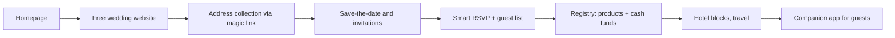

# Joy (JOY): Tier A teardown dossier (international, US)

> **Status: v1, session 08 (2026-11-03). No guest-page measurement.** Evidence level **C** (robots and homepage; `../../_handoff/review-20261101.md` §2). Joy is in Tier A as the **free all-in-one guest-experience benchmark**. Couples' wedding websites are personal and their private areas are robots-disallowed; the single demo-shaped link from discovery (a save-the-date card page) was not verified as a placeholder or captured. Guest-page behaviour is therefore [UNKNOWN] here.
>
> Evidence used (times UTC): **D-JOY** (s04 re-run after the robots fix: `withjoy.com` → `/cards/wedding/save-the-date`, 1 demo-shaped link); longlist row (Tranco 28,738, stack hint Lottie, 2026-10-29); **S-JOY-001** robots (an explicit AI-agent group allows public pages; `/forever/`, `/login` and private wedding areas disallowed) + homepage (2026-11-01 17:10Z). Private copies from s07 were lost; the evidence-index row is the record.

## 1. Snapshot
| Item | Finding | Evidence |
|---|---|---|
| Positioning | **Free** wedding website + registry + RSVP in one product, with a companion app | [CLAIMED S-JOY-001] |
| Size signals | Tranco 28,738 | [ESTIMATE 2026-10-29] |
| Features | Smart RSVP, guest list, save-the-dates and invitations, registry with **cash funds**, **hotel blocks**, "magic link" address collection, companion app | [CLAIMED S-JOY-001] |
| Pricing | Core website free; revenue from registry, prints and hotel blocks | [CLAIMED free] / revenue [INFERRED, medium] |
| Robots stance | Public pages explicitly open to AI agents; private wedding areas closed | [OBSERVED S-JOY-001] |

## 2. Funnel and flows

All steps [CLAIMED S-JOY-001]; nothing was created or used.

## 3. Builder / editor
[UNKNOWN] beyond the claims above (no editor observed).

## 4. Guest invitation: no guest-page measurement
Real couples' websites are personal data (R1) and robots closes their private areas; no vendor placeholder site was verified. Structure, motion (Lottie is in the stack hints), weight and accessibility: [UNKNOWN].

## 5. Tech fingerprint
| Layer | Finding | Confidence |
|---|---|---|
| Marketing | Lottie animations | medium [OBSERVED longlist probe] |
| Other layers | [UNKNOWN] | — |

## 6. Public API surface
No endpoints observed. See `api-observed.md`.

## 7. Mobile app
A companion app is claimed; store metadata not read. [CLAIMED] / details [UNKNOWN]

## 8. Growth and SEO
- **Free core as the acquisition engine**; every guest who visits a couple's site meets the registry and the brand. [CLAIMED] / loop [INFERRED, high]
- "Magic link" address collection turns guests into contacts before invitations go out. [CLAIMED]

## 9. Monetization and pricing psychology
Free for the couple; monetized through registry (cash funds), prints and hotel blocks. [INFERRED, medium from S-JOY-001 features] Fee levels: [UNKNOWN].

## 10. Strengths, weaknesses, public complaints
- **Strengths:** the whole wedding guest journey (address collection → save the date → invitation → RSVP → registry → travel) in one free product; companion app. [CLAIMED]
- **Weaknesses:** US-centric commerce (registry, hotel blocks) with no direct Indonesian analogue. [INFERRED]
- **Public complaints:** s14: no store link in the homepage's static HTML (S-JOY-002); Trustpilot is restricted under D-030 (S-JOY-003, Q-O08 residual). [UNKNOWN]

## 11. Patterns to learn, to avoid, and our counter-move
| Learn (principle) | Avoid | Our counter-move |
|---|---|---|
| Collect guest contacts before the invitation (magic link) | — | Bulk import (F-046) plus a self-registration link for guests that fills the guest list |
| One journey from save-the-date to registry | — | Save-the-date (F-012) and gifts (F-021/F-022/F-023) inside the same invitation |
| Free core, monetized at the edges | Free tiers that cannot be shared | Free draft + preview, paid publish (F-075); gifting fees shown to the host |

## 12. Mapping to our modules and features
| Joy capability | Ours | Modules | Verdict |
|---|---|---|---|
| Smart RSVP, guest list | F-013 full, F-017 config-only, F-053 partial | M-014, M-019 | partial |
| Address collection link | F-046 missing (bulk import) | M-019 | gap |
| Save-the-date | F-012 missing | M-013 | gap |
| Registry with cash funds | F-021 partial, F-022 missing, F-023 partial | M-013, M-025 | gap |
| Hotel blocks / travel | none | — | out of scope (no local analogue) |
| Companion app | none | — | gap |
| Guest-page weight and motion | C-INV-005 | M-012, M-013 | **not comparable** (JOY unmeasured) |
