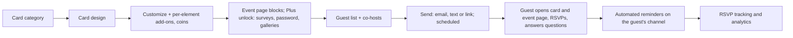

# Paperless Post (PPO): Tier A teardown dossier (international, US)

> **Status: v1, session 08 (2026-11-03). No guest-page measurement.** Evidence level **C** (pricing and marketing pages; `../../_handoff/review-20261101.md` §2). Paperless Post is in Tier A as the **design and motion craft benchmark**, but no official sample event or card page was identified: discovery found 941 card-catalog links and no demo-shaped URL, and card pages need a manual pattern that was never confirmed as a public placeholder (D-PPO, D-008). The craft claim therefore stays [UNKNOWN] in this version.
>
> Evidence used (times UTC): **D-PPO** (2026-10-29: no catalog detected; s04 re-run after the robots fix: `/cards/category/holiday-invitations`, 358 + 583 links, 0 demo-shaped); longlist row (Tranco 24,449, stack hints WordPress + Next.js, 2026-10-29); **S-PPO-001** robots (AI-agent opt-outs checked first) + pricing page, **S-PPO-002** homepage (2026-11-01 17:08–17:09Z). Private copies from s07 were lost with that sandbox; the evidence-index rows are the record.

## 1. Snapshot
| Item | Finding | Evidence |
|---|---|---|
| Positioning | Designer digital stationery: "thousands of templates and designer collections", custom design upload, printed invitations via Paper Source | [CLAIMED S-PPO-002] |
| Size signals | Tranco 24,449 | [ESTIMATE 2026-10-29] |
| Pricing model | **Coins** (example on the pricing page: 3 coins = $1.44, ≈ $0.48 per coin); a **"Plus" unlock for 200 coins** (premium blocks, surveys, password protection, galleries); per-element design add-ons; **Paperless Pro** annual subscription priced by guest count | [OBSERVED S-PPO-001] |
| Host tools | Multi-channel sending, RSVP tracking and analytics, guest-info collection, co-hosts, event-page blocks, scheduled sends, automated reminders on each guest's chosen channel, shareable links | [CLAIMED S-PPO-002] |
| Catalog | Category pages with hundreds of card links (holiday category: 358 + 583) | [OBSERVED D-PPO] |
| Free tier, watermark | [UNKNOWN] (not on the pages read) | — |

## 2. Funnel and flows

- Every step after the catalog is [CLAIMED S-PPO-001/002]; nothing was customized, sent or bought.

## 3. Builder / editor
Card designs customized element by element (paid add-ons per element), an event page assembled from blocks, custom design upload. [CLAIMED S-PPO-001/002] Live preview, motion editing, autosave: [UNKNOWN].

## 4. Guest invitation: no guest-page measurement
No official public sample card or event page was identified, so nothing was captured. Opening animation, audio, structure, weight and accessibility are [UNKNOWN]. Revisit trigger: a vendor-published sample event (placeholder content verified per D-008) → capture under new ids.

## 5. Tech fingerprint
| Layer | Finding | Confidence |
|---|---|---|
| Marketing / catalog | WordPress and Next.js hints in the s02 probe | medium [OBSERVED longlist] |
| Printing | Paper Source partnership | [CLAIMED S-PPO-002] |
| Other layers | [UNKNOWN] | — |

## 6. Public API surface
No endpoints observed. See `api-observed.md`.

## 7. Mobile app
Not covered by the pages read. [UNKNOWN]

## 8. Growth and SEO
- Large category catalog (hundreds of cards per occasion) as the SEO surface. [OBSERVED D-PPO]
- Designer collections and a print partner as brand signals. [CLAIMED S-PPO-002]

## 9. Monetization and pricing psychology
- **Micro-currency:** coins abstract the price of each card, send and feature; a bundle unlock (Plus, 200 coins) packages premium features. [OBSERVED S-PPO-001]
- **Per-element upsells** on the design itself. [OBSERVED S-PPO-001]
- **Guest-count subscription** for frequent hosts (Paperless Pro). [OBSERVED S-PPO-001]
- Contrast: Indonesian vendors sell one flat price per invitation (IDI Rp 39–119k, SMO Rp 79k+, ours Rp 149k / 299k).

## 10. Strengths, weaknesses, public complaints
- **Strengths:** design catalogue depth; multi-channel delivery with per-guest channel reminders; co-hosts; surveys; password protection; print bridge. [CLAIMED]
- **Weaknesses:** coin pricing makes the total cost hard to predict; premium features behind an unlock. [OBSERVED pricing] / perception [INFERRED, medium]
- **Public complaints:** s14: no store link in the homepage's static HTML (S-PPO-003); Trustpilot is restricted under D-030 (S-PPO-004, Q-O08 residual). [UNKNOWN]

## 11. Patterns to learn, to avoid, and our counter-move
| Learn (principle) | Avoid | Our counter-move |
|---|---|---|
| Reminders on the channel each guest prefers, scheduled sends | Opaque micro-currency | Reminders (F-052) over WhatsApp first, scheduled from the host dashboard; flat rupiah prices |
| Co-hosts with shared guest management | — | Multi-user access (F-076) for co-host and usher roles |
| Password-protected events, guest surveys | Paywalling basic privacy | Password option (F-067) and custom questions (F-017) inside the standard tier |

## 12. Mapping to our modules and features
| Paperless Post capability | Ours | Modules | Verdict |
|---|---|---|---|
| Multi-channel sending, scheduled | F-050 partial, F-051 missing | M-019, M-040 | gap |
| Automated reminders | F-052 config-only | M-019 | gap |
| RSVP tracking and analytics | F-053 partial, F-059 partial | M-019 | partial |
| Guest surveys / info collection | F-017, F-018 config-only | M-014, M-021 | gap |
| Co-hosts | F-076 missing | M-030 | gap |
| Password protection | F-067 missing | M-011, M-012 | gap |
| Galleries | F-008 partial | M-013 | partial |
| Custom design upload, per-element design | F-036 missing | M-013, M-018 | gap |
| Printed invitations | F-090 missing | — | gap |
| Guest-page weight and motion | C-INV-005 | M-012, M-013 | **not comparable** (PPO unmeasured) |
