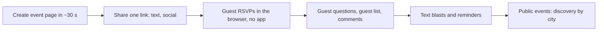

# Partiful (PTF): Tier A teardown dossier (international, US)

> **Status: v1, session 08 (2026-11-03). No guest-page measurement.** Evidence level **C** (robots, homepage and help centre; `../../_handoff/review-20261101.md` §2). Partiful is in Tier A as the **viral mobile-first sharing benchmark**. Its event pages are hosts' real events (private events are out of scope, R1), and no vendor sample event was identified, so guest-page behaviour is [UNKNOWN].
>
> Evidence used (times UTC): longlist row (Tranco 27,562, stack hint GTM, 2026-10-29); **S-PTF-001** (2026-11-01 17:11Z): robots on `partiful.com` (allow groups for search and link-preview bots, a "Disallow training" group for GPTBot, ClaudeBot, Google-Extended, CCBot and Bytespider, no `*` group) and on `help.partiful.com` (`*` with `Crawl-delay: 1`), then one browser-UA fetch each of the homepage and the help centre. Not a training crawl; no reader tool. Private copies from s07 were lost; the evidence-index row is the record.

## 1. Snapshot
| Item | Finding | Evidence |
|---|---|---|
| Positioning | Casual, mobile-first event invitations: a free event page "in ≈ 30 seconds", shared with one link | [CLAIMED S-PTF-001] |
| Features | RSVP **without an app**, text blasts, guest questions, guest list and comments, ticket sales, reminders, **public-event discovery by city** | [CLAIMED S-PTF-001] |
| Social proof | App rating claim 5.0 from 200k+ reviews | [CLAIMED S-PTF-001] |
| Size signal | Tranco 27,562 | [ESTIMATE 2026-10-29] |
| Pricing | Free event pages; ticket sales exist; fees [UNKNOWN] | [CLAIMED] / [UNKNOWN] |

## 2. Funnel and flows

All steps [CLAIMED S-PTF-001].

## 3. Builder / editor
Speed-first event creation (≈ 30 s claim). [CLAIMED] Details: [UNKNOWN].

## 4. Guest invitation: no guest-page measurement
Event pages are hosts' events (personal data); no sample was identified or captured. [UNKNOWN]

## 5. Tech fingerprint
| Layer | Finding | Confidence |
|---|---|---|
| Marketing site | Framer; Transcend consent manager; Google Tag Manager | high [OBSERVED S-PTF-001; longlist] |
| Help centre | Separate host with `Crawl-delay: 1` | [OBSERVED S-PTF-001] |
| Other layers | [UNKNOWN] | — |

## 6. Public API surface
No endpoints observed. See `api-observed.md`.

## 7. Mobile app
An app exists (rating claim); store metadata not read. [CLAIMED] / details [UNKNOWN]

## 8. Growth and SEO
- **Built-in virality:** one link, RSVP without an app, a visible guest list with comments (social proof inside every invite), and city-level public-event discovery that turns guests into hosts. [CLAIMED] / loop [INFERRED, high]
- robots welcomes search and link-preview bots and blocks training crawlers. [OBSERVED S-PTF-001]

## 9. Monetization and pricing psychology
Free for hosts; ticket sales are the visible revenue line; fees [UNKNOWN].

## 10. Strengths, weaknesses, public complaints
- **Strengths:** the lowest-friction creation and RSVP in the set; group texting; social layer (guest list, comments). [CLAIMED]
- **Weaknesses for our market:** casual US social events, not ceremony-centred invitations with family, religious and gift sections. [INFERRED, medium]
- **Public complaints (s14, S-PTF-003, paraphrased, no names):** Google Play listing 4.9★ from 27K reviews (500K+). Of the three reviews shown first (Aug–Sep 2026): one reviewer withholds the fifth star over re-invite limits (50 contacts from past events plus 50 from attended events, and people who left an event cannot be invited again); one reports frequent crashes, heavy mobile-data use and notifications that stopped arriving; a positive one asks to keep received greeting cards on the profile. Trustpilot is restricted under D-030 (S-PTF-004). Not a representative sample. [CLAIMED by reviewers]

## 11. Patterns to learn, to avoid, and our counter-move
| Learn (principle) | Avoid | Our counter-move |
|---|---|---|
| RSVP without an account, from one link | — | Already true for personal links (F-001); keep it for any generic link too |
| Guest list and comments as social proof | Exposing guest identities without consent | Host-controlled visibility for the wishes wall (F-019, F-020) |
| Group text blasts and reminders | — | WhatsApp blast (F-051) and reminders (F-052) |
| Guests become hosts (discovery) | — | "Create yours" footer credit as an opt-out referral (F-068 policy) |

## 12. Mapping to our modules and features
| Partiful capability | Ours | Modules | Verdict |
|---|---|---|---|
| One-link RSVP without an app | F-001, F-013 full | M-012, M-014 | parity |
| Guest questions | F-017 config-only | M-014, M-021 | gap |
| Guest list visibility, comments | F-019 full, F-020 config-only | M-013, M-014 | partial |
| Text blasts, reminders | F-051 missing, F-052 config-only | M-040 | gap |
| Ticket sales | F-041 config-only | M-021 | gap |
| Share from the guest page | F-027 missing | M-013 | gap |
| Public-event discovery | none | — | out of scope for private ceremonies |
| Guest-page weight | C-INV-005 | M-012, M-013 | **not comparable** (PTF unmeasured) |
