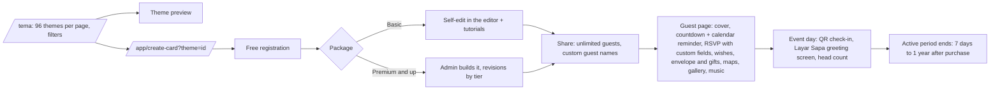

# Satu Momen (SMO): Tier A teardown dossier

> **Status: v1, session 08 (2026-11-03). No guest-page measurement.** Evidence level **C** (marketing, pricing, reseller, catalog structure and non-identifying observations; `../../_handoff/review-20261101.md` §2). Satu Momen lists 96 public theme previews, but **all three wedding previews checked render personal data** (S-SMO-004), so none is a placeholder under D-008 and none was captured; checking more previews one by one would mean reading more real people's data (brief 05 §13). This dossier exists under **ADR-W1** (`../../09-masterplan/12-decision-log.md`) and reports **no guest-page performance, structure or interaction numbers**.
>
> Evidence used (times UTC): **D-SMO** discovery (2026-10-29, 0 demo links in headless Chrome); longlist row (Tranco 2026-10-29); **S-SMO-001** homepage (2026-10-29 03:29Z, plain fetch); visitor reads on 2026-11-03, one request at a time, robots first (S-SMO-002 at 16:34Z: `User-agent: *` disallows only `/*cursor=`; ClaudeBot and Amazonbot training crawlers are disallowed `/`, which does not bind user-initiated visitor reads per `_rea-playbook.md` §5 and `robots.mjs`): **S-SMO-003** `/tema` (16:35Z), **S-SMO-004** D-008 check of three wedding previews (16:36–16:37Z; stopped, non-identifying facts only), **S-SMO-005** `/harga` (16:47:53Z, HTTP 200, 83,944 bytes), **S-SMO-006** `/reseller-undangan-digital-website` (16:47:56Z, HTTP 200, 88,134 bytes); no challenge on any. Private copies: `$INVITESION_PRIVATE_DIR/pages/{demo-search,satumomen}/` (not committed).
>
> **Privacy:** no name, rank, address or handle from any preview is recorded; the testimonial names on the pricing page are not recorded. No account, form, checkout, chat, RSVP or wish was used.

## 1. Snapshot
| Item | Finding | Evidence |
|---|---|---|
| Positioning | "Murah, Nggak Ngurangin Fitur": every package has the same invitation features; packages differ by admin help, convenience and **active period** | [OBSERVED S-SMO-005 headline + FAQ] |
| Company | PT. Inovatif Cipta Media, Banjarmasin (South Kalimantan) | [OBSERVED S-SMO-005 footer] |
| Size signals | Tranco 475,635; no Android app linked; "500+ tema, 600+ musik" | [ESTIMATE Tranco 2026-10-29] / [OBSERVED absence] / [CLAIMED S-SMO-001] |
| Product lines | Website invitations, **printed invitations**, **3D video invitations**, **3D greeting videos**, **Check In System**, custom domain; partner programmes: reseller, affiliate, content creator, freelance | [OBSERVED S-SMO-005 navigation] |
| Consumer pricing (IDR, 2026-11-03; active period from **purchase**) | **Basic 79,000** (7 days, self-edit, no admin help) · **Premium 129,000** "TERLARIS" (30 days, built by admin, 2× minor revisions, WhatsApp support in working hours) · **Prioritas 199,000** (90 days, fully built by admin, unlimited reasonable revisions, priority response) · **Signature 249,000 → 235,500** (−5 %, 180 days) · **Custom Desain 700,000 → 599,000** (−14 %, 1 year, custom design, bonus `.my.id` domain, no watermark, consultation first) · **Corporate 1,200,000 → 850,000** (−29 %, 1 year, bonus `.com` domain, no watermark) | [OBSERVED S-SMO-005] |
| Reseller pricing | **Lite 250,000** (6 months, 100 starting credits, 20 per invitation, free subdomain) · **Pro 1,000,000** (1 year, 300 credits, 15 per invitation, free `.my.id`) · **Enterprise 3,000,000 → 2,800,000** (−7 %, 3 years, 600 credits, 10 per invitation, free `.com` for 1 year); all with custom branding, landing page, marketing tools, reseller groups and customer edit access; credits can be topped up (price [UNKNOWN]) | [OBSERVED S-SMO-005, S-SMO-006] |
| Free tier | Free registration ("Daftar Gratis"); a 12-hour free trial and "1 undangan = 20 credit points" were stated on 2026-10-29; a "Lifetime" package mentioned then is absent from the 2026-11-03 price list | [OBSERVED S-SMO-001, S-SMO-005] |
| Watermark | "Tanpa watermark" is listed only on Custom Desain and Corporate, so the standard tiers carry one | [OBSERVED labels] / [INFERRED, high] |
| Catalog | First catalog page: **96 themes** (cursor-paginated) — Umum & Seminar 37, Wedding 33, School & Graduation 12, Kids & Birthday 9, Syukuran & Islami 3; 89 badged Premium; filters by event and style (Adat, Syari, Tanpa Foto, Watercolor, …); some company-branded designs; "500+ tema" claimed | [OBSERVED S-SMO-003] / [CLAIMED] |
| Consistency | The FAQ calls the Rp 129,000 tier "Paket Plus"; its price card says "Premium" | [OBSERVED S-SMO-005] |

## 2. Funnel and flows

- Catalog, preview and create links are [OBSERVED S-SMO-003]; everything behind registration is [CLAIMED] from S-SMO-005/006 (no signup, R1).
- **Clock starts at purchase, not at the event:** buyers must time the purchase or pay for a longer tier; upgrades are possible during the active period; data stays editable while active. [OBSERVED S-SMO-005 FAQ]
- **Basic is self-service only:** admin help on Basic is charged separately. [OBSERVED S-SMO-005 FAQ]
- **Host day-of (Check In System):** the committee scans each guest's QR; only registered guests get in; the "Layar Sapa" screen shows the guest's name on scan and a counter shows how many guests are inside. [CLAIMED S-SMO-006]
- **Reseller:** pick a package and the reseller's website "is ready instantly", with custom branding, a sales page and edit access for the reseller's customers; credits pay for each invitation. [CLAIMED S-SMO-006]
- Time to publish: [UNKNOWN].

## 3. Builder / editor (claimed, S-SMO-006 "13 fitur")
- **Page-based composition:** add, remove and **drag-and-drop reorder pages**, no page limit; "dozens of page layouts" to rearrange images and text per page.
- **Styling:** colour and font size in the editor; changing the font family is described as possible "with developer tools", which suggests no font-family picker [INFERRED, medium].
- **Music:** hundreds of tracks, plus custom songs via SoundCloud.
- **RSVP and wishes** with a customizable form; **digital envelope and gifts** page; **countdown with a Google Calendar reminder**; **Google Maps** integration; **photo and video gallery** without an upload limit; unlimited custom guest names.
- A 3D theme variant exists in the catalog (S-SMO-004), next to separate 3D video products.
- Autosave, undo, media size limits and AI helpers: [UNKNOWN].

## 4. Guest invitation: no guest-page measurement
### 4.1 Why nothing is measured (ADR-W1)
- 0 valid guest-page captures. The 96 previews are public and robots-allowed, but the three wedding previews checked showed realistic full names with parents, an official rank title, a street address and personal Instagram handles (S-SMO-004): real-looking events, not vendor placeholders. Nothing was queued or captured; the scratch HTML was deleted.
- **Confidence:** guest-experience statements below are vendor claims or structure-only observations from three pages. Conclusions about SMO guest-page quality are **low confidence**.

### 4.2 Structure-only observations (S-SMO-004, three previews)
Guest salutation with a guest-name slot → "Open Invitation" cover → countdown (with an "Atur Countdown" control) → Qur'an verse blocks → parents and Instagram blocks → akad and reception schedule with a maps link; one theme had a 3D variant. [OBSERVED headings and controls; no copy kept]

### 4.3 Against our own guest page
No performance or accessibility comparison is possible (SMO unmeasured). Feature comparison in §12, pricing in §9.

## 5. Tech fingerprint
| Layer | Finding | Confidence |
|---|---|---|
| Web app | Laravel (the catalog's cursor token decodes to `{"id":576,"_pointsToNextItems":true}`, Laravel's cursor-paginator format; CSRF meta tag) + Vite (`/build/assets/` bundles); app routes under `/app/` (`login`, `register`, `create-card?theme=<id>`) | high [OBSERVED S-SMO-003, S-SMO-005] |
| Edge / bot protection | Cloudflare passive challenge-platform script, no challenge on plain fetches; the s02 non-browser probe got HTTP 403 | high [OBSERVED S-SMO-003…006; longlist] |
| Analytics | Google tag (`gtag`, GTM) | high [OBSERVED S-SMO-003, S-SMO-005] |
| Fonts / media | Google Fonts; YouTube links; SoundCloud for custom music | high [OBSERVED] / SoundCloud [CLAIMED] |
| Payments | No gateway marker on the pricing page | [UNKNOWN] |

## 6. Public API surface
No endpoints observed (plain page fetches only). See `api-observed.md`.

## 7. Mobile app
None linked from `/tema` or `/harga`; none in the longlist. [OBSERVED absence] / [UNKNOWN]

## 8. Growth and SEO
- Price- and keyword-led pages ("Harga Undangan Online digital Website", "Reseller Undangan Digital Website #1"), blog, tutorials, portfolio, promo page. [OBSERVED S-SMO-005, S-SMO-006]
- **Four partner channels:** reseller (credit packages), affiliate (30 % claimed on 2026-10-29), content creator, freelance. [OBSERVED navigation] / commission [CLAIMED S-SMO-001]
- Social proof: Google-review quotes on the pricing page; chat widget with prefilled questions about print and video prices; "Sunday slow response, chat only" notice. [OBSERVED S-SMO-005]
- Company-branded designs in the public catalog serve as B2B references. [OBSERVED S-SMO-003] / intent [INFERRED, medium]

## 9. Monetization and pricing psychology
- **Time-boxed access:** price scales with the active period (7 / 30 / 90 / 180 / 365 days), counted from purchase. Contrast: Indoinvite sells "tanpa masa aktif" at Rp 39–119k, and our F-064 gives 12 months at Rp 149k. [OBSERVED]
- **Service ladder:** self-edit (79k) → admin-built (129k, "most chosen") → priority (199k) → custom design (599k) → corporate (850k). [OBSERVED]
- **Strikethrough discounts on the upper tiers:** −5 % Signature, −14 % Custom, −29 % Corporate, −7 % Enterprise reseller. [OBSERVED S-SMO-005] / permanence [UNKNOWN, one observation]
- **Reseller unit economics:** starting credits make an invitation cost Rp 50,000 (Lite, Pro) or ≈ Rp 46,667 (Enterprise) to the reseller before top-ups. [derived from S-SMO-005]
- **Upsells:** printed invitations, 3D videos, greeting videos, custom domain, custom-theme add-on, watermark removal via custom/corporate tiers. [OBSERVED / INFERRED as tagged]

## 10. Strengths, weaknesses, public complaints
- **Strengths:** full feature set on every tier (claimed); an event-day check-in system with a greeting screen and head count; a page-based editor with reorderable pages and layouts; the most complete reseller packaging in the set (instant branded site, credits, domains); adjacent products (print, 3D video); broad event categories including seminars, schools and corporate events. [CLAIMED/OBSERVED as tagged]
- **Weaknesses:** public previews show real people's data (S-SMO-004); a 7-day Basic window from purchase; watermark on standard tiers [INFERRED]; inconsistent tier naming; font family only "via developer tools" [CLAIMED]; no app; non-browser clients blocked. [OBSERVED unless tagged]
- **Public complaints:** s14: the homepage links no store listing (S-SMO-007), and no independent review source was read. [UNKNOWN]

## 11. Patterns to learn, to avoid, and our counter-move
| Learn (principle) | Avoid | Our counter-move |
|---|---|---|
| Event-day check-in with a greeting screen and live head count | Hardware or staff dependence | QR pass (F-026) + phone scanner (F-055) + a greeting-screen view for a venue display |
| Page-based composition: add, remove, reorder sections | Font changes only through developer tools | Section reordering and a font picker inside our module editor (M-018) |
| Reseller as a packaged product (branded site, credits, domains) | Opaque top-up pricing | Reseller workspace (F-079) with published credit prices |
| Same features on every tier, differentiate by service | Access clocks that start at purchase | Expiry counted from the event date (F-064 already gives 12 months) |
| Customizable RSVP fields | Public previews built from customers' events | Render F-017 questions; placeholder-only previews (M-005) |

## 12. Mapping to our modules and features
| Satu Momen capability | Ours | Modules | Verdict |
|---|---|---|---|
| Guest name on cover, unlimited personal links | F-001, F-002 full | M-012, M-013 | parity |
| Cover gate, music (library + SoundCloud) | F-003 missing, F-004 config-only, F-072 missing | M-013, M-027 | gap |
| Countdown + calendar reminder | F-005, F-012 missing | M-013 | gap |
| RSVP with custom fields, wishes | F-013 full, F-017 config-only, F-019 full | M-014, M-021 | partial |
| Digital envelope and gifts | F-021 partial, F-022 missing, F-023 partial | M-013, M-025 | gap |
| Maps integration | F-011 partial | M-013 | partial |
| Unlimited photo and video gallery | F-008 partial, F-009 missing, F-071 (≤ 5 MB images) | M-013, M-027 | gap |
| Reorderable pages and layouts | F-036 missing (palette only) | M-013, M-018 | gap |
| QR check-in, greeting screen, head count | F-026, F-055 missing; F-056 manual full; greeting screen none | M-019 | gap |
| 3D theme variant, 3D video invitations | F-038, F-089 missing | M-013 | gap |
| Printed invitations | F-090 missing | — | gap |
| Custom domain, watermark removal | F-066, F-068 missing | M-013 | gap |
| Reseller packages, affiliate | F-079, F-080 missing | M-035 | gap |
| Active period | F-064 full (12 months) | M-011 | **we lead** on duration per rupiah |
| Catalog with filters | F-093 full (27 categories) | M-004 | parity |
| Guest-page weight and accessibility | C-INV-005 (local production build, no middleware) | M-012, M-013 | **not comparable** (SMO unmeasured) |
