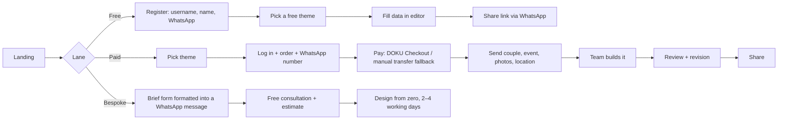

# Sitemu (STM): Tier A teardown dossier

> **Status: v1, session 12 (2026-11-04). Evidence level C:** marketing, pricing, catalog, ordering flow, free-tier and custom-service pages read as a visitor. No guest-page measurement, because demo pages are never followed (D-008). §4 is [UNKNOWN] and §10 public complaints are pending RQ-COMP-05. Sitemu is Tier A rank 10 (`../../02-competitor-discovery/shortlist.md`).
>
> **Access basis (D-030, `../../02-competitor-discovery/robots-applicability-s12.md`).** `sitemu.id/robots.txt` starts with Cloudflare's managed block. `anthropic-ai` and `Claude-Web` appear only in its "Training crawlers" section, which the site's Training = Disallow policy generates; that makes them a documented training opt-out that does not bind user-directed retrieval. The site's own section, after the block, explicitly allows `Claude-Web`, `ClaudeBot`, `ChatGPT-User`, `GPTBot` and `Google-Extended`, and disallows only `/api/` and `/private/`. Content signals: `search=yes, ai-train=no, use=reference`, so this file keeps facts, our own analysis and links, with no reproduction of copy. Blocked from s10 to s11 under D-026; history in the appendix.
>
> Evidence: **S-STM-007** (robots applicability, 2026-11-04 10:16Z, via `_tools/discovery/robots-applicability-audit.py`), **S-STM-008** (homepage and `/product`, 10:17:52–10:17:59Z), **S-STM-009** (`/faq`, `/undangan-digital-gratis`, `/undangan-custom`, 10:19:52–10:20:02Z), both via `_tools/discovery/profile-reads.py`; **S-STM-010** (s13 re-read of robots.txt, byte-identical). Facts: `../../raw/_discovery/profile-reads-2026-11-04.jsonl`. Page text stayed private and did not survive the s12 sandbox, so statements beyond the committed facts (prices, counts, claims, feature keywords, stack) rest on the s12 reading. *(s13 correction: S-STM-009 was written as "≈ 10:25Z"; the record says 10:19:52–10:20:02Z.)*

## 1. Snapshot
- **Positioning:** wedding e-invitations promising "coba gratis, jadi 5 menit" (free to try, ready in five minutes), with "120+" premium and free themes. Two order lanes: online checkout through **DOKU**, or manual ordering through WhatsApp. [OBSERVED S-STM-008]
- **Segment:** Indonesian couples, price-sensitive to mid-market, plus a bespoke lane for corporate, hospital and institutional events. [OBSERVED S-STM-009 / CLAIMED client types]
- **Claims:** "5.000+ Pelanggan Puas", "120+ Tema", "1 Tahun Masa Aktif", "Harga Mulai Rp25Rb". [CLAIMED] **The Rp 25k "from" price does not match any price on the pages read; the lowest paid price shown is Rp 50,000** [OBSERVED discrepancy].
- **Plan matrix:**

| Lane | Price | What is included | Validity |
|---|---|---|---|
| Free (3 themes, "Free #01–#03") | Rp 0 | Self-serve editor, personal guest-name links, Google Maps, countdown, responsive layout, gallery of 3 photos (upgradable to 10). RSVP, digital envelope and background music are paid add-ons | **3 months** |
| Premium (per theme) | Rp 100,000 crossed out → **Rp 50,000** | Theme + order handled by the team | 1 year |
| Premium "Tanpa Foto" (no photo) | Rp 130,000 → **Rp 65,000** | as above | 1 year |
| Luxury | Rp 150,000 → **Rp 75,000** | as above | 1 year |
| Eksklusif | Rp 200,000 → **Rp 100,000**; one Eksklusif at Rp 80,000 without anchor | as above | 1 year |
| Custom Wedding Special | from **Rp 300,000** | Designed from scratch to a mood board, RSVP, digital envelope, maps, gallery + pre-wedding video, chosen music, unlimited guest names, revisions until approved | 1 year; 2–4 working days |
| Custom Corporate & Gathering ("Instansi & Perusahaan") | from **Rp 450,000** | For hospitals, agencies, state-owned companies, anniversaries, gatherings and gala dinners: official logo and colours, structured RSVP and digital guest book, **QR check-in**, integrated agenda / rundown, video teaser | 1 year |

[OBSERVED S-STM-008, S-STM-009]
- **Catalog:** filter chips Free, Eksklusif, Luxury, Premium, Adat, Art, **Tanpa Foto**, Khitan, Video, 3D; sorting by newest, name and price; themes are **numbered, not named** ("Premium #22"); 17 featured on the homepage, 12 per catalog page. [OBSERVED S-STM-008]

## 2. Funnel and flows

- The free lane is self-serve. The paid lane is **done-for-you after payment**: seven steps in which the team prepares the invitation and handles revisions. That is the inverse of our self-serve editor. [OBSERVED S-STM-008, S-STM-009]
- Time to publish: "5 minutes" is claimed for the free lane; the paid lane depends on data completeness and the order queue. The FAQ gives no SLA; the custom lane says 2–4 working days. [CLAIMED / OBSERVED]
- Friction: an account and a WhatsApp number are required up front; the manual WhatsApp lane remains for people who do not want to pay online. [OBSERVED]

## 3. Builder / editor
Free-lane "editor undangan" for couple data, date and time, location and photos [OBSERVED S-STM-009]. Its type (form or WYSIWYG), autosave, validation and media limits beyond the photo count are [UNKNOWN], because the editor sits behind signup and no account was created (R1). A public **"Generator Link"** page makes personal guest-name links outside the dashboard. [OBSERVED internal path `/generator-link-undangan`, not read]

## 4. Guest-facing invitation
[UNKNOWN]. "Demo" buttons exist per theme, but demo and preview pages are never followed (D-008). The 2026-10-29 discovery (D-STM) found no demo links in static HTML. Sitemu is outside the top-8 strict Wave 1, so it is not part of RQ-DEMO-01. The hero shows a fictional sample couple with a countdown and a "Buka Undangan" cover. [OBSERVED marketing mock-up, not a guest page]

## 5. Tech fingerprint
Next.js pages with WordPress traces (likely blog or media), Cloudflare (managed robots.txt, edge), GA4 / GTM, **Hotjar**, WhatsApp CTAs, DOKU Checkout (named on the page). [OBSERVED S-STM-008; payment: CLAIMED on the page]

## 6. Public API surface
None observed in normal page use (no API markers in the HTML). No probing. [OBSERVED]

## 7. Mobile app
None linked from the pages read. [OBSERVED absence on 5 pages; an app elsewhere is UNKNOWN]

## 8. Growth and SEO
- Intent pages for "undangan digital gratis", "undangan custom", a FAQ, a blog and a free link-generator tool, all aimed at search intent. [OBSERVED]
- Social proof: "5.000+" customers, and four testimonial quotes attributed to couples marked "Verified Couple" (names not recorded). [CLAIMED]
- robots.txt invites search and AI assistants in its own section while the CDN block opts out of training: an explicit "be found, don't be trained on" stance. [OBSERVED S-STM-007]

## 9. Monetization and pricing psychology
- Per-theme one-time prices tiered by art direction (Premium < Luxury < Eksklusif). A no-photo variant costs more than standard Premium (65k against 50k), plausibly because the art has to carry the page without photos [INFERRED, low].
- **Permanent-looking 50 % strike-through anchors on 16 of 17 featured themes, with "Terlaris" (best-seller) badges on 15** [OBSERVED S-STM-008]. Together with the unmatched "from Rp 25k" headline, this is the same honesty gap seen at sangmempelai.id (78–86 % anchors).
- The free lane is time-boxed (3 months) and feature-limited (RSVP, envelope and music are paid add-ons), which converts through add-ons or an upgrade. Paid invitations expire after a year, with extension through the admin. [OBSERVED S-STM-009]
- The bespoke ladder (300k / 450k) captures corporate and institutional events that the template lane cannot. [OBSERVED]

## 10. Strengths, weaknesses, user complaints
- **Strengths:** a genuinely free lane; a clear seven-step paid flow with online payment and a human fallback; done-for-you production for people who do not want to edit; "Tanpa Foto", Adat, Khitan, Video and 3D as first-class filters; a transparent custom ladder with stated turnaround. [OBSERVED]
- **Weaknesses:** discount anchors and an unsubstantiated "from" price; numbered themes with no identity; expiry (3 months free, 1 year paid); RSVP missing from the free tier; manual production makes turnaround queue-dependent. [OBSERVED]
- **Public complaints:** the vendor's pages link no store listing (S-STM-008, s12), and no other public review source was read. [UNKNOWN] (RQ-COMP-05, availability-qualified)

## 11. Patterns worth learning (principle level), what to avoid, our counter-move
- **Learn:**
  - Treat "no photo" as a design capability, not an afterthought. Families of couples who prefer not to publish photos need layouts whose art carries the page (content-contract capability `photos: optional | none`).
  - A public link-generator tool as a search entry point.
  - An explicit assisted lane (WhatsApp) beside self-serve checkout.
- **Avoid:** perpetual strike-through anchors and "best-seller" on everything; numbered theme names; expiring links for guests.
- **Counter:** honest one-time prices (ADR-O02); named design families with a stated personality (harness workstream); links that keep working for the event's natural life; text-only design families rendered through the same contract.

## 12. Mapping to our codebase
| Sitemu capability | Ours (`01-codebase-audit/feature-inventory.csv`) | Modules | Verdict |
|---|---|---|---|
| Free self-serve publish (3 months, limits) | Free drafting, paid publish (ADR-O02) | M-024, M-025 | Deliberate difference |
| Personal guest-name links, public generator page | F-049 full (dashboard only) | M-019 | Parity; their public tool is an SEO entry we lack |
| Countdown | F-005: missing at the `22ed99e` baseline, shipped in s09 with B-008 (`../../01-codebase-audit/revalidation-s10.md` §3) | M-013 | Parity |
| Gallery (3 → 10 photos) | F-008 partial | M-013, M-027 | Partial |
| Maps | F-011 partial | M-013 | Partial |
| RSVP (paid add-on on free) | F-013 full | M-014 | We lead on the entry tier |
| Digital envelope | F-021 partial; QRIS gift F-022 missing | M-013, M-025 | Partial |
| Background music | F-004 config-only (stored, not rendered: `../01-codebase-audit/template-editability-s11.md`) | M-009, M-013 | **Missing in practice** |
| Online checkout (DOKU) + manual transfer | F-081 partial | M-024, M-025 | Parity in kind |
| WhatsApp ordering and support | F-100 partial | M-001 | Partial |
| Catalog filters incl. Tanpa Foto / Adat / Khitan / Video / 3D | F-093 full (category / style / tier) | M-004 | Parity on filtering; no "no photo" capability (F-036 missing) |
| QR check-in (custom lane) | F-055 missing | M-019 | Missing |
| Done-for-you production, bespoke design | Not offered (self-serve product) | n/a | Different model; not a gap to close |

## Appendix: access history (kept as history)
- **s10, 2026-11-03 20:52Z.** Seven pages were fetched before `profile-reads.py` checked AI-agent groups. After D-026 classed the legacy names as an explicit opt-out, that page text, the facts derived from it and a draft dossier were **deleted unused**. Nothing from those reads is in this file.
- **s11, S-STM-006.** The corrected matcher (D-029) confirmed the restriction held through `anthropic-ai`. The two `Claude-Web` groups (managed Disallow, site Allow) tie, and Allow wins.
- **s12, S-STM-007.** The applicability audit (D-030) found both legacy names only inside Cloudflare's managed "Training crawlers" section: a documented training opt-out, not binding. Re-read the same day with the D-030 tool (S-STM-008, S-STM-009).
- Pre-rule historical rows: longlist probe 2026-10-29 ("120 tema; Rp50k–Rp300k; coba gratis"), D-STM 2026-10-29 (no static demo links). Both are consistent with the s12 reads.
