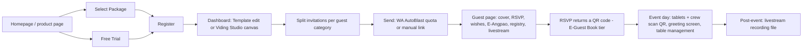

# Viding (VID): Tier A teardown dossier

> **Status: v1.1, session 10 (2026-11-04); v1 was session 08.** All 12 sections have evidence or an explicit [UNKNOWN]. §4 rests on **six permitted official demos**: C-VID-101…103 (s04/s06) plus **C-VID-107…109** (s10, 2026-11-04 01:38–01:42Z, themes 166 / 164 / 163, REA driver with the trusted click, robots `Allow: /`). The cover opening is verified on two of them (§4.1). Evidence level **B** (6 valid guest-page captures; level per `../../_handoff/review-20261101.md` §2). C-VID-104…106 (`studio.viding.co`) are **excluded** (D-022: that host's robots.txt answered HTTP 500, which means disallow); this dossier uses no number from them, and nobody visits that host while its robots.txt is unreachable.
>
> Evidence used (times UTC): **D-VID** discovery (2026-10-29, 13 official demo links: 8 on `viding.co`, 5 on `studio.viding.co`); **C-VID-101** (2026-10-29, pre-s06 CDP driver), **C-VID-102/103** (2026-10-29, REA driver, pre-D-016 click), **C-VID-107…109** (2026-11-04, REA driver, trusted click; `viding.co/robots.txt` re-read 01:37Z: `User-Agent: *` `Allow: /`, no AI-agent group); **H-VID-001** robots check (2026-11-01); visitor reads on 2026-11-03, one request at a time, robots first: **S-VID-001** `robots.txt` + homepage (16:29Z), **S-VID-002** `/undangan-digital`, **S-VID-003** `/template-design`, **S-VID-004** `/buku-tamu-digital` (16:29–16:30Z), **S-VID-005** `/live-streaming`, **S-VID-006** `/kemitraan` (16:30Z). Private page copies: `$INVITESION_PRIVATE_DIR/pages/viding/` (not committed). Tables generated by `_tools/capture/dossier-digest.py` (eligible captures only, medians per theme).
>
> **Privacy:** the demos use generic role words in the title and a brand-derived placeholder couple in the headings, repeated across four themes on both hosts (vendor placeholder [INFERRED, high]; s08 audit in `../../00-setup/privacy-hygiene.md`); no name is repeated here. No account, form, checkout, RSVP or wish was used.

## 1. Snapshot
| Item | Finding | Evidence |
|---|---|---|
| Positioning | "Wedding Website & Digital Invitation", "#1 Digital Invitation Platform", "One-Stop Wedding Digitalization Platform": invitation + digital guest book with on-site crew + cinematic livestream | [CLAIMED S-VID-001] |
| Company | PT Aku Bisa Ibadah (footer © 2024); "Registered with Indonesia's Ministry of Communication and IT" (PSE claim) | [CLAIMED S-VID-001] |
| Size signals | Tranco rank 306,504 (2026-10-29); homepage counters render client-side (0 in server HTML), so no couple/guest counts are recorded | [ESTIMATE longlist] / [UNKNOWN] |
| Languages / markets | Routes `/id`, `/en`, `/ms`; pages answered in English even with `Accept-Language: id-ID` | [OBSERVED S-VID-001…006] / Malaysian ambition [INFERRED, medium] |
| Product lines | Digital Invitation (3 tiers), E-Guest Book (event-day service), Live Streaming (3 tiers), **Viding Studio** canvas editor, partner programme | [OBSERVED S-VID-002…006] |
| Pricing (IDR, strikethrough list → sale, 2026-11-03) | Invitation Basic 360,000 → **300,000**; Intimate 740,000 → **670,000**; Royal 900,000 → **850,000**. E-Guest Book 2,390,000 → **2,100,000** (Royal invitation included). Live Streaming Bronze 3,999,000 → **3,700,000** (+ Basic), Silver 7,780,000 → **5,250,000** (+ Intimate), Gold 10,190,000 → **6,250,000** (+ E-Guest Book) | [OBSERVED S-VID-002, S-VID-004, S-VID-005] |
| Free tier | "Free Trial" (`/register?type=trial`); trial limits not shown publicly | [OBSERVED link] / limits [UNKNOWN] |
| Catalog | Two kinds: ready-made **Template** (edit names, dates, photos) and **Studio** themes (full canvas control), the latter "only available on the Royal, Digital Guestbook, and Gold packages"; the catalog's server HTML lists six numbered themes (162–167) each with a Studio twin (202–207); "Hundreds of themes" | [OBSERVED S-VID-003] / count [CLAIMED] |
| Watermark | No vendor credit flag on the three s04/s06 demos (`watermark` false); not re-read for C-VID-107…109 | [OBSERVED C-VID-101…103] |

## 2. Funnel and flows

- Steps up to "Select Package" and "Free Trial" are [OBSERVED S-VID-001/002]; everything behind registration is [CLAIMED] from product pages (no signup, R1).
- **Host day-of** is a staffed service: 2 tablets, internet modem, technical crew and 4 hours on site in the E-Guest Book package; QR codes go to every invited or RSVP'd guest to keep uninvited guests out [CLAIMED S-VID-004].
- **Reseller / partner:** commission-based agents, "each city has only one partner", free to join, tiered commission and monthly cashback; no white-label or quota resale was described [CLAIMED S-VID-006].
- Step counts for creation and publishing [UNKNOWN] (dashboard not observed).

## 3. Builder / editor
- **Viding Studio:** "custom design as easy as editing in Canva, without coding", full control over every element [CLAIMED S-VID-001/003]. Ready-made templates instead edit names, date, photos and event details [CLAIMED S-VID-003].
- **Assistant Support:** human assistants help during creation; unlimited revisions on every invitation tier [CLAIMED S-VID-002].
- **Split Invitation:** several invitation variants (offline / online guests, VIPs, ceremony vs reception) for the price of one [CLAIMED S-VID-002].
- Limits by tier: asset uploads 50 (Basic, Intimate) or unlimited (Royal); background music on all tiers; password-protected invitation from Intimate [CLAIMED S-VID-002].
- Autosave, undo, media size limits, AI features: [UNKNOWN].

## 4. Guest invitation (six permitted demos)
### 4.1 What was measured, and its limits
- Targets: `viding.co/theme/preview/167`, `/165`, `/72` (s04/s06) and `/166`, `/164`, `/163` (s10), all official "See Template" links from D-VID; the remaining `viding.co` demo (162) and the five `studio.viding.co` demos were not captured. Lighthouse never clicks, so all six cold-load runs are valid; post-visit bytes come from our CDP session and are kept apart.
- **Opening verified on two demos (C-VID-107, C-VID-109):** the trusted click on "Open the Invitation" landed inside the control and the gate wording was gone afterwards (`verified_open`). On C-VID-108 the same trusted click left the gate wording in place (`gate_persisted`), so its post-open interaction is unverified. C-VID-101 (s04) and C-VID-102 (s06) did not click (the detector's wording list did not match the control then; cover not detected ≠ no cover); C-VID-103 clicked with the pre-D-016 synthetic click and the gate persisted. All 11–14 sections are present in the DOM before and after on every demo, so the **section structure is usable**; post-open motion and audio start stay [UNKNOWN] (opening ≠ playback, D-016).
- Hazard: C-VID-101 ran on the pre-s06 CDP visit, the other five under REA; post-visit CDP bytes are therefore not strictly comparable for C-VID-101.

### 4.2 Cold load (Lighthouse 12.8.2 mobile, simulated Slow 4G + 4× CPU, 412×915, cold cache)
| Capture | Theme | Perf | A11y | BP | SEO | FCP s | LCP s | TBT ms | CLS | LH req | LH KiB | JS KiB | Img KiB | Font KiB |
|---|---|---|---|---|---|---|---|---|---|---|---|---|---|---|
| C-VID-101 | 167 | 50 | 81 | 82 | 100 | 2.52 | 16.89 | 594 | 0.025 | 89 | 3,529 | 224 | 2,686 | 388 |
| C-VID-102 | 165 | 45 | 80 | 86 | 100 | 2.88 | 15.08 | 760 | 0.016 | 78 | 2,882 | 219 | 2,005 | 433 |
| C-VID-103 | 72 | 54 | 74 | 82 | 100 | 4.27 | 10.47 | 257 | 0.020 | 71 | 3,285 | 500 | 1,916 | 367 |
| C-VID-107 | 166 | 57 | 81 | 86 | 100 | 2.52 | 10.73 | 277 | 0.093 | 72 | 2,151 | 203 | 1,156 | 591 |
| C-VID-108 | 164 | 53 | 82 | 86 | 100 | 2.68 | 11.93 | 402 | 0.049 | 74 | 2,263 | 220 | 1,333 | 483 |
| C-VID-109 | 163 | 53 | 81 | 82 | 100 | 2.66 | 13.22 | 430 | 0.051 | 88 | 3,621 | 217 | 2,755 | 418 |
| **Median (6 themes)** | | **53** | **81** | 84 | 100 | 2.67 | **12.58** | **416** | 0.037 | 76 | **3,084** | 219 | 1,960 | 425 |

[OBSERVED C-VID-101…103, C-VID-107…109; `dossier-digest.py --competitor viding`, 2026-11-04]. Images are 54–76 % of the cold-load bytes; fonts alone are 367–591 KiB (several display faces + Font Awesome 6 + IcoFont). The s08 three-theme medians (Perf 50, LCP 15.08 s, 3,285 KiB) are superseded by these six-theme medians.

### 4.3 After the visit (our CDP session, unthrottled; not Lighthouse)
| Capture | Driver | Cover / click / opening | CDP req | CDP KiB | JS KiB | Img KiB | Font KiB | DOM | Sections |
|---|---|---|---|---|---|---|---|---|---|
| C-VID-101 | pre-s06 | not detected / none / unverified | 91 | 3,610 | 224 | 2,721 | 436 | 1,590 | 12 |
| C-VID-102 | rea | not detected / none / unverified | 80 | 3,176 | 218 | 2,006 | 734 | 1,167 | 12 |
| C-VID-103 | rea | detected / pre-D-016 / gate persisted | 84 | 4,057 | 518 | 2,625 | 414 | 904 | 14 |
| C-VID-107 | rea | detected / trusted / **verified open** | 81 | 2,440 | 225 | 1,272 | 742 | 1,021 | 11 |
| C-VID-108 | rea | detected / trusted / gate persisted | 82 | 2,557 | 230 | 1,571 | 530 | 1,035 | 12 |
| C-VID-109 | rea | detected / trusted / **verified open** | 95 | 3,767 | 225 | 2,855 | 466 | 1,578 | 11 |
| **Median (6 themes)** | | | 83 | 3,393 | 225 | 2,315 | 498 | 1,101 | 12 |

[OBSERVED]. Lazy images: 0 of 63–220 on C-VID-101…103, 2 of 53 (107), 0 of 54 (108), 0 of 209 (109); the MP3 is not fetched during the visit (0 KiB media), including after the two verified openings.

### 4.4 Guest experience as observed (structure only, no copy)
- **Section sequence** (all three, minor variations): couple hero (two blocks) → bride and groom → our story → gallery block → location ("Lokasi") with a location button → RSVP (on 103) → wedding wishes (300-character limit) → **E-Angpao** (digital envelope) + **Gift Registry** ("Send Gift", "Give as a Gift", confirm step) → an "Apology" block → **live streaming** ("Join YouTube") → thank-you. A "Save the Date" button sits near the top. [OBSERVED headings and controls]
- **Buyer-side colour customizer on the demo:** "Color Variation" with primary, secondary and button colour pickers, Apply, Reset, Save Color, so a prospect can recolour the theme before buying. [OBSERVED controls] / purpose [INFERRED, high]
- **Forms:** RSVP with guest count and a select field; wishes (name + message); gift forms with amount and confirmation; no attendance "maybe" state was identified [OBSERVED field types] / semantics [INFERRED].
- **Feature flags (C-VID-103, the fullest):** calendar, countdown, dress code, gift, livestream, love story, music control, health protocol, RSVP, wishes. C-VID-101/102 show countdown and music control only, because English headings were outside the Indonesian/English keyword list at the time [OBSERVED] / gap [INFERRED].
- **Audio:** two `<audio>` elements (one MP3, looping on 103), no autoplay attribute; playback **not measured** (no capture records media state). [OBSERVED elements] / playback [UNKNOWN]
- **Personalization:** the demos carry no guest parameter; per-guest names ("one name, one exclusive invitation") and QR passes are claimed for real invitations. [CLAIMED S-VID-002/004]

### 4.5 Assets, fonts, third parties, accessibility, localization
- **Fonts:** Poppins, Nunito Sans, Prata, Mulish, Unna (Google Fonts → OFL [INFERRED, high]); "Florilane Cardillac" (licence [UNKNOWN]); Font Awesome 6 and IcoFont icon fonts; 1–2 `font-display` issues per page. [OBSERVED]
- **Third parties:** cdnjs (Cloudflare CDN, ≈ 313–348 KiB), jsDelivr, code.jquery.com, Google Fonts, Cloudflare Insights; first-party asset hosts `cdn.`, `media.`, `themes.` and one further `*.viding.co` host; YouTube iframe on 103. No tag manager in Lighthouse's full third-party list on any of the three guest pages. [OBSERVED LH + CDP]
- **Accessibility:** automated 74–81. Failing on all three: `meta-viewport` (**zoom blocked**: `user-scalable=no, maximum-scale=1.0`), `button-name`, `link-name`, `color-contrast`, `heading-order`; plus `frame-title` and `select-name` on 103. `prefers-reduced-motion` CSS exists. [OBSERVED]
- **Localization:** `<html lang="en">` on mixed English/Indonesian content; no WIB/WITA/WIT label detected in rendered text [OBSERVED] / labels inside images [UNKNOWN].
- **Long names, RTL, in-app browsers:** not testable on third-party pages without typing into the vendor's tools [UNKNOWN].

### 4.6 Against our own guest page (same protocol)
| | Viding (median of 6 themes, s10) | Invitesion C-INV-005 (one run; local production build of `22ed99e`, no middleware; pre-P0) |
|---|---|---|
| Perf / LCP / TBT / CLS (Lighthouse lab) | 53 / 12.58 s / 416 ms / 0.037 | 93 / 2.62 s / 209 ms / 0 |
| INP | not measured | not measured |
| Transfer / requests at cold load (Lighthouse) | 3,084 KiB / 76 | 321 KiB / 26 |
| Accessibility (automated) | 81 | 96 |
| QR pass + staffed check-in, greeting screen, table management, split invitations, WA auto-blast, E-Angpao + registry, livestream, countdown | present or claimed | F-026, F-055 missing; F-042 config-only; F-048 partial; F-051 missing; F-021 partial, F-023 partial; F-024 full; F-005 missing |

**Scope:** lab measurements under one protocol; ours transfers ≈ 9.6× less at load with better Perf, LCP, TBT, CLS and automated a11y (our page is unmeasured since the s09 P0 changes); INP was not measured; C-INV-005 omits `middleware.ts` (placeholder Clerk keys, D-012, P-INV-010), so real-key auth, middleware, CSP and locale-cookie behaviour are not covered. Viding's lead is event-day operations and service bundles, not page weight. [OBSERVED] / interpretation [INFERRED, high]

## 5. Tech fingerprint
| Layer | Finding | Confidence |
|---|---|---|
| Guest pages (`viding.co/theme/preview/*`) | jQuery + Bootstrap + GSAP + ScrollTrigger on all six (+ Owl on 101, 107, 109; AOS on 103), Font Awesome 6, IcoFont; assets on first-party `*.viding.co` hosts | high [OBSERVED C-VID-101…103, C-VID-107…109] |
| Marketing site | Next.js App Router (RSC payload `self.__next_f`, Turbopack chunk names), robots disallows `/api/` and `/_next/`; Google Tag Manager linked | high [OBSERVED S-VID-001] / GTM: medium |
| Second product generation | `studio.viding.co` serves the Studio themes; observed before D-022 as a Next.js-based generation. **No further evidence and no numbers** while its robots.txt answers 5xx | medium [OBSERVED before D-022] |
| Edge | Cloudflare (CDN entity, Insights beacon), HTTP/3 | high [OBSERVED] |

## 6. Public API surface
No endpoints observed under this method: the marketing pages were plain fetches, and the guest-page captures did not retain request URLs beyond hosts. `/api/` is robots-disallowed and was not touched. See `api-observed.md`.

## 7. Mobile app
None found on the six pages read and none in the longlist (installs "—"). [UNKNOWN]

## 8. Growth and SEO
- Blog ("Tips & References", Indonesian articles 2022–2023), FAQ, sitemap; testimonials carousel; WhatsApp chat CTA. [OBSERVED S-VID-001]
- Sustainability messaging (CO₂e reduction, SDG commitment). [CLAIMED S-VID-001]
- Guest pages: Lighthouse SEO 100 on all three; OG image, title and description present. [OBSERVED]
- Partner programme as an acquisition channel: one exclusive partner per city, tiered commission. [CLAIMED S-VID-006]

## 9. Monetization and pricing psychology
- **Every price shows a strikethrough "list" price** (6–39 % off on all seven packages; Gold 39 %, Silver 33 %, Royal 6 %), a strong anchoring device. [OBSERVED S-VID-002/004/005] / "permanent" [INFERRED, medium: one observation date]
- **Bundling up the ladder:** each service tier includes an invitation tier (Bronze → Basic, Silver → Intimate, E-Guest Book → Royal, Gold → E-Guest Book). [OBSERVED]
- **Quota-based upsell** on WhatsApp auto-blasts (50 / 100 / 300) and uploads (50 / unlimited); **theme gating** (Studio themes only on Royal, E-Guest Book, Gold); E-Gift and password protection start at Intimate. [OBSERVED]
- Price band: invitations Rp 300–850k (above the Rp 25–450k mass market in the longlist); services Rp 2.1–6.25 M. One-time packages; validity period [UNKNOWN].

## 10. Strengths, weaknesses, public complaints
- **Strengths:** the broadest event-operations bundle in the set (invitation → QR guest book with on-site devices and crew → greeting screen → table management → cinematic multi-platform livestream with recording); split invitations; WhatsApp automation with a block-risk claim; a canvas editor; theme preview with colour variations; multi-locale marketing. [OBSERVED/CLAIMED as tagged]
- **Weaknesses (measured on the legacy generation):** median 3,084 KiB and LCP 12.58 s at cold load (six themes); almost no lazy loading (2 of 53–220 images on one theme); zoom blocked; `lang="en"`; automated a11y 74–82; English-first marketing for an Indonesian audience. The newer Studio generation cannot be assessed while its robots.txt is unreachable. [OBSERVED]
- **Public complaints:** s14 checked the vendor's own homepage for a store listing: none is linked in its static HTML (S-VID-007), and no other public review source was read. [UNKNOWN] Would resolve: a vendor-linked store listing or a public review page that robots and D-030 allow.

## 11. Patterns to learn, to avoid, and our counter-move
| Learn (principle) | Avoid | Our counter-move |
|---|---|---|
| Sell event-day operations as a service tier on top of the invitation | Hardware-bound check-in as the only path | Software-first QR check-in on the host's own phone (F-055), optional staffed add-on later |
| One invitation, several guest-category variants at no extra cost | Separate purchases per audience | Guest groups (F-048) drive per-group sections and copy |
| RSVP issues the entry QR | QR only in the most expensive package | QR pass (F-026) in the mid tier, scanner in the host app |
| Let buyers recolour a theme on the demo before paying | Heavy legacy payloads, zoom blocking, wrong `lang` | Preview-time palette switcher on our template preview (M-005) inside the guest-page weight budget |
| Bundle the next tier into premium services | Permanent strikethrough anchors | Honest list prices with explicit, dated promotions |

## 12. Mapping to our modules and features
| Viding capability | Ours | Modules | Verdict |
|---|---|---|---|
| Cover gate + music | F-003 missing, F-004 config-only | M-012, M-013 | gap |
| Countdown, save the date | F-005, F-012 missing | M-013 | gap |
| RSVP with pax, wishes | F-013 full, F-015 partial, F-019 full | M-014 | parity on basics |
| E-Angpao + gift registry | F-021 partial, F-022 missing, F-023 partial | M-013, M-025 | gap (QRIS gift) |
| Livestream | F-024 full (link) | M-013 | parity (link only; no streaming service) |
| QR pass + QR scanner check-in | F-026, F-055 missing; F-056 manual full | M-019 | gap |
| Table / seating | F-042 config-only | M-021 | gap |
| Split invitation (guest categories) | F-048 partial | M-019 | partial |
| WhatsApp auto-blast | F-051 missing (F-050 partial per-guest share) | M-040 (`wa_log`, planned Fonnte) | gap |
| Password-protected invitation | F-067 missing | M-011, M-012 | gap |
| Canvas editor (Studio) | form-based module editor | M-018 | different model; not a P0 by itself |
| Multi-locale guest UI | F-034 missing, F-096 partial | M-034 | gap |
| Guest-page weight and a11y | C-INV-005 321 KiB, a11y 96 | M-012, M-013 | **we lead** (lab, with C-INV-005 limits) |
